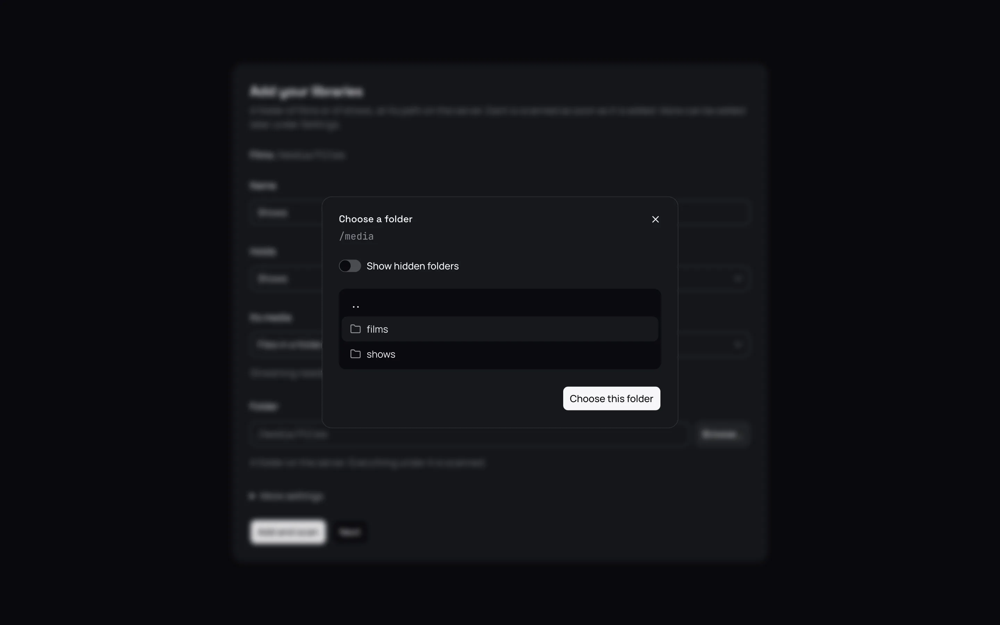
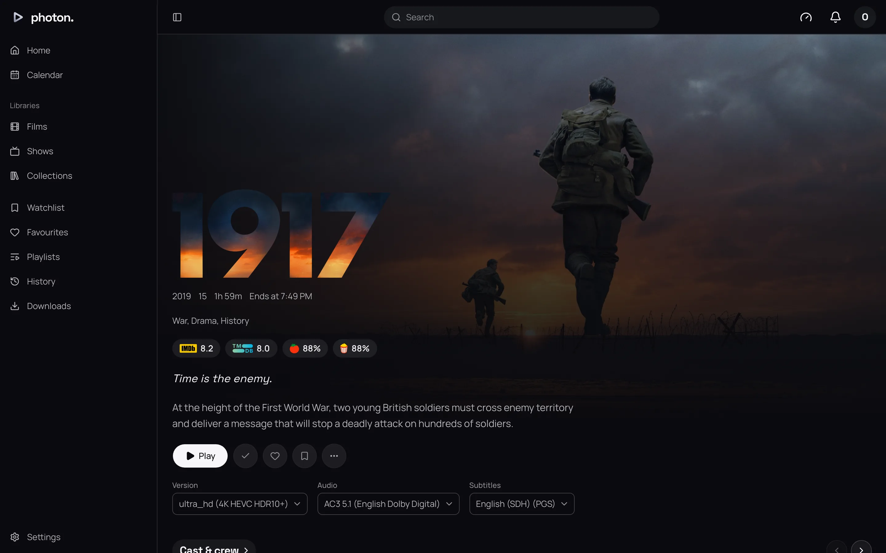

This is the shortest way to a working server. You will install photon-server with Docker, set it
up in your browser, add one library, play something, and then watch it on an Apple TV. It takes
about 15 minutes, plus however long your first scan runs.

Each step links to a full page if you want more detail or something goes wrong.

## What you need

- A computer that stays on, running Linux, Windows or macOS, with
  [Docker](https://docs.docker.com/get-docker/) installed. Docker is a free tool that runs apps in
  their own sealed-off space, so you install nothing else by hand.
- A folder of films or TV shows on that computer.
- A browser on a device on the same home network.
- An Apple TV with [Photon Player](https://apps.apple.com/gb/app/photon-player/id6804291311)
  installed.

## 1. Install the server

1. Make a new folder for the server, such as `photon`.
2. Copy the `compose.yml` file from [Install with Docker](02-install-docker.md#write-the-compose-file)
   into it. This file tells Docker what to run.
3. In the same folder, make a file called `.env` with two passwords of your own (letters and
   digits only) and the folder that holds your films and shows:

   ```sh
   POSTGRES_PASSWORD=pickapassword1
   VALKEY_PASSWORD=pickapassword2
   MEDIA_DIR=/srv/media
   ```

4. Open a terminal in that folder and start it:

   ```sh
   docker compose up -d
   ```

   The first start downloads everything it needs, which can take a few minutes.

You never need to type these two passwords anywhere else. They protect the server's own database.

## 2. Open the web app

1. On a device on your home network, open a browser.
2. Go to the server's address followed by `:8640`, such as `http://192.168.1.20:8640`. On the
   server itself, use `http://localhost:8640`.

You will see the **Set up** page.

> **Important:** Do this from your home network, at the server's own address. Setup will not open
> from the internet or through a reverse proxy, so nobody else can claim your server first.

## 3. Set up the server

1. Under **Set up**, choose a **Name** and **Password** for yourself, type the password again in
   **Confirm password**, and select **Create admin**. You are now signed in as the admin.
2. On **Name the server**, give it a name, such as Home, and check the language and country. Select
   **Next**.

Full detail: [Set up a new server](04-first-run.md).

## 4. Add one library

On **Add your libraries**:

1. Type a **Name**, such as Films.
2. Under **Holds**, choose **Films**, **Shows**, or **Films and shows**.
3. Next to **Folder**, select **Browse…**, find your folder and select **Choose this folder**.
   Your files appear under `/media`, so a folder at `/srv/media/Films` on your computer is
   `/media/Films` here.
4. Select **Add and scan**. The library is listed above the form and its scan starts.
5. Select **Next**. On **Watching away from home**, select **Skip for now**.
6. Select **Start watching**.



Full detail: [Add and manage libraries](../03-library/02-libraries.md). If titles are matched
wrongly later, see [Prepare folders and name files](../03-library/01-name-your-files.md).

## 5. Wait for the scan

You are now on Home. Posters appear as each title is matched, so you can start as soon as you see
one. A big library takes longer to finish. To watch the progress, open Settings › Server ›
Libraries.

## 6. Play something in the browser

1. Select any poster to open its page.
2. Select **Play**.



The film plays in the browser. If it plays, your server is working.

Full detail: [Watching in the browser](../02-web-app/05-watching.md).

## 7. Watch on your Apple TV

1. In Photon on the Apple TV, choose **Add a Media Server**, then **Photon Server**.
2. Pick your server under **On This Network**. If it is not listed, type its address in **Address**,
   such as `http://192.168.1.20:8640`, and choose **Connect**. A server installed with Docker is
   usually not listed, so expect to type it.
3. The TV shows a code, such as `BCDF-GHJK`.
4. In the web app, open your profile menu and select **Link a device**.
5. Type the code under **Code** and select **Link**.

A few seconds later, the Apple TV signs in and shows your library.


Full detail: [Connect Photon and other apps](05-connect-apps.md).

## What next

- Add everyone else in the house under Settings › Profiles. See
  [Profiles, passwords, PINs and roles](../04-access/01-profiles.md).
- Watch from outside your home. See [Reach your server from outside](../04-access/04-remote-access.md).
- Use your graphics card to convert video. See
  [Install with Docker](02-install-docker.md#hardware-transcoding).
