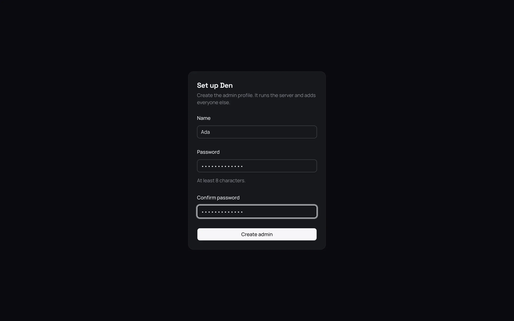
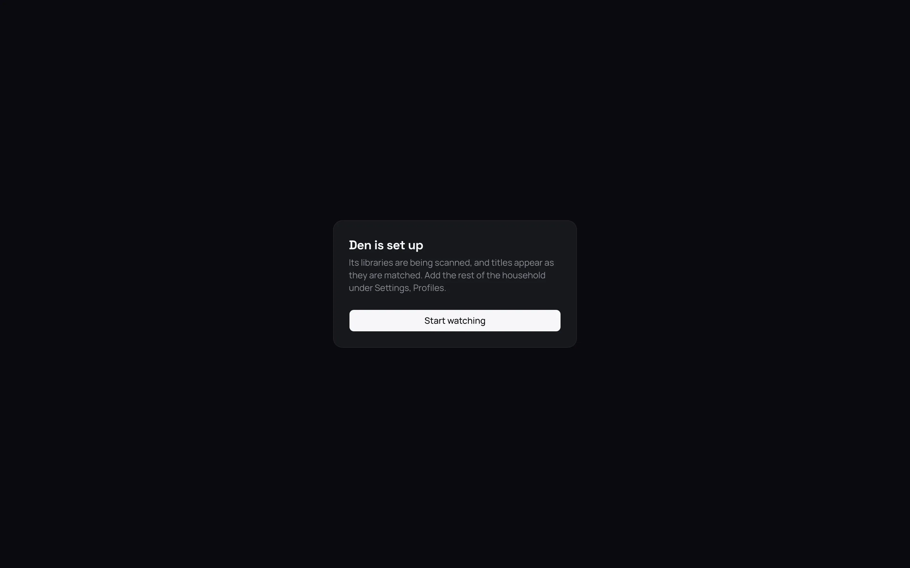

A new photon-server has no profiles, so nobody can sign in yet. Setup fixes that in four short
steps in the web app. You create your own admin profile, name the server, add your first
libraries, and choose how it is reached away from home. At the end you are signed in, and your
libraries are scanning.

Almost everything you choose here can be changed later in Settings.

## Before you start

On a device on the same home network as the server, open a browser and go to the server's address
followed by `:8640`. For example, `http://192.168.1.20:8640`, or `http://localhost:8640` on the
server itself. A server that is not set up yet shows its **Set up** page.

> **Important:** Setup only opens from your home network, at the server's own address. This stops
> a stranger on the internet from finding your new server and claiming it first. It also will not
> open through a reverse proxy (a separate program that forwards web traffic to the server), so
> set the server up first and add the proxy afterwards.

If you open setup from anywhere else, the page says so and offers nothing to fill in. Once the
admin profile exists, setup never opens again.

## 1. Create the admin

The first page is **Set up**. This makes your own profile, with the admin role, which lets you
change the server's settings.

1. In **Name**, type the name you will sign in with.
2. In **Password**, type a password of at least 8 characters.
3. Type it again in **Confirm password**. Nobody else can reset it yet, so it is worth getting
   right.
4. Select **Create admin**.

You are signed in, and the next step opens.

## 2. Name the server

**Name the server** has four settings. All four can be changed later under
Settings › Server › **General**.

| Setting | What it does |
| --- | --- |
| Name | What apps and the sign-in page call this server, such as Home. Until you set one, it is the name of the machine it runs on. |
| Metadata language | The language titles are described in. US English (`en-US`) at first. |
| Certification country | Which country's age ratings titles show. The United States at first. |
| Look for new versions | Whether the server asks GitHub a few times a day for a newer release, and says on the dashboard when one is out. On at first. |

Select **Next**.

## 3. Add your libraries

A library is a folder of films, of shows, or of both. **Add your libraries** adds them one at a
time.

1. In **Name**, type what the library is called on Home, such as Films.
2. Under **Holds**, choose **Films**, **Shows** or **Films and shows**. You cannot change this
   later.
3. Leave **Its media** at **Files in a folder**.
4. Next to **Folder**, select **Browse…**, find the folder and select **Choose this folder**.
5. Select **Add and scan**.

The library is listed above the form and the server starts scanning it. The form clears, ready for
the next one. When you have added them all, select **Next**. To add them later instead, select
**Skip for now**, then go to Settings › Server › **Libraries**.

> **Tip:** The folder is the path on the server, not on your device. If you installed with Docker,
> your media folder is `/media`, so your films might be in `/media/Films`.

The form has more settings, which you can leave alone for now. See
[Add and manage libraries](../03-library/02-libraries.md). For the best matches, name your files the
way the server expects: see [Prepare folders and name files](../03-library/01-name-your-files.md).

Titles are matched with TMDB and TheTVDB, two free film and TV databases, without any account of
your own. You can add more sources of ratings and subtitles later. See
[Metadata providers and artwork](../03-library/03-metadata.md).

## 4. Watching away from home

**Watching away from home** has two settings. Both are under Settings › Server › **Network** later.

| Setting | What it does |
| --- | --- |
| Public address | The address people use to reach the server from outside your home, such as `https://photon.example.com`. Leave it empty if you have not set this up. |
| Remote streaming limit (Mbps) | The fastest the server sends video to someone away from home, so your internet upload is not used up. 0 means no limit, which is the default. |

Select **Next**, or **Skip for now** to leave both empty. Making the server reachable from outside
takes more than this setting. See [Reach your server from outside](../04-access/04-remote-access.md).

## Done

The last page says the server is set up and its libraries are being scanned. Titles appear on Home
as they are matched. Select **Start watching**.

What to do next:

- Add the rest of the household under Settings › **Profiles**. See
  [Profiles, passwords, PINs and roles](../04-access/01-profiles.md).
- Sign in from your phone, TV and other devices. See
  [Connect Photon and other apps](05-connect-apps.md).
- Check that backups are being made. See [Back up and restore](../07-maintain/01-backups.md).

## Good to know

- **Forgotten admin password.** If there is no other admin to reset it, the server can do it
  itself. On the sign-in page, from your home network, select **Forgot your password?**, type the
  profile's name and select **Get a code**. The server writes a code into its log, which only the
  person who runs the server can read. With Docker, read it with `docker compose logs server`.
  Type the code and a new password, and select **Reset password**. The code lasts 30 minutes, and
  the profile is signed out on every device. See
  [Profiles, passwords, PINs and roles](../04-access/01-profiles.md#a-forgotten-password).
- **Home network.** Setup counts the server itself and the usual private home addresses as your
  home network. Once you are an admin, you can add others under Settings › Server › Network ›
  **Local networks**, and a reverse proxy under **Trusted proxies**.
