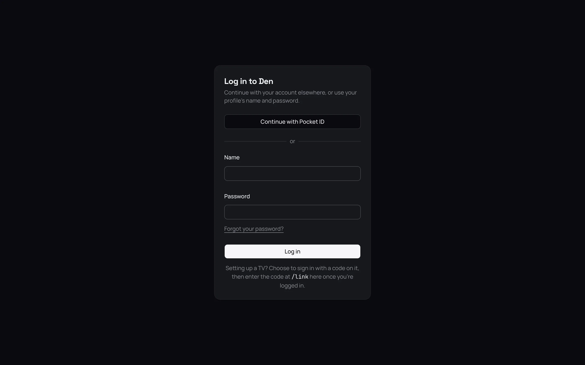

Once the server is [set up](04-first-run.md), everyone signs in on their own devices with their
own profile. This page covers the web app, Photon on Apple devices, and apps made for Jellyfin.

You can see every device signed in to your profile under Settings › **Devices**, and sign any of
them out there.

## The web app

The web app is built into the server. Open the server's address in a browser, such as
`http://192.168.1.20:8640` at home, or your [public address](../04-access/04-remote-access.md)
when you are away.

On **Log in**, type your profile's name and password. If an admin has set up
[single sign-on](../04-access/02-single-sign-on.md) (signing in with another account you already
have), there is a button for it too. See [Use the web app](../02-web-app/index.md).

## Photon

[Photon Player](https://apps.apple.com/gb/app/photon-player/id6804291311) is the App Store app for
iPhone, iPad, Mac, Apple TV and Apple Vision Pro. It can play from several kinds of media server.
In Photon, photon-server is called **Photon Server**.

### Add the server

1. In Photon, open Settings › **Media Servers** › **Add Server**. If Photon is new, choose
   **Add a Media Server** on the welcome screen instead.
2. Choose **Photon Server**.
3. Pick your server under **On This Network**. If it is not listed, type its address in
   **Address**, such as `http://192.168.1.20:8640`, and choose **Connect**.
4. Sign in with your profile's name and password.

Photon checks the address before it asks for your password, so a typing mistake shows up straight
away.

> **Tip:** Type `http://` at the start of the address. Without it, Photon tries a secure
> connection first, which a server at home usually does not have.

The first media server in Photon is free. Adding a second needs Photon Pro.

### When the server is not listed

Photon finds servers on your home network by itself. It will not list yours when:

- the server runs in Docker, which blocks this. See
  [Install with Docker](02-install-docker.md#publish-other-ports).
- the device is on a different network, such as a guest Wi-Fi or a VPN.
- an admin has turned off Settings › Server › Network › **Discovery**. It is on at first.

In each case, type the address instead.

### Sign in on Apple TV

Typing a password with a remote is slow, so an Apple TV signs in with a short code instead.

1. Add the server on the Apple TV as above. Photon shows a code, such as `BCDF-GHJK`, and an
   address to enter it at.
2. On your phone or computer, open that address. Or, in the web app, open your profile menu and
   select **Link a device**.
3. Type the code under **Code** and select **Link**.

A few seconds later, the Apple TV is signed in as your profile. The code works for ten minutes. If
it runs out, start again on the TV for a new one. See [Sign in on a TV](../04-access/03-pair-a-tv.md).

### Switch profile

A device can switch to another profile without signing in again. In Photon, open
Settings › **Media Servers**, choose the server, then **Active Profile**. A profile with a PIN or
password asks for it first. See [Profiles, passwords, PINs and roles](../04-access/01-profiles.md).

### Staying signed in

A device stays signed in as long as it is used. It is only signed out after 90 days without
reaching the server. Signing it out under Settings › **Devices**, or changing the profile's
password on another device, signs it out at once, and Photon asks for the password again.

## Apps made for Jellyfin

Jellyfin is another media server. photon-server can talk to apps made for it, such as Infuse,
Swiftfin, Findroid and Jellyfin's own. This is off at first.

1. As an admin, turn on Settings › Server › Network › **Jellyfin apps**. It uses port 8096, where
   these apps look first.
2. If you installed with Docker, open that port too: see
   [Install with Docker](02-install-docker.md#publish-other-ports).
3. In the app, add a Jellyfin server at your server's address with `:8096`, such as
   `http://192.168.1.20:8096`, and sign in with your profile's name and password.

Some apps offer **Quick Connect**, which shows six digits instead of asking for a password. Type
them under **Link a device** in the web app, as for a TV. See
[Use Jellyfin apps](../04-access/05-jellyfin-apps.md) for what these apps can and cannot do.

## Good to know

- **Stremio** does not play from photon-server. It works the other way round: an admin can add a
  Stremio addon to the server, to fill collections and libraries. See
  [Stremio addons](../06-integrations/03-stremio.md).
- **Your own scripts** can sign in as a device does, or use an API key an admin makes. See
  [API keys](../04-access/06-api-keys.md) and the [API reference](../08-reference/03-api.md).
