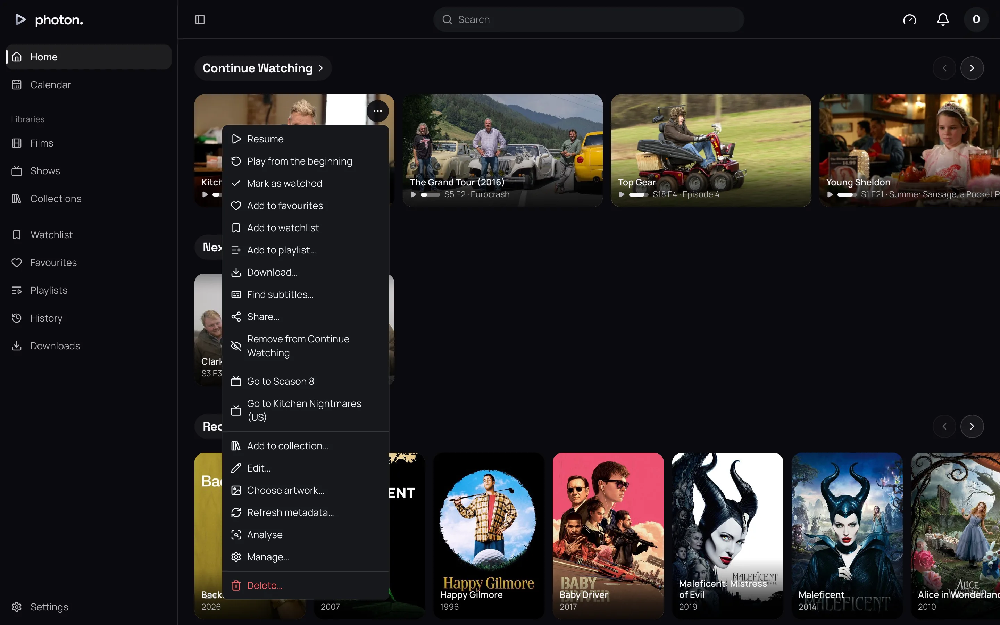
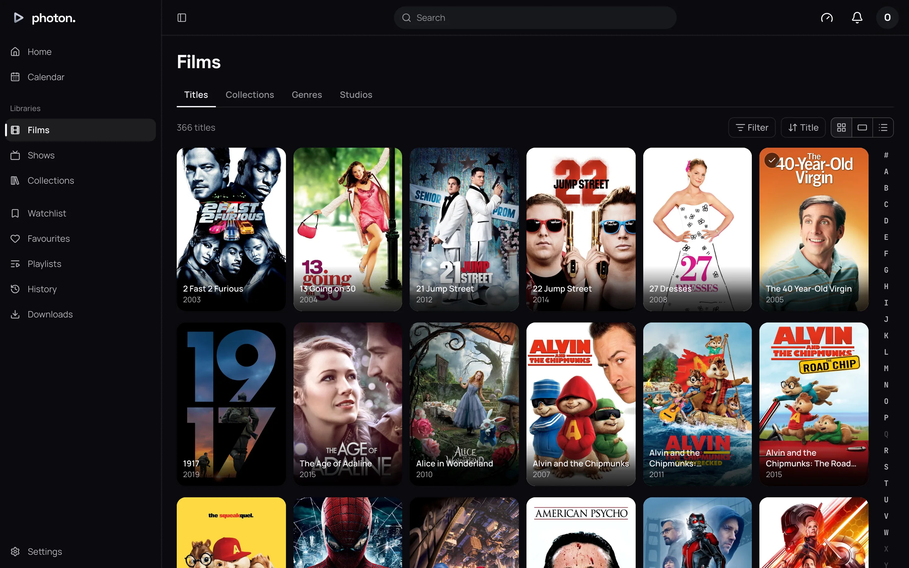
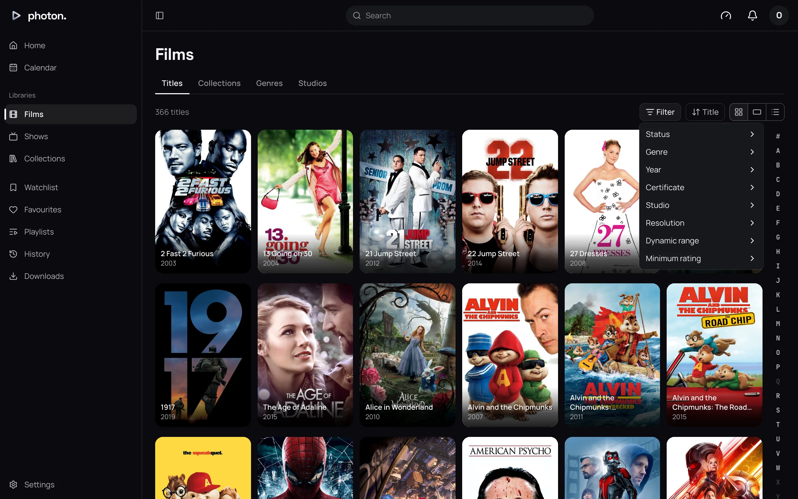
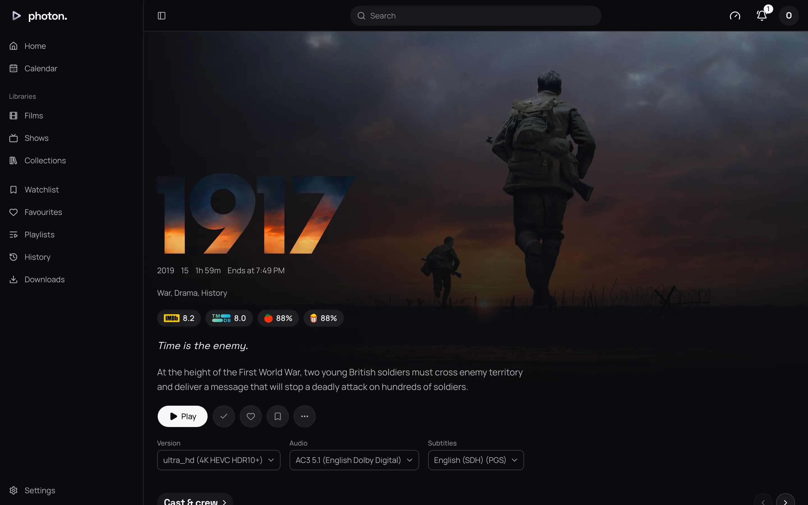

This page covers what you see before you press Play: Home, a library, a title's page and a
person's page.

## Home

Home is a set of rows. Choose a row's name to see everything in it. The arrows at the end of a row
scroll it a screen at a time. With the keyboard, Left and Right move from card to card.

| Row | What it shows |
| --- | --- |
| Continue Watching | Films and episodes you stopped part way through, most recent first. |
| Next Up | The next episode of each show you are watching. |
| Watchlist | Titles you have saved to watch, newest first. |
| Favourites | Titles you have marked as favourites, newest first. |
| Recently Added | One row for each film or show library, newest first. |
| Recently Released | Films and shows out in the last year, in each library. |
| Top Rated | Films and shows you have not started, best rated first, in each library. |

You can hide rows and change their order in [Home rows](06-your-settings.md#home-rows). A row with
nothing in it is not shown. A new server says **Nothing to watch yet** until a library has been
scanned.

## A card and its menu

Every title is a card: a poster, or a still picture for an episode. A card shows:

- a tick once you have watched it
- how many episodes are left on a show you have started
- a heart if it is a favourite
- a bar showing how far you got

The **⋯** button on a card shows what you can do without opening the title. It appears when you
point at the card, and is always there on a touch screen.

- **Play** or **Resume**, **Play from the beginning**, and **Play version…** if there is more than
  one version of the file.
- **Mark as watched** or **Mark as unwatched**.
- **Add to favourites**, **Add to watchlist** and **Add to playlist…**.
- **Download…** and **Find subtitles…**.
- **Share…**, which copies a link to the title. Whoever opens it logs in first.
- **Remove from Continue Watching**, which forgets where you stopped but keeps whether you watched
  it.
- **Go to** an episode's season or show.

An admin sees more items for fixing a title's details. See
[fixing a match](../03-library/05-fix-a-match.md).

## A library

A library opens on its **Titles**. Tabs beside it show its **Collections**, **Genres** and
**Studios** (or **Networks** for shows), if it has any.

The bar above the titles holds:

- **Show**, on a library with shows: choose **Shows** or **Episodes** (and **Films** or **All** in a
  mixed library).
- How many titles there are.
- **Filter** and the sort menu.
- **Show as**: **Posters**, **Stills** or **List**. Your browser remembers this for each library.

When sorted by title, a strip of letters beside the titles jumps to that letter. **#** is anything
before A.

### Filter

**Filter** only offers what the library has.

| Filter | What it narrows to |
| --- | --- |
| Status | Watched, Unwatched, In progress, Favourites or Watchlist. |
| Genre | The library's genres. |
| Year | Release years. |
| Certificate | Age ratings. |
| Studio | Studios and networks. |
| Resolution | SD, 720p, 1080p or 4K. |
| Dynamic range | SDR, or a kind of HDR (high dynamic range: brighter, richer picture). |
| Minimum rating | A score out of 100, from a rating site you pick under **Rated by**. |

Ticking two genres shows titles in either. Using two filters shows titles that match both.
**Clear filters** removes them all.

The filters are part of the page's address, so you can bookmark a filtered library or send it to
someone.

### Sort

| Sort | Ways |
| --- | --- |
| Title | A to Z, Z to A |
| Date added | Oldest first, Newest first |
| Release date | Oldest first, Newest first |
| Rating | Lowest first, Highest first |
| Runtime | Shortest first, Longest first |
| Last played | Longest ago, Most recent |

Titles are A to Z at first. Titles with nothing to sort by come last.

### Genres, studios and collections

Choose a genre or studio to see the library's titles filtered to it. **Collections** in a library
shows its box sets. **Collections** in the sidebar shows every collection on the server.

To change the order of your libraries in the sidebar:

1. Choose **⋯** beside a library's name, then **Reorder**.
2. Drag each library by its grip, or use the up and down arrow keys.
3. Choose **Done**. The new order is used on all your devices.

## A title's page

A film's page shows its picture and title, then its year, age rating, running time, and **Ends at**:
the time it would finish if you started now. Below that are its genres, its scores from rating
sites, and a description.

The buttons under them:

- **Play**, or **Resume from** where you stopped, and **From the beginning**.
- **Shuffle**, on a show or a collection.
- **Trailer**, if the title has one.
- The tick, heart and bookmark: watched, favourite and watchlist.
- **⋯**: **Add to playlist…**, **Download…**, **Find subtitles…** and **Media info**, which lists
  the file and every track in it.

If there is a choice, **Version**, **Audio** and **Subtitles** pick what Play plays. If you leave
them alone, your [playback settings](06-your-settings.md#playback) decide.

Further down, where the title has them: **Cast & crew**, **Extras**, the **Collections** it is in,
**More like this**, and **Details**, with links to sites such as IMDb under **Elsewhere**.

### Shows and episodes

A show's page plays the episode you are up to: **Play S1 E3**, or **Resume S1 E3** once you have
started it. The **Seasons** row shows how many episodes of each season you have watched. Choosing
a season opens the episode you are up to in it.

An episode's page lists the rest of its season. Choose the season's name to switch to another.

A collection's page lists the titles in it. **Shuffle** plays them in a random order.

> **Note:** A title in a library that fetches from elsewhere, such as a
> [Stremio addon](../06-integrations/03-stremio.md), may say **Being fetched**. It plays once it
> has arrived.

## A person's page

Choose someone under **Cast & crew** to open their page: their photograph, when and where they were
born, and their biography. **Browse** opens a library filtered to them. Their work follows in rows:
**Acting**, **Directing**, **Creating**, **Writing**, **Producing** and **Music**.
