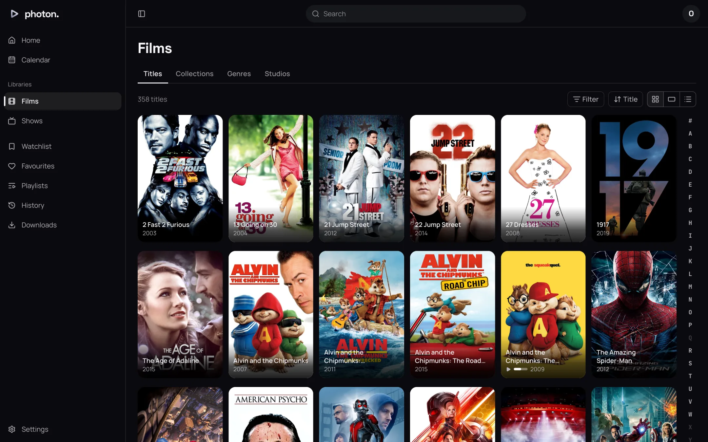
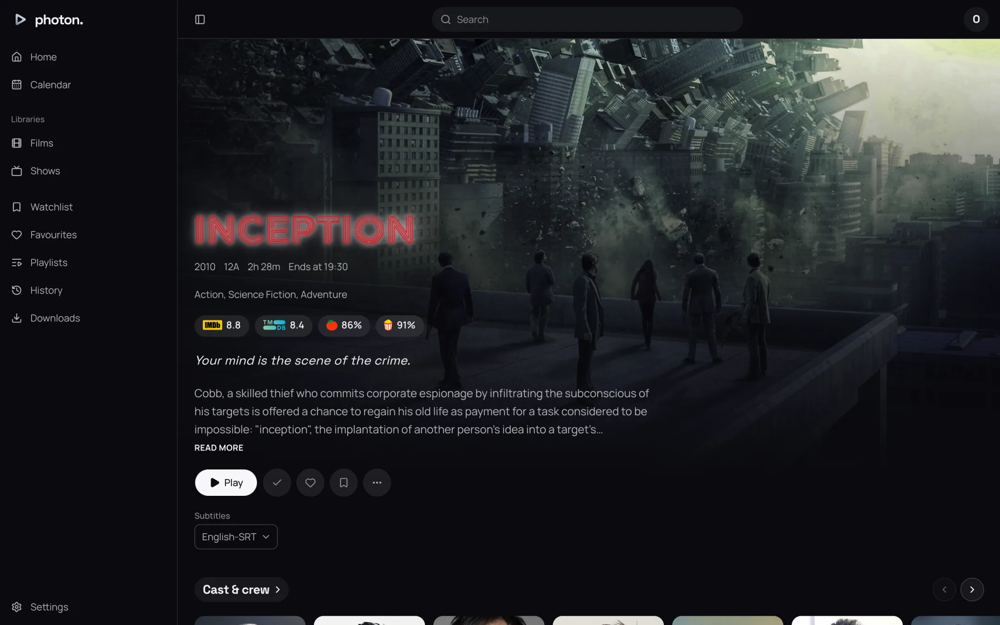
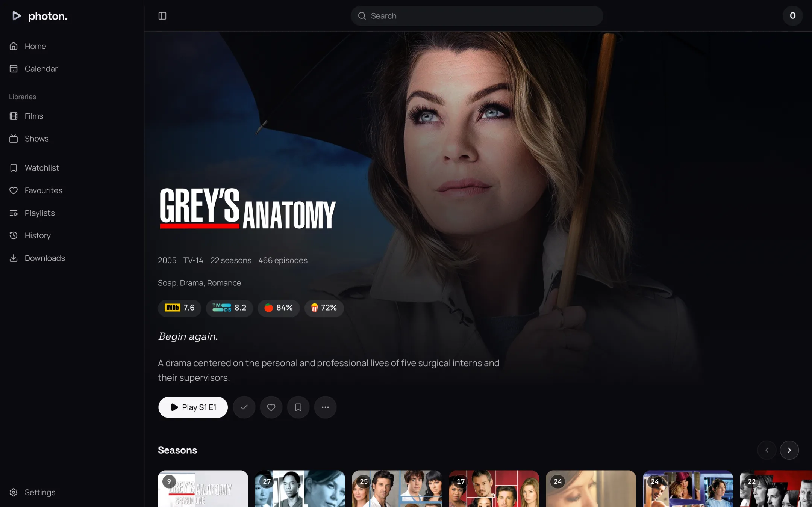

This page walks through what you see between logging in and pressing Play: Home, a library, its
genres, studios and collections, a title's page and a person's.

## Home

Home is a stack of rows, each drawn as soon as the server answers it. A row's name is a button
that opens all of it; the arrows at the end of the line scroll it a screen at a time, and Left and
Right step from card to card once one has focus.

| Row | What it holds |
| --- | --- |
| Continue Watching | Films and episodes you stopped part way, the most recent first. |
| Next Up | For each show under way, the episode after the furthest one you watched, specials aside, unless you have started it already, when it is in Continue Watching instead. |
| Watchlist | What you put on your watchlist, the latest first. |
| Favourites | Your favourites, the latest first. |
| Recently Added in `{library}` | One row for each film or show library: films by when they were added, shows by their newest episode. |
| Recently Released in `{library}` | Films and shows out in the last year, a show by when its newest episode aired; nothing yet to come. |
| Top Rated in `{library}` | The films and shows you have not begun, by IMDb rating, leaving out ratings with fewer than 1,000 votes. |

Every row is shown until you hide it, in the order above until you move it: see
[Home rows](06-your-settings.md#home-rows). A row with nothing in it is not drawn. A server with no
titles yet says "Nothing to watch yet" until a library has been scanned.

A title held in several libraries is listed once on your own rows (Continue Watching, Next Up,
Watchlist, Favourites). The library rows are each library's own, so such a title is in each one's
row.

To read a row from the API:

```sh
curl https://photon.example/api/v1/profile/rows/continue_watching?limit=20 \
  -H "Authorization: Bearer $TOKEN"
```

A library's row is `GET /api/v1/libraries/{id}/rows/{row}`.

## A card and its menu

Every title is a card: a poster, or a still for an episode or a row about where you are. A card
shows a tick once you have watched it, the number of episodes left on a show or season you have
started, a heart for a favourite, and a bar for how far you got.

The **⋯** button on a card (shown on hover, and always on a touch screen) opens what can be done
to a title without opening it:

- **Play** or **Resume**, **Play from the beginning**, and **Play version…** where there are
  several copies.
- **Mark as watched** or **Mark as unwatched**. A show or season is marked episode by episode.
- **Add to favourites**, **Add to watchlist**, **Add to playlist…**.
- **Download…**, **Find subtitles…** and **Share…**, which copies the title's link (or opens your
  device's share sheet). Whoever opens it logs in first.
- **Remove from Continue Watching**, which forgets where you stopped and keeps whether you watched
  it.
- **Go to** the episode's season and show.

An admin sees more entries below these, for editing and matching the title: those are covered in
[fixing a match](../03-library/05-fix-a-match.md).

## A library



A library opens on its **Titles**, with tabs beside it for **Collections**, **Genres** and
**Studios** (**Networks** for a show library) where it has any.

The bar over the wall holds:

- **Show**, on a show library (**Shows** or **Episodes**) or a mixed one (**All**, **Films**,
  **Shows**, **Episodes**).
- How many titles the wall holds.
- **Filter** and the sort menu.
- **Show as**: **Posters**, **Stills** or **List**. This browser remembers the choice for each
  library.

In title order, a bar of letters beside the wall jumps to a letter; **#** is anything before A. A
letter with nothing under it is drawn but cannot be chosen, so the bar does not move.

### Filter

**Filter** lists only what the library has values for:

| Filter | What it narrows to |
| --- | --- |
| Status | Watched, Unwatched, In progress, Favourites, Watchlist. A show is watched when every episode is. |
| Genre | The library's genres. |
| Year | Release years. |
| Certificate | Age ratings. |
| Studio | Studios and networks. |
| Resolution | SD, 720p, 1080p, 4K, of a copy on disk. |
| Dynamic range | SDR, HLG, HDR10, HDR10+, Dolby Vision. |
| Minimum rating | Any, or a score of 50 to 90 out of 100 or more, by the site under **Rated by** where the library has more than one. |

Within one filter a title matches any value you tick; across filters it must match every one. An
episode is narrowed by its show's genres, studios and certificate. **Clear filters** takes the
filters off and keeps the sort.

The filters live in the page's address, so a narrowed wall can be bookmarked or passed on, and Back
leaves the library rather than undoing a filter.

### Sort

| Sort | Ways |
| --- | --- |
| Title | A to Z, Z to A |
| Date added | Oldest first, Newest first |
| Release date | Oldest first, Newest first |
| Rating | Lowest first, Highest first, by the site you choose under **Rated by** |
| Runtime | Shortest first, Longest first |
| Last played | Longest ago, Most recent |

Title is A to Z by default; every other sort starts newest or highest first. A title with no value
to sort by comes last either way. **Rating** is offered only where the library's titles have
ratings.

The same wall from the API, here unwatched comedies, newest first:

```sh
curl "https://photon.example/api/v1/libraries/$LIBRARY/titles?genre=Comedy&mark=unwatched&sort=added&order=desc" \
  -H "Authorization: Bearer $TOKEN"
```

An admin also sees **Save as a smart collection** on a narrowed or sorted wall; see
[collections](../03-library/07-collections.md).

### Genres, studios and collections

**Genres** and **Studios** (or **Networks**) list the library's values; choosing one opens the wall
filtered to it. **Collections** is the library's box sets. **Collections** in the sidebar is every
collection on the server, in no one library, shown wherever there is at least one.

The library's menu in the sidebar (**⋯** beside its name) has **Reorder**: drag each library by
its grip, or move it with the up and down arrow keys, then **Done**. The order is your profile's,
on every device:

```sh
curl -X PUT https://photon.example/api/v1/profile/library-order \
  -H "Authorization: Bearer $TOKEN" -H "Content-Type: application/json" \
  -d '{"library_ids": ["…", "…"]}'
```

## A title's page



A film's page leads with its backdrop and lettering, then what it is: year, certificate, running
time and **Ends at** the time it would finish if you started now, its genres, every site's score,
its tagline and its write-up.

Under them are the actions:

- **Play**, or **Resume from** where you stopped, and **From the beginning**.
- **Shuffle**, on a show or collection, and on an episode for its show.
- **Trailer**, where the title has one among its extras.
- The tick, heart and bookmark: watched, favourite and watchlist.
- **⋯**: **Add to playlist…**, **Download…**, **Find subtitles…** and **Media info**, which lists
  each copy's file and every track in it.
- A button to stop the theme music, while one plays (see
  [Play theme music](06-your-settings.md#playback)).

Where the title has several copies, or several audio or subtitle tracks, **Version**, **Audio** and
**Subtitles** choose what Play plays. A choice with one answer is not offered. What you leave alone
is the server's choice for your profile, by your [playback settings](06-your-settings.md#playback).

Below come, where the title has them: **Cast & crew**, **Extras**, the **Collections** it is in,
**More like this**, and **Details** (original title, **Directed by**, **Written by**, studios or
networks, and links to IMDb, TMDB and TheTVDB under **Elsewhere**). A row with more than it shows
opens the whole of it from its name.



A show's page plays the episode you are at: **Play S1 E3**, or **Resume S1 E3** once you have started it. Its **Seasons** row
says how many episodes of each you have watched. A season has no page of its own: it opens on the
episode you are at in it, else its first. An episode's page shows its season as a row, with the
season's name as a menu to pick another, and takes its links, extras, collections and **More like
this** from its show.

A collection's page lists the titles it holds, and **Shuffle** plays its films and episodes in a
random order.

A title in a library that fetches from elsewhere (a [Stremio addon](../06-integrations/03-stremio.md),
say) may say it is **Being fetched**: it plays once its provider has it.

## A person's page

A cast or crew card opens the person: their photograph, when and where they were born and died,
their biography, and a **Browse** link for each library that opens it filtered to them. Their work
follows in rows: **Acting**, **Directing**, **Creating**, **Writing**, **Producing** and **Music**.
A title is listed once, under the first of those they did on it, with the year and their part or
job beneath it.
