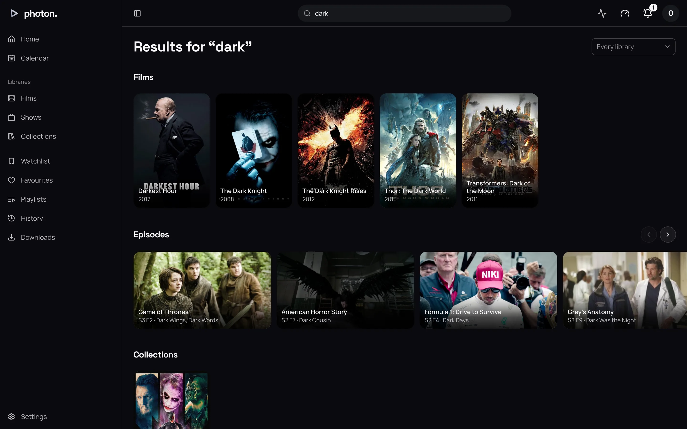

The search field is at the top of every page. Type what you are looking for and press Return.

## What a search finds

Search matches **the start of words**. Capitals and accents do not matter, and nor does the order
of the words:

- `amel` finds Amélie.
- `dark knight` finds The Dark Knight Rises.

A film can also be found by its original title, such as the name it was first released under.

The closest matches come first: a title named exactly what you typed, then titles that start with
it, then the rest. A show's episodes come after the show itself.

If nothing matches and you typed at least five letters, search tries again allowing for a typing
mistake. `intersteller` still finds Interstellar.

People are found the same way, by the start of each word of their name.

## The results page

Results come in rows: **Films**, **Shows**, **Episodes**, **Collections**, then **People**. Choose a
row's name to see everything of that kind.

If you can see more than one library, **Search in** narrows the results to one library, or choose
**Every library**. People are always shown, whichever library you pick.

If nothing is found, the page says **Nothing here matches**.

> **Note:** If a library fetches from elsewhere, such as a
> [Stremio addon](../06-integrations/03-stremio.md), a search of every library may also list titles
> the server does not have yet. Opening one adds it to the library.

Search only shows what your profile is allowed to see.

## Titles the server doesn't have

If the server takes requests, a search also shows, under **Not in library**, films and
shows that none of its libraries has. See [ask for a title](07-requests.md).
