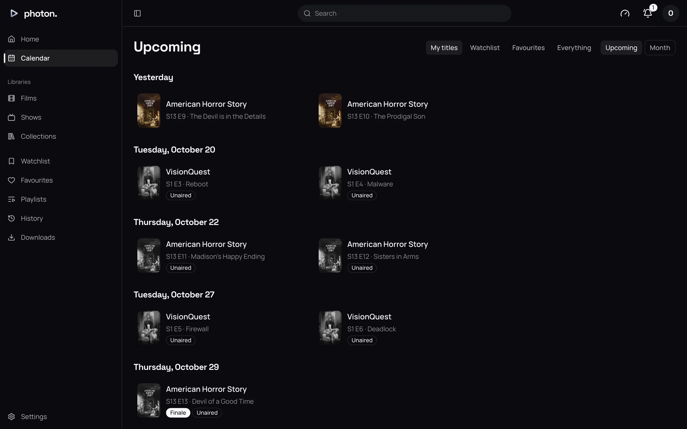

Each profile keeps its own lists: what you want to watch, what you like, and what you have played.
They follow you to every device and app you sign in to. Nobody else in the household sees them.

## What counts as watched

When you stop playing, the server decides what to keep:

- **Stopped in the first 5%**: nothing is kept. A quick look does not count.
- **Stopped between 5% and 90%**: the title goes into Continue Watching, ready to resume.
- **Past 90%**: the title is marked **watched**.

A show or season counts as watched once every episode in it is.

To mark something yourself, use the tick on its page, or **Mark as watched** in a card's **⋯**
menu. Marking a show or season marks every episode in it.

- **Mark as unwatched** also forgets where you stopped.
- **Remove from Continue Watching** forgets where you stopped but keeps whether you watched it.

## Watchlist

The watchlist is for things you mean to watch. Add a title with the bookmark on its page, or **Add
to watchlist** in a card's menu. **Watchlist** in the sidebar shows them, newest first.

- Only films and shows go on the watchlist. Adding a season or episode adds its show.
- **Watching takes a title off.** A film leaves once you have watched it, and a show once you have
  watched every episode.

## Favourites

Favourites are titles you like. They stay there after you watch them. Add one with the heart on its
page, or **Add to favourites** in a card's menu. Anything can be a favourite, including a single
episode or a collection.

**Favourites** in the sidebar groups them into **Films**, **Shows**, **Seasons**, **Episodes**,
**Collections** and **Extras**, newest first.

Your watchlist and favourites also appear as rows on Home. See
[Home rows](06-your-settings.md#home-rows).

## History

**History** lists everything you have played, newest first, grouped by day. Each entry shows when
you started, where you **stopped at**, and how it reached you:

- **Direct play**: the file was sent as it is.
- **Direct stream**: the picture was sent as it is, with small changes so the browser could play it.
- **Transcode**: the server converted it as it played.

**Download history** saves every play you have made as a CSV file, which a spreadsheet opens and
services such as Trakt can import. Each row is one play, the latest first, with these columns:

| Column | What it holds |
| --- | --- |
| `started_at`, `stopped_at` | When the play started and stopped, in UTC, such as `2026-10-01T20:00:00Z`. |
| `profile` | Whose play it was. |
| `kind` | `movie` or `episode`. |
| `title`, `year` | The film's or episode's title, and a film's year. |
| `show_title`, `season`, `episode` | Which show an episode is of, and where in it. |
| `position_ms` | Where the play stopped, in milliseconds. |
| `method` | `direct`, `remux` or `transcode`: direct play, direct stream or transcode. |
| `tmdb_id`, `tvdb_id`, `imdb_id` | The film's ids at TMDB, TheTVDB and IMDb, or for an episode its show's. Empty where it was never matched there. |

The file does not say whether a play was finished, as photon-server keeps only where it stopped.

An admin can see everyone's history in Settings › Server › Play history, and download it there the
same way: everyone's, or the profile chosen under **Who**. See
[signed-in devices and what is playing now](../04-access/07-devices-and-playback.md). You can also
[bring in your history](../06-integrations/07-import-history.md) from Plex, Jellyfin or Emby.

## Calendar

**Calendar** shows films being released and episodes airing, day by day. It includes episodes you
do not have yet.

It opens on **Upcoming**: six weeks starting yesterday, with days headed **Yesterday**, **Today**, **Tomorrow** or by
date.
**Month** shows a month as a grid, with buttons for the previous and next month and **Today** to
come back.

Choose whose titles it shows:

| Filter | What it shows |
| --- | --- |
| My titles | The default. Shows you have started, and titles on your watchlist or favourites. |
| Watchlist | Only your watchlist. |
| Favourites | Only your favourites. |
| Everything | Every film and show you can see. |

Choose an entry to open its title. An episode you do not have yet is greyed out and marked
**Unaired**, or **Missing** once its air date has passed. Episodes are also marked **Series
premiere**, **Season premiere** or **Finale**. Anything you have watched is dimmed.
