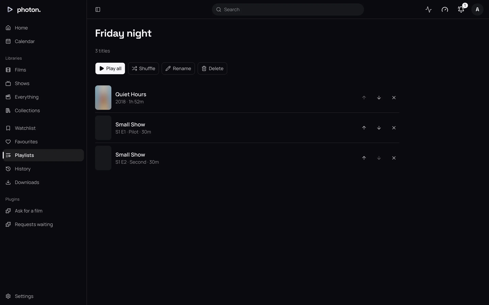

A playlist is a list of films and episodes you put together, to play in your order or shuffled.
Your playlists are your own: nobody else in the household sees them, and they follow you to every
app you sign in to.

Collections are different. An admin keeps those for everyone. See
[collections](../03-library/07-collections.md).

## Make a playlist

1. Open **Playlists** in the sidebar.
2. Type a name under **New playlist**.
3. Choose **Create**. The new, empty playlist opens.

You can also make one while adding a title: **Add to playlist…** offers **New playlist** below your
existing ones.

**Playlists** lists yours by name, with how many titles each holds and how long they last.

## Add titles

1. Choose **⋯** on a card or on a title's page.
2. Choose **Add to playlist…**.
3. Choose the playlist. The title is added at the end.

What you add decides what plays:

- A film or episode is added as it is.
- A show is added as all its episodes, in order.
- A season is added as its episodes, in order.
- A collection is added as everything in it.

The same title can be added more than once.

## Change the order, rename or delete

On a playlist's page:

- The up and down arrows beside an entry move it one place.
- The cross beside an entry removes it.
- **Rename** changes the name. Choose **Save** to keep it.
- **Delete** removes the playlist after asking. The titles stay in your library.

## Play a playlist

- **Play all** plays from the first entry.
- **Shuffle** plays every entry once, in a random order.

When one title ends, **Up next** offers the next. **Previous** and **Next** in the
[player](05-watching.md), or Shift+P and Shift+N, move through the list.

> **Note:** The playlist only plays in the tab you started it in. If you reload the page or open a
> title from somewhere else, the player goes back to its usual behaviour.

What you watch from a playlist is marked watched and kept in Continue Watching as usual. A playlist
does not keep a place of its own.

## Good to know

If an admin takes away your access to a library, its titles disappear from your playlists. They
come back if you are given the library again.
