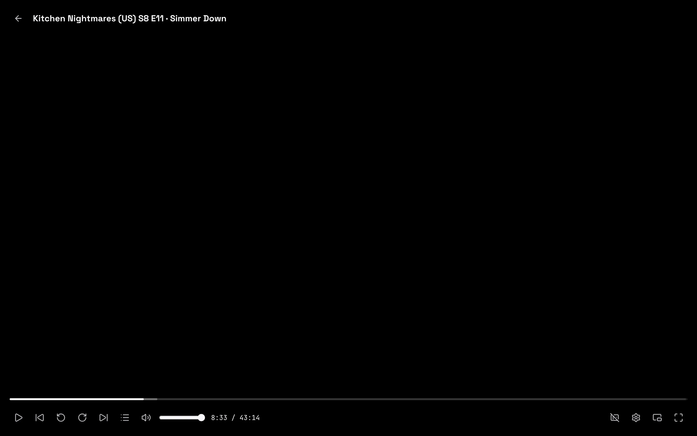
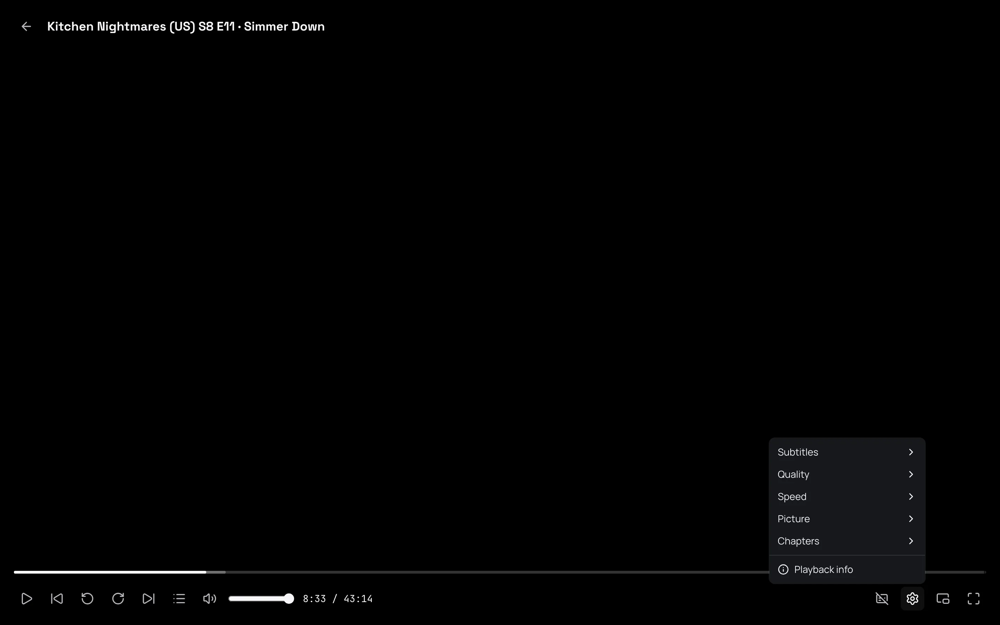
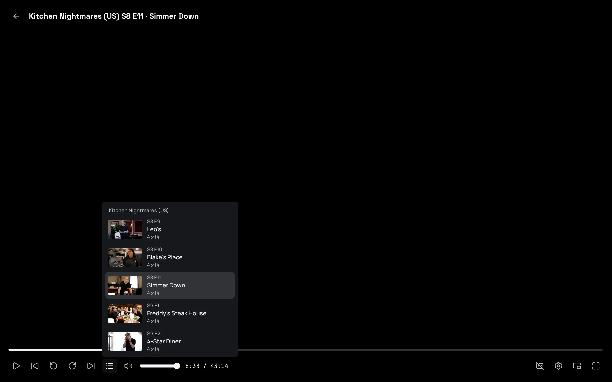

Press **Play** on a title's page, or **Play** or **Resume** in a card's **⋯** menu. The player fills
the window and starts where you last stopped.

As you watch, the player keeps the server up to date with how far you have got. Continue Watching
and your other devices pick up from the same place.

## How the title gets to your browser

When your browser can play a file as it is, photon-server sends it unchanged. When it can't, the
server converts it as it plays (this is called transcoding), using a graphics card if the server
has one. **Playback info** in the player's settings shows which happened, and why. To learn more,
see [transcoding](../05-playback/01-transcoding.md).

If a title cannot play, the player says **Can't play this here** and the reason, with **Try
again** and **Back**.

## The controls

Move the pointer or press a key to show the controls. They hide after three seconds while playing,
and stay while paused or while a menu is open.

| Control | What it does |
| --- | --- |
| Back arrow | Goes back to the title's page. |
| Play, Pause | Starts or pauses. Clicking the picture does the same. Double-click it for full screen. |
| Previous | Plays the title before, in a playlist or a show. |
| Back 10 seconds, Forward 10 seconds | Jumps back or forward. |
| Next | Plays the next title, in a playlist or a show. |
| Episodes | Lists the show's episodes. See [choosing an episode](#choosing-an-episode). |
| Mute and Volume | Your browser remembers the volume. |
| Subtitles | Turns subtitles on or off. Shown if the title has any. |
| Settings | Opens [the settings menu](#the-settings-menu). |
| Cast | Shown if a Chromecast is found. See [cast to a Chromecast](#cast-to-a-chromecast). |
| Play on another screen | AirPlay in Safari, or casting in Chrome on Android. |
| Picture in picture | Plays in a small window over your other windows, if your browser can. |
| Full screen | Fills the screen. |

On a phone, Previous, Next and the volume slider are left out to save room.

The bar along the bottom shows how far you are. Point at it to see a small picture of that moment.
Chapters show as small marks on the bar.

Your keyboard's media keys, and controls such as headphone buttons or a lock screen, also work.

### Keys

| Key | What it does |
| --- | --- |
| Space or K | Play or pause |
| Left, Right | Back or forward 5 seconds |
| J, L | Back or forward 10 seconds |
| Up, Down | Volume up or down |
| M | Mute |
| F | Full screen |
| C | Subtitles on or off |
| Shift+N, Shift+P | Next or previous title |
| 0 to 9 | Jump through the title: 0 is the start, 5 is halfway |

## The settings menu

Choose **Settings** in the player to open this menu.

| Item | What it does |
| --- | --- |
| Audio | Picks a soundtrack, such as another language or a commentary. Shown if there is more than one. |
| Subtitles | **Off**, or one of the title's subtitles. |
| Subtitle timing | Moves subtitles earlier or later, if they are out of step with the picture. **On time** puts them back. This is forgotten when you leave. |
| Quality | **Original**, or a limit from 40 Mbps down to 420 kbps. Lower it on a slow connection. Your choice is kept for all your devices. |
| Speed | From 0.5× to 2×. **Normal** is the usual speed. |
| Picture | **Fit** (the default), **Crop to fill** or **Stretch**, for a screen of a different shape. |
| Chapters | Jumps to a chapter, if the title has them. |
| Playback info | How the title is reaching you, and details about the file. |

## Choosing an episode

When you are watching an episode, **Episodes** lists the show's episodes in order. Each one shows
how far you got, with a tick on those you have watched. Choose one to play it.

## Subtitles

All kinds of subtitles work in the browser, including styled ones and the picture subtitles from
Blu-rays and DVDs.

You can change how plain subtitles look in this browser: their size, colour and background. Go to
Settings › Playback › **Subtitles on this device**. See
[subtitles on this device](06-your-settings.md#subtitles-on-this-device). Styled and picture
subtitles keep their own look.

### Find subtitles

If a title has no subtitles in your language, an admin may have set up a way to find them.

1. On a film's or episode's page or card, choose **⋯**, then **Find subtitles…**.
2. Pick another **Language** if you need to. A result marked with a star was made for this exact
   file.
3. Choose **Add**. The subtitle is kept for everyone in the household.

Setting this up is covered in [subtitles](../03-library/10-subtitles.md).

## Skipping intros and credits

If the server knows where they are, the player shows **Skip Intro**, **Skip Recap**, **Skip
Credits** or **Skip Preview** over the picture. In your
[playback settings](06-your-settings.md#playback) you can choose to see the button, skip
automatically, or never be offered.

Skipping credits at the very end of an episode goes straight to the next one.

## Up next

Near the end of an episode, **Up next** shows the next one, or the next title in a playlist.
**Play now** plays it. **Hide** puts it away.

If **Play the next episode** is on in your [playback settings](06-your-settings.md#playback), it
plays by itself after counting down ten seconds. If it is off, it waits for you.

## Cast to a Chromecast

In Chrome, and browsers based on it, **Cast** appears when a Chromecast is on your network.

1. Choose **Cast** and pick the device.
2. The title carries on there from where it was. Your screen says **Playing on** the device's name,
   and the player's controls control it.
3. End the cast and the title comes back to your browser where it got to.

> **Important:** Casting only works if you opened the web app at an `https` address the Chromecast
> can reach. It does not work at `localhost`. See [remote access](../04-access/04-remote-access.md).

While casting, the volume is your TV's, and **Speed**, **Picture**, **Subtitle timing** and picture
in picture are not available.

## Download a copy

You can save a film or episode to watch offline.

1. On its page or card, choose **⋯**, then **Download…**.
2. Choose a quality. **Original** is the file as it is. The others (**1080p, 20 Mbps** down to
   **480p, 1.5 Mbps**) are smaller files the server makes for you.
3. Open **Downloads** in the sidebar. Each download shows **Waiting**, **Converting** with its
   progress, **Ready**, or **Failed** with the reason.
4. When it is **Ready**, choose **Save** to save the file.

If the title has more than one version, pick it with **Version** on the page first. The cross
removes a download.

> **Note:** A download is kept on the server for a week after it is ready, then removed. Save it
> before then.

More about how downloads are made is in [downloads](../05-playback/03-downloads.md).
