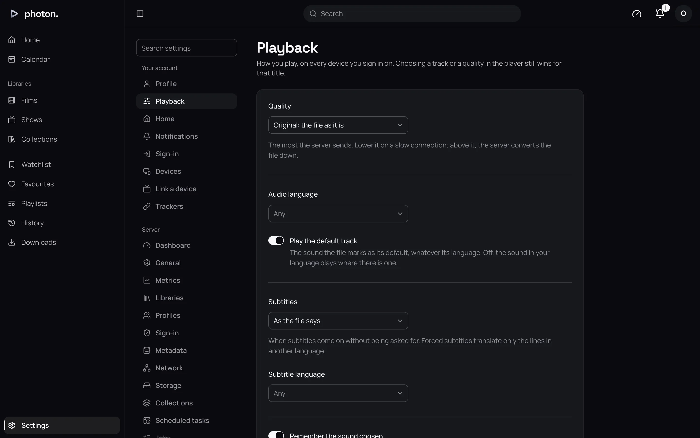
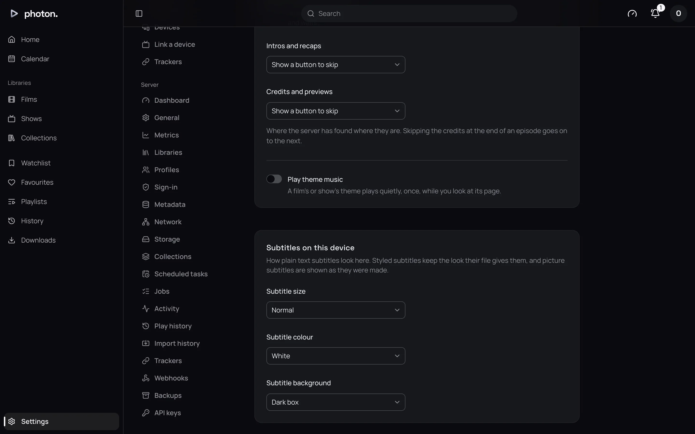

**Settings**, at the bottom of the sidebar, opens on **Your account**: the pages every profile has.
**Search settings**, at the top of the list, finds a setting by name.

Almost everything here follows you to every device and app you sign in to. Two things are kept by
each browser separately: how subtitles look, and whether the browser shows notifications.

An admin also sees **Server**, and a manager **Profiles**. Those are covered in
[giving people access](../04-access/index.md).

## Profile

At the top is your picture, name and role. **Add a picture** (or **Change picture**) takes a JPEG,
PNG, GIF or WebP image. **Remove picture** takes it away.

| Setting | What it does |
| --- | --- |
| Name | What every device calls you. No two profiles can share a name. |
| Password | Type your **Current password**, then the new one twice. Changing it signs you out on every other device. If you have never had a password, leave **Current password** empty. |
| Authenticator app | Asks for the code from an app on your phone as well as your password when a device logs in. See [an authenticator app](../04-access/01-profiles.md#an-authenticator-app). |
| PIN | 4 to 6 digits, asked for instead of your password when someone switches to your profile. **Remove PIN** goes back to the password. An admin's profile cannot have a PIN. |

Which libraries you can see is set by an admin or manager. See
[profiles](../04-access/01-profiles.md).

## Playback

These choose how titles play for you, wherever you watch. A choice you make in the player still
wins for that title. Changes are saved as you make them.

| Setting | What it does |
| --- | --- |
| Quality | The most the server sends. Default: **Original: the file as it is**. Choose **Up to** a lower limit on a slow connection, and the server makes a smaller version as it plays. |
| Audio language | The language you want to hear. Default: **Any**. |
| Play the default track | Default: on. Plays the soundtrack the file marks as its main one. Turn off to prefer your **Audio language**. |
| Subtitles | When subtitles come on by themselves. See below. Default: **As the file says**. |
| Subtitle language | The language subtitles are chosen in. Default: **Any**. |
| Remember the sound chosen | Default: on. A title plays again with the soundtrack you last picked for it. |
| Remember the subtitles chosen | Default: on. A title plays again with the subtitles you last picked for it, or none. |
| Play the next episode | Default: on. The next episode plays after a ten-second countdown. Off, it waits for you. |
| Intros and recaps | Default: **Show a button to skip**. Or **Skip by itself**, or **Don't offer to skip**. |
| Credits and previews | The same three choices. |
| Play theme music | Default: off. On, a show's or film's theme tune plays quietly once on its page. |

The choices for **Subtitles**:

- **As the file says**: whatever the file turns on.
- **When the sound is in another language**: full subtitles when the soundtrack is not in your
  subtitle language.
- **Always**: subtitles in your language whenever there are some.
- **Only forced subtitles**: only the lines in another language are translated, such as an alien
  speaking in an English film.
- **Never**.

Skipping only works where the server has found the intro or credits. See
[markers and previews](../03-library/09-markers-and-previews.md). Theme music needs a tune for the
title. See [theme music](../03-library/11-theme-music.md).

### Subtitles on this device

How plain subtitles look in this browser. It is kept by the browser, since it depends on your
screen and how far away you sit.

| Setting | What it does |
| --- | --- |
| Subtitle size | **Small**, **Normal** (the default), **Large** or **Larger**. |
| Subtitle colour | **White** (the default) or **Yellow**. |
| Subtitle background | **Dark box** (the default) or **Shadow**. |

Styled subtitles and picture subtitles from discs keep their own look.

## Home rows

**Home** lists every row your Home page can have, in order.

- Drag a row by its grip, or use its arrows, to move it.
- Use the switch beside a row to show or hide it.

Changes apply on all your devices. The rows are described in
[Home](01-home-and-browsing.md#home). **Recently Added**, **Recently Released** and **Top Rated**
are one entry each here, but show once for each library on Home.

## Notifications

The bell at the top of every page lists new titles, newest first. A dot marks unread ones, and the
bell shows how many. A show's new episodes are gathered into one notification.

- Choose a notification to open the title.
- **Mark all read** and **Clear all** act on everything in the list.

What you read or clear on one device is cleared on the others too.

**Notifications**, in Settings or at the bottom of the bell, chooses what you hear about:

| Setting | What it does |
| --- | --- |
| Tell me of | Default: **New episodes of shows I follow**. You follow a show once it is on your watchlist, a favourite, or started. Or **Every new film and episode**, or **Nothing**. |
| From | The libraries you hear about. Untick a library to hear nothing from it. |
| Notify this browser | Default: off. On, this browser shows notifications even when the web app is closed. Turn it on in each browser you want. |

> **Note:** **Notify this browser** needs the web app at an `https` address. On an iPhone or iPad,
> you also need to add the web app to your Home Screen first. If your browser has blocked
> notifications for the site, allow them in its settings.

The Photon apps get the same notifications. See
[notifications and push](../06-integrations/06-notifications.md).

## Sign-in

If an admin has set up a shared sign-in, this page offers **Link** for each one. After linking,
**Continue with** that service on the log-in page signs you in as this profile. **Unlink** stops
this. Set a password first if you do not have one. See
[single sign-on](../04-access/02-single-sign-on.md).

## Devices

**Devices** lists everything signed in as you, with **This browser** among them, and when each was
last used. **Sign out** signs a device out straight away. Signing out this browser logs you out.

## Link a device

A TV app can show a code, such as `ABCD-EFGH`, so you can sign it in without typing a password on
it.

1. On the TV, choose to sign in with a code.
2. In the web app, open **Link a device**, in Settings or from your picture's menu. Or open the
   address the TV shows on another device: the code is filled in for you.
3. Type the **Code** and choose **Link**.

The page says the device is signed in. The TV may take a few seconds to notice. It then appears
under **Devices**. See [signing in on a TV](../04-access/03-pair-a-tv.md).

## Trackers

**Trackers** links your accounts on **Trakt**, **Simkl**, **MDBList** and **AniList**. These are
websites that keep a record of what you watch across apps. Once linked, the server tells Trakt,
Simkl and MDBList what you play and what you mark watched. For AniList, it updates how far you are
into each anime.

1. Choose **Link** beside the tracker. If an admin has not set it up yet, the page says so.
2. The page shows a code and the tracker's address. Choose **Open**, sign in there and allow
   access. For AniList, paste the token it gives you into the page and choose **Link**.
3. The page shows **Linked as** your name on the tracker.

**Unlink** removes the connection. What the tracker already has stays there. Setting trackers up is
in [sync with trackers](../06-integrations/04-trackers.md).
