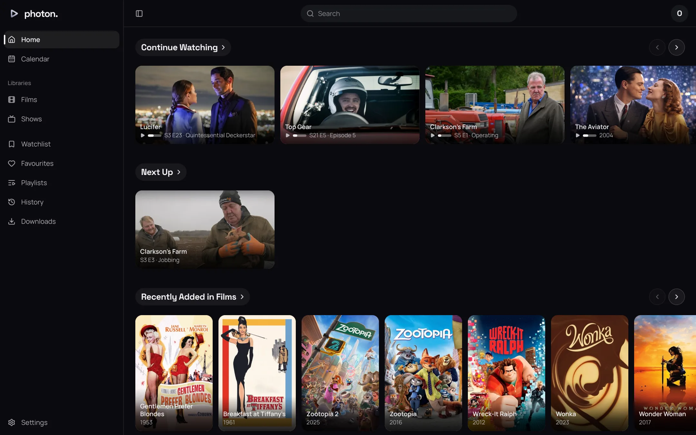

photon-server serves its own web app at its address, the same port as the API: open
`https://photon.example` in a browser and log in. Everything a household does from a sofa is here:
browsing the libraries, searching, keeping a watchlist, favourites and playlists, playing in the
browser, and choosing how you play. This section is for someone watching; running the server is in
the sections after it.

## Logging in

The log-in page asks for your profile's **Name** and **Password**. Where an admin has set up a
sign-in provider, it offers **Continue with** that provider above them (see
[single sign-on](../04-access/02-single-sign-on.md)).

**Forgot your password?** leads to **Reset your password**. Ask for a code from a device on the
server's own network: the server writes it to its log, not to an email, so whoever runs the server
reads it to you. The code works for a limited time, and resetting with it signs out every device
signed in as you.

After logging in, a household with several profiles chooses one on **Who's watching?**. A profile
other than the one you are watching as asks for its PIN or password first. Switch later from your
picture at the top right, **Switch profile**. Profiles, PINs and roles are in
[profiles](../04-access/01-profiles.md).

## Finding your way around

The sidebar holds:

- **Home** and **Calendar**.
- **Libraries**: each library an admin has given you, then **Collections** where the server has
  any.
- **Watchlist**, **Favourites**, **Playlists**, **History** and **Downloads**.
- **Plugins**: pages a plugin adds, where any does (see [plugins](../06-integrations/01-plugins.md)).
- **Settings**, at the foot.

The search field is at the top of every page. Your picture at the top right opens a menu with
**Switch profile**, **Settings**, **Link a device** and **Log out**. An admin also sees the server's
activity and a **Server dashboard** button there, which belong to the admin sections.

What a profile sees is set by an admin: which libraries, and which titles in them. The web app only
ever shows what your profile may see. Your own rows on Home, search and the calendar list a title
held in two libraries once.

The web app keeps up by itself. While it is open, the server tells it what changes (a title added,
a mark set on another device, a playlist changed) and the pages showing it are read again, so there
is nothing to refresh.

## Pages

- [Home and browsing](01-home-and-browsing.md): Home's rows, a library's titles, filters and sorts,
  genres, studios, collections, a title's page and a person's.
- [Search](02-search.md): what a search finds and how it ranks it.
- [Your lists](03-your-lists.md): the watchlist, favourites, history and the calendar.
- [Playlists](04-playlists.md): making, ordering and playing playlists.
- [Watching](05-watching.md): the player, tracks, subtitles, skipping, and downloads.
- [Your settings](06-your-settings.md): your profile, playback, Home's rows, devices, linking a TV,
  sign-in and trackers.

Everything the web app does goes through the API, which any other app can use with a token: see
the [API reference](../08-reference/03-api.md).
