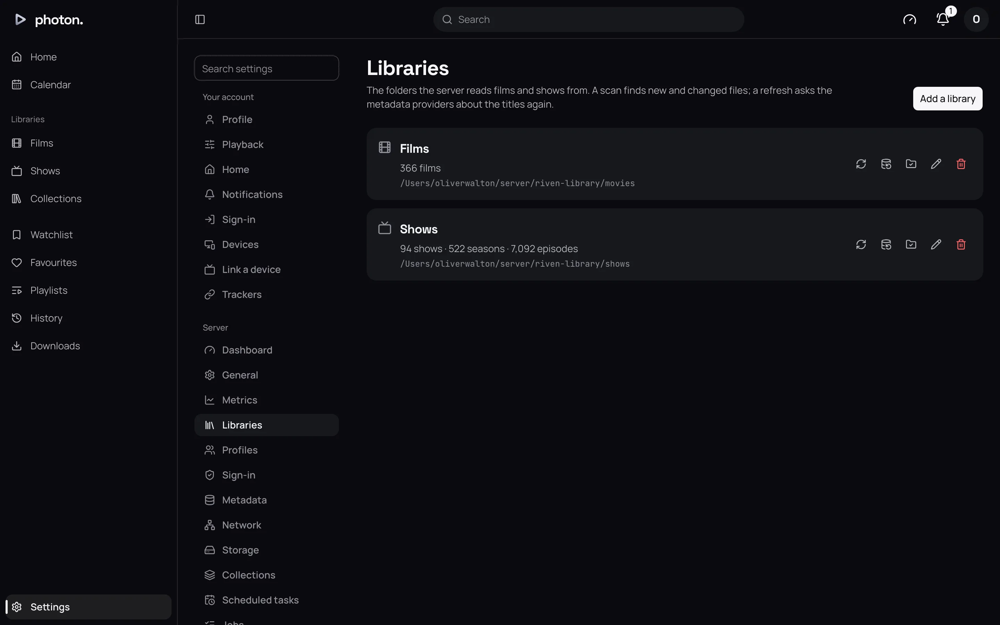
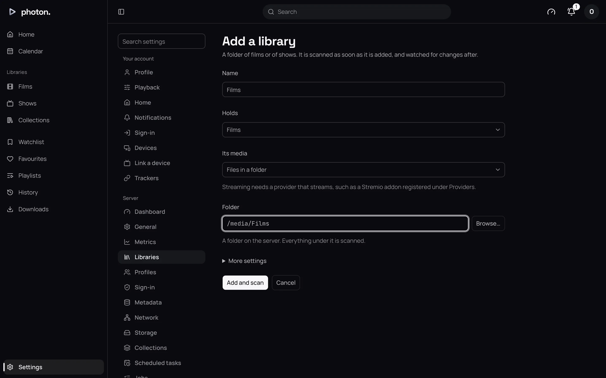
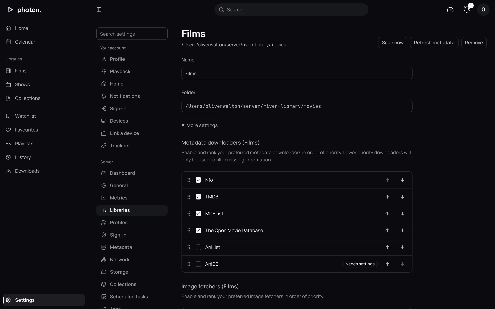

A library is one folder on the server and everything inside it. It can hold films, shows, or both.
Libraries live at Settings › Server › Libraries, which only an admin can see.

## Before you start

- Lay out your files as [prepare folders and name files](01-name-your-files.md) describes.
- The folder you choose is the folder **as the server sees it**. If you run photon-server in
  Docker (a way of running it in its own sealed-off box), that is the path inside the box. With the
  setup in [install with Docker](../01-get-started/02-install-docker.md), a folder
  `/srv/media/Films` on your computer is `/media/Films` to the server.
- The server only needs to read the folder. It needs to write to it only if you allow
  [media deletion](#media-deletion).
- Two libraries cannot use the same folder or the same name.

## Add a library

1. Open Settings › Server › Libraries and choose **Add a library**.
2. Type a **Name**. This is what you see in the sidebar and on Home.
3. Choose what it **Holds**: **Films**, **Shows**, or **Films and shows**.
4. Leave **Its media** at **Files in a folder**.
5. Choose the **Folder**. You can browse the server's folders from here.
6. To change any of the settings below now, open **More settings**. Otherwise leave the defaults;
   you can change them later.
7. Choose **Add and scan**.

The server starts reading the folder at once, and shows its progress beside the library. Titles
appear as they are found, and fill in with descriptions and pictures over the next few minutes.

> **Note:** What a library holds and its folder can't be changed later. To change either, add a
> new library and remove the old one.

## Its settings

To change a library's settings, choose **Edit** beside it at Settings › Server › Libraries, then
**Save**.

| Setting | What it does |
| --- | --- |
| **Metadata downloaders** | Where titles' descriptions come from, in order of trust. Default: **Nfo**, then **TMDB**. See [metadata providers](03-metadata.md). |
| **Image fetchers** | Where posters and other pictures come from, in order of trust. Default: **TMDB**. |
| **Videos to link from the providers** | Which extras to show from online, such as trailers. Default: trailers, featurettes and behind the scenes. |
| **Subtitles to download** | Languages to fetch subtitles in when a film has none. Default: none. See [subtitles](10-subtitles.md). |
| **Watch for changes** | **As they happen** (the default) notices new files within about a minute. **Only when scanned** waits for the next scan. See [keep libraries up to date](06-keep-up-to-date.md). |
| **Refresh metadata** | How often to look each title up again for new details. Default: every 30 days. |
| **Previews** | The small pictures you see while seeking. Default: **Chapters and seeking**. See [timeline previews](09-markers-and-previews.md). |
| **Intros and credits** | Whether to find intros and credits so players can offer to skip them. Default: **From chapters, sound and picture**. |
| **Theme music** | Where shows' tunes come from. Default: **Local files only**. See [theme music](11-theme-music.md). |
| **Metadata language** | The language for titles, descriptions and pictures. Default: **Server default**, set at Settings › Server › General. |
| **Titles** | **In its language** (the default) shows names in the library's language. **As first named** keeps each title's original name. |
| **Pictures** | **In its language first** (the default) prefers posters in your language. **The most liked, any language** takes the most popular. |
| **Certification country** | Which country's age ratings to show, which parental controls use. Default: **Automatic**. |
| **Media deletion** | Whether an admin can delete files from the web app. Default: **Not allowed**. See below. |

Changing **Metadata downloaders**, **Image fetchers** or **Metadata language** looks up every title
in the library again, which can take a while on a large library.

### Media deletion

With **Media deletion** set to **Allowed, files and all**, an admin's **Delete…** on a title
removes its files from the disk, and then the title. For a show, that is every episode.

> **Important:** Deleted files can't be brought back. The server also needs permission to write to
> the folder.

## Check the server can read it

**Check access**, beside a library at Settings › Server › Libraries, tries to read its folder and tells you what it found.
If it says the folder is empty, the drive or network share is usually not connected.

## Scan and refresh

- **Scan now** reads the library's folder for new, changed or removed files. **Scan all
  libraries**, on Settings › Server, scans every one.
- **Refresh metadata** looks the library's titles up online again. **Refresh missing metadata**
  takes only titles with gaps, such as no poster or a new season. **Refresh all metadata** takes
  everything, and can take hours on a large library.

Your own edits and chosen pictures are kept either way. You can also start both from the library's
menu in the sidebar.

## Remove a library

Choose **Remove** beside the library. Its titles disappear from photon-server, along with what
everyone has watched in it. Your files are not touched.

## Good to know

- **Keyframes**, in **More settings**, controls how the server reads each file's layout, which it
  uses when converting video as it plays. The default suits most people, including network shares.
- **One title in another language.** A single film or show can have its own language over its
  library's: see [a title's own language](05-fix-a-match.md#a-titles-own-language).
- **Streamed libraries.** Once a provider that streams, such as a Stremio addon, is set up at
  Settings › Server › Metadata, **Its media** also offers **Streamed by a provider**: a library
  with no folder, whose titles play from that provider. See
  [Stremio addons](../06-integrations/03-stremio.md).
- **Several servers.** If you run more than one, each one reads the libraries from its own copy of
  the folder, at the same path. **Check access** reports on each. See
  [several servers](../05-playback/04-several-servers.md).
