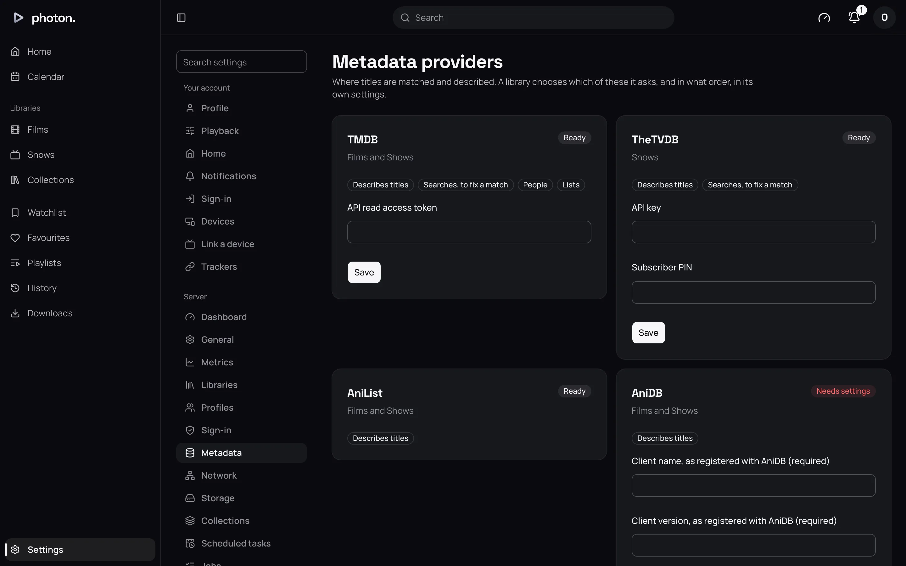

A file's name tells photon-server what a title is. A **metadata provider** tells it everything
else. A provider is an online service that knows a film's or show's title, year, description,
cast, age rating, scores and pictures. This page covers which providers photon-server uses, which
need a key, and how each library chooses between them.

## The providers

| Provider | Covers | What you get from it |
| --- | --- | --- |
| **TMDB** | Films and shows | Descriptions, cast and crew, genres, age ratings, posters, backgrounds, logos, episode stills and trailers. The default for everything. |
| **TheTVDB** | Shows | Descriptions and pictures for shows, seasons and episodes, including DVD and absolute numbering, and where specials aired. |
| **MDBList** | Films and shows | Scores: IMDb, TMDB and Rotten Tomatoes. |
| **The Open Movie Database** (OMDb) | Films and shows | Descriptions, a poster, and IMDb and Rotten Tomatoes scores. |
| **AniList** | Anime | Descriptions, voice cast, studios, scores and pictures. |
| **AniDB** | Anime | Descriptions, voice cast, scores, a poster, and episode names. |

TMDB is all most people need. Add the others for Rotten Tomatoes scores, for anime, or for shows
whose episodes TMDB numbers differently from your files.

**OpenSubtitles** is listed with them, but it only finds subtitles: see
[subtitles](10-subtitles.md). Plugins and Stremio addons you add appear here too: see
[plugins](../06-integrations/01-plugins.md).

## Set up a provider's key

Some providers need a key: a code from their website that lets photon-server use them.

1. Open Settings › Server › Metadata.
2. Find the provider's card. It says **Ready** or **Needs settings**.
3. Type the key in its field and choose **Save**.

| Provider | Needs a key? |
| --- | --- |
| TMDB | No. photon-server comes with its own. You can enter your own **API read access token** from [TMDB's API settings](https://www.themoviedb.org/settings/api); use the long "API Read Access Token", not the shorter API key. |
| TheTVDB | No. photon-server comes with its own. If you pay for a TheTVDB subscription, you can enter your **API key** and **Subscriber PIN**. |
| MDBList | Yes, a free **API key** from [MDBList](https://mdblist.com/preferences/). |
| OMDb | Yes, an **API key** from [OMDb](https://www.omdbapi.com/apikey.aspx). |
| AniList | No. |
| AniDB | Yes. Register a client with your AniDB account, then enter its name and version under **Client name, as registered with AniDB** and **Client version, as registered with AniDB**. |

A saved key is never shown again. Its field reads "Set; type to replace it", and its **Clear** button (such as
**Clear API key**) removes it.

> **Note:** If a library uses a provider that still needs its key, it is listed under **Needs
> attention** on Settings › Server. Until then the server skips it and uses the next provider.

## Choose where a library's details come from

Each library has two ordered lists in its settings, at Settings › Server › Libraries:

- **Metadata downloaders**: where descriptions, cast and scores come from.
- **Image fetchers**: where posters and other pictures come from.

There is a pair of lists for each kind of item the library holds: films, or shows, seasons and
episodes.

1. Tick a provider to use it.
2. Move it up or down. The one at the top is trusted most.
3. Choose **Save**.

The top provider fills in everything it can. Lower ones only fill the gaps it leaves. A new library
uses **Nfo** (description files beside your media, see [NFO files](04-nfo.md)) and then **TMDB**
for details, and **TMDB** for pictures.

For example, to take a show's episode names from TheTVDB instead of TMDB, tick **TheTVDB** under
**Metadata downloaders (Episodes)** and move it above TMDB.

> **Note:** Changing either list looks up every title in the library again.

Anything you edit on a title yourself always wins, and stays through every refresh: see
[edit its details](05-fix-a-match.md#edit-its-details).

## How a title is matched

When the server finds a new film or show, it looks it up in this order:

1. **By an ID it already has**, from its folder name or an NFO file.
2. **By another site's ID.** Once TMDB has found a title, the other providers use the IDs TMDB
   gives to find the same one.
3. **By searching** for its name and year, and taking the closest result. If nothing turns up, it
   searches again without the year.

If nothing matches, the title keeps the name from its file. If the wrong title was picked, see
[fix a match](05-fix-a-match.md).

## Ratings

Scores come from every provider a library uses for details. To show Rotten Tomatoes scores, tick
**MDBList** or **The Open Movie Database** under the library's **Metadata downloaders**.

## Pictures

For each kind of picture, the server uses, in order:

1. One you chose or uploaded yourself (see [choose artwork](05-fix-a-match.md#choose-artwork)).
2. A file beside the title (see
   [pictures beside a title](01-name-your-files.md#pictures-beside-a-title)).
3. The library's **Image fetchers**, top first.

The library's **Pictures** setting decides between a provider's own: posters in your language
first, or the most popular in any language.

## Seasons and episodes

TMDB and TheTVDB number episodes in the order they aired. If your files follow DVD order, or one
running number, set the show's [episode order](05-fix-a-match.md#episode-order). TheTVDB handles
both well.

TheTVDB, and NFO files, can say when a special aired. The server then also lists that special in
the season it aired in, in the right place, so you can watch it in order.

A show with an upcoming episode is looked up again every week, so its calendar stays current.

## Anime

AniList and AniDB treat each season or film of an anime as a separate entry, where TMDB and
TheTVDB treat it as one show with seasons. photon-server keeps the show-with-seasons shape and uses
published anime lists to fit the AniList and AniDB entries into it. It refreshes those lists daily.

AniList and AniDB don't search. They find a title through the IDs TMDB or TheTVDB give, so keep
TMDB or TheTVDB above them in the library's lists.

## Good to know

- **Languages.** A library's **Metadata language** and **Certification country** decide the
  language of descriptions and whose age ratings are shown.
- **AniDB is strict about how often it is asked.** photon-server waits between requests and keeps
  each answer for a day, so it is not blocked.
- **OMDb looks titles up only by IMDb ID**, so it adds nothing to a title no other provider found.
- **A provider that is down** is skipped, and the next one in the list is used.
