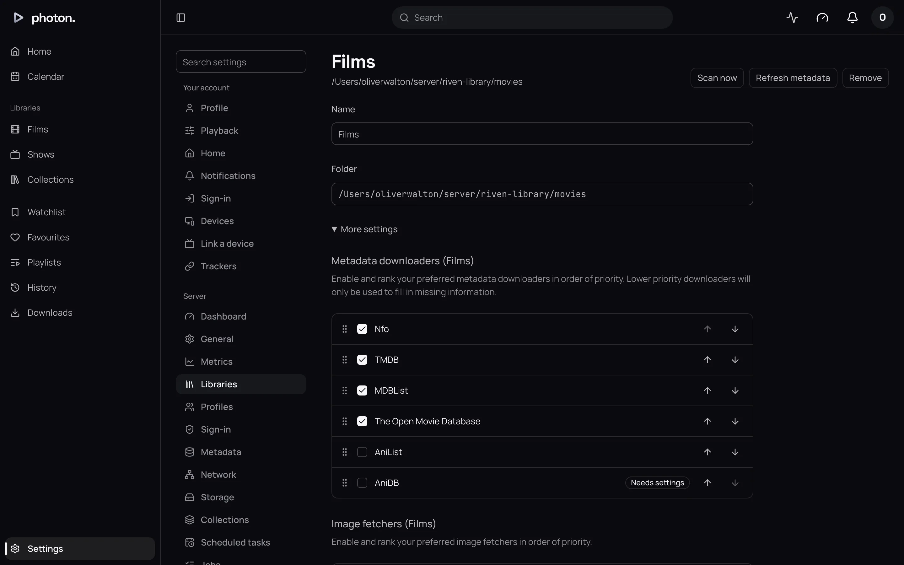

An **NFO** is a small text file that sits beside a film or episode and describes it: its title,
plot, genres and the ID of the matching entry on sites such as TMDB. Kodi, Jellyfin, Emby, Radarr,
Sonarr and tinyMediaManager all write them. photon-server reads them the same way Jellyfin does,
so a library you have already described with one of those tools keeps its descriptions.

## Turn NFOs on or off

NFOs are listed as **Nfo** in a library's **Metadata downloaders**, at Settings › Server ›
Libraries. A new library has it ticked and at the top, above TMDB. That means:

- What an NFO says wins over what TMDB says.
- TMDB fills in whatever the NFO leaves out, such as the cast and scores.



To change this:

1. Choose **Edit** beside the library.
2. Under **Metadata downloaders**, move **Nfo** below **TMDB** to let TMDB win, or untick it to
   ignore NFO files in this library.
3. Choose **Save**.

NFOs don't provide pictures. Pictures come from files beside the title and the library's **Image
fetchers** (see [pictures](03-metadata.md#pictures)).

## Where to put them

| For | Name it |
| --- | --- |
| A film in its own folder | after the film's file, `Heat (1995).nfo`, or `movie.nfo` |
| A film among others in a folder | after the film's file: `Alien (1979).nfo` |
| A show | `tvshow.nfo` in the show's folder |
| A season | `season.nfo` in the season's folder |
| An episode | after the episode's file: `The Wire S01E01.nfo` |

```text
/media/Shows/The Wire (2002)
├── tvshow.nfo
└── Season 1
    ├── season.nfo
    ├── The Wire S01E01.mkv
    └── The Wire S01E01.nfo
```

When you add or edit an NFO, the server reads it the next time it scans that folder. If the library
watches for changes, that is within about a minute. If an NFO can't be read, the server notes it in
its log and carries on without it.

## What it takes from an NFO

- The title, original title and the title it sorts by.
- The plot and tagline.
- The age rating.
- The release or air date, and the year.
- Genres and studios.
- IDs on TMDB, IMDb, TheTVDB, AniDB and AniList.
- Season and episode numbers.
- Where a special aired among the seasons.
- Which fields are locked (see below).

The cast, scores, pictures and collections in an NFO are ignored; those come from the providers.

## IDs

An NFO's IDs are the most useful thing in it. With one, the server finds the exact title on TMDB or
TheTVDB without searching. An ID in the folder name beats one in an NFO, and a match you fix by hand
beats both.

An NFO that is only a web address, such as an IMDb or TMDB link, also works.

## Episode numbers

An episode's NFO decides its season and episode, over what the file name says. The file's name
still has to look like an episode (see [episode names](01-name-your-files.md#episode-names)), or
the file is skipped.

## Specials in the season they aired in

A special's NFO can say where it aired, such as before episode 3 of season 2, the way Kodi and
Jellyfin write it. The server then lists the special in that season, in that place, so it plays in
order. It stays in Specials as well.

## Locked fields

If you locked fields in Jellyfin, it wrote that into its NFOs, and photon-server respects it. A
locked field is never filled in by any source ranked below the NFO, even if the NFO leaves it
empty.

> **Note:** A source ranked above the NFO is not held back by its locks. To protect a field from
> every source, lock it on the title itself: see
> [edit its details](05-fix-a-match.md#edit-its-details).

## Good to know

- A file holding several episodes can have one NFO describing them all. Their titles are joined
  with " / ".
- In a library of films and shows, a `tvshow.nfo` also marks its folder as a show (see
  [films and shows in one library](01-name-your-files.md#films-and-shows-in-one-library)).
