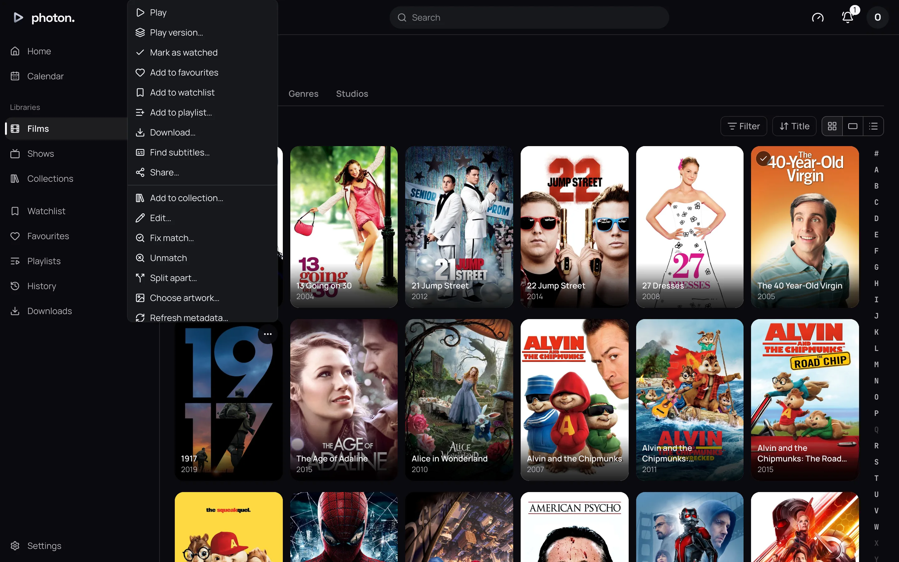
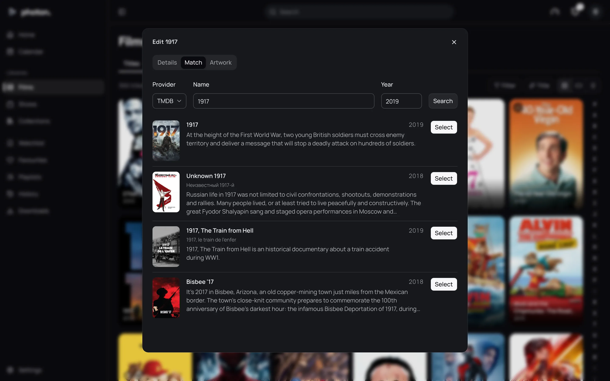
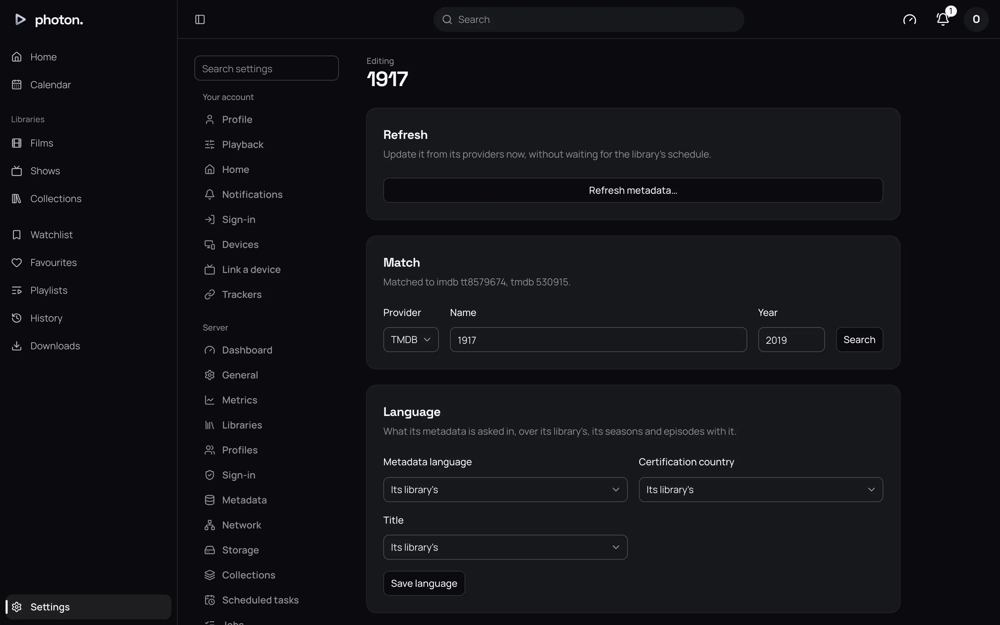
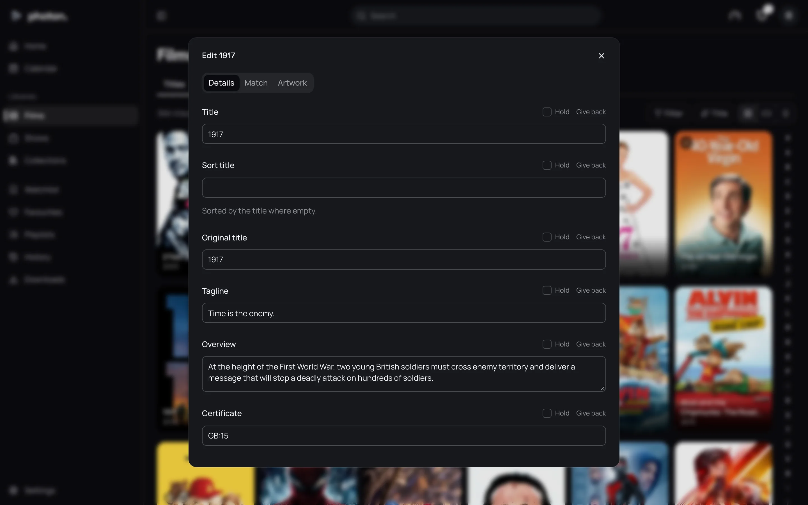

photon-server matches most titles from their file names alone. Now and then it picks the wrong
film, such as a remake instead of the original, or finds nothing at all. This page shows how to put
that right, and how to change a title's details and pictures. Everything here is for admins.

## Where to find it

As an admin, you can fix a title from two places:

- **Its card**, anywhere in a library, on Home or in search. Its **⋯** button opens a menu with
  **Edit…**, **Fix match…**, **Unmatch**, **Choose artwork…**, **Refresh metadata…** and
  **Manage…**, depending on the title.
- **Its page.** The **More** button (three dots) has an **Admin** part with **Edit metadata**,
  **Identify**, **Edit artwork** and **Edit markers**. Each opens that part of the title's
  Manage page.

**Edit…**, **Fix match…** and **Choose artwork…** open the same dialog, with **Details**,
**Match** and **Artwork** tabs. **Manage…** opens the title's own settings page, with everything on
this page in one place.

## Fix a wrongly matched film

Say your copy of 1917 (2019) shows up with the poster and description of a different film with
the same name.

1. Find the film's card in its library, choose its **⋯** button, then **Fix match…**. The dialog
   opens on the **Match** tab.
2. Choose the **Provider** to search. TMDB is right for most films.
3. Check the **Name** and **Year**. Correct them if your file name had them wrong.
4. Choose **Search**. A list of results appears, each with its poster, name, year and
   description, so you can tell films with the same name apart.
5. Choose **Select** beside the right one.

You will see "Matched. Its details follow in a moment." The title's description, cast and pictures
update shortly after.

The match you choose sticks. It wins over any ID in the folder name or an NFO file, and later
refreshes keep it. For a show, fix the show itself; its seasons and episodes follow.

> **Tip:** To get a title right from the start, put its ID in the folder name: see
> [naming the match yourself](01-name-your-files.md#naming-the-match-yourself).

### From the Manage page

**Manage…** shows the same search in its **Match** card. The card also tells you what the title is
matched to now, such as "Matched to tmdb 949", or "Not matched to any provider."

### Unmatch

**Unmatch** takes a title off every provider, and it keeps only what its file name and any NFO say.
Use it for home videos or recordings that no provider knows, rather than leave them showing a
stranger's film.

## Edit its details

The **Details** tab lets you change a title's **Title**, **Sort title**, **Original title**,
**Tagline**, **Overview**, **Certificate**, **Released**, **Year**, **Genres** and **Studios**.
Separate genres and studios with commas. Seasons, episodes and extras can be edited the same way.

- **What you type wins** over every provider, and stays through every refresh.
- **Hold** beside a field keeps its current value without you retyping it. No provider will change
  it.
- **Give back** hands a field back to the providers. **Give every field back** does it for all of
  them.

To blank out a field, give it back rather than emptying it. An empty **Sort title** sorts by the
title.

An episode has three more fields: **Airs before season**, **Airs before episode** and **Airs after
season**. Use them to place a special in the season it aired in, so it plays in order there.

## Choose artwork

The **Artwork** tab has a tab for each kind of picture: **Poster**, **Backdrop**, **Still**,
**Logo** and **Banner**. Each shows every picture the providers have, with where it came from and
its size. Choose one to use it.

To undo your choice, choose **Give the poster back to the sources** (or the backdrop, and so on).

To use a picture of your own, put it beside the title's file, named as
[pictures beside a title](01-name-your-files.md#pictures-beside-a-title) describes. The server
finds it at the next scan.

## A title's own language

A single film or show can be described in a different language from the rest of its library. Use
the **Language** card on its **Manage…** page. Set **Metadata language**, **Certification
country** and **Title**, then choose **Save language**. Each starts at **Its library's**.

For example, one Japanese film in an English library can show its Japanese title and description.

## Episode order

Episodes can be numbered three ways:

- **Aired**: in the order they were broadcast. This is the default.
- **DVD**: as they appear on the DVDs.
- **Absolute**: one running number from the first episode, as anime often is.

If a show's episodes look muddled, its files probably follow a different order. Open the show's
**Manage…** page, find the **Episode order** card, choose the right one under **Numbered as**, and
choose **Save order**. The show's seasons and episodes are then looked up again in that order.

The list may also offer TMDB's **episode groups**: other orders TMDB's editors have made for the
show, such as story arcs. Choose one if your files follow it.

## Split a film apart

Sometimes the server treats two different films as two versions of one, because their files share
a folder and a name. **Split apart…** fixes this. The first version stays; each other one becomes a
film of its own and is matched afresh. It stays separate through later scans.

## Merge films

The opposite happens too: a director's cut in a folder of its own shows up as a second film.
Choose **Merge…** on the film to keep, or open its **Manage…** page, and find the other film under
**Versions**. **Merge in** makes its versions this film's. The other film leaves the library, and
what anyone had watched, favourited or put on a watchlist or playlist of it moves to this one.

Only films of the same library can be merged. They stay together through later scans, and the film
kept keeps its own name and details. **Split apart…** parts them again.

## Refresh a title

**Refresh metadata…** looks a title up again now, rather than waiting for the library's schedule.

- **Refresh missing metadata** updates the title and fills in any season or episode with no
  details yet.
- **Refresh all metadata** fetches everything again.

Your edits, held fields and chosen pictures are kept either way.

## Good to know

- **Analyse** is different from refreshing. It reads the title's files again and remakes what comes
  from them, such as the previews you see while seeking and the intro and credits markers.
- **Fix match** offers only providers that can search and are ready: TMDB for films and shows,
  TheTVDB for shows, and plugins that search.
- **Delete…** removes a title's files from the disk, but only where its library allows
  [media deletion](02-libraries.md#media-deletion). It can't be undone. A file you delete yourself
  instead leaves the title showing as missing: see
  [keep libraries up to date](06-keep-up-to-date.md#a-file-that-moves-or-goes-missing).
