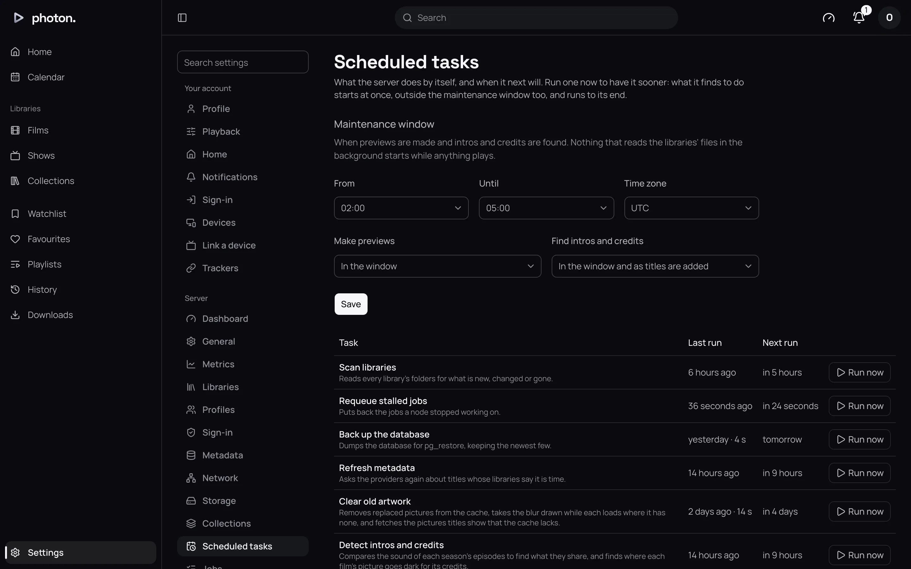

Once a library is added, photon-server keeps it in step with its folder. A **scan** is the server
reading the folder for what has changed. Three things start one:

- **The folder watch**, within about a minute of a file changing.
- **The schedule**, every 12 hours.
- **You**, or a tool such as Radarr or Sonarr, asking for one.

## Watching folders

A library's **Watch for changes** setting is **As they happen** by default. When you add, rename or
remove a file, the server waits until the folder has been quiet for a minute, then scans just that
part of the library. The wait means a film still being copied in is read once, when it is
complete.

To turn the watch off, set **Watch for changes** to **Only when scanned** in the library's
settings. The library then waits for the schedule or a scan you start.

### When the watch can't see changes

The watch relies on your computer telling the server when files change. It doesn't work for:

- **Network shares changed from another computer.** If another machine adds a file to a shared
  folder, the server's computer isn't told.
- **Very large libraries on Linux**, where the system's limit on watched folders runs out. The log
  then says "out of inotify watches".

For these, the 12-hour schedule catches up, or you can scan by hand. See **Good to know** for
raising the Linux limit.

## The scan schedule

The **Scan libraries** task scans every library every 12 hours, watched or not. You can see when it
last ran, and run it now, at Settings › Server › Scheduled tasks. See
[scheduled tasks](../07-maintain/04-tasks-and-jobs.md).



## Scan a library now

1. Open Settings › Server › Libraries.
2. Choose **Scan now** beside the library.

The button reads **Scanning…** while it works. You can also choose **Scan library files** from the
library's menu in the sidebar, or **Scan all libraries** on Settings › Server to scan every one.

> **Tip:** Radarr, Sonarr and similar tools can ask photon-server to scan just the folder they
> have added a file to, using an [API key](../04-access/06-api-keys.md). The
> [API reference](../08-reference/03-api.md) has the details.

## What a scan reads

Scans are quick when little has changed. The server skips folders and files that look exactly as
they did last time, and only reads files that are new or changed.

If a file can't be read right now, for example because a network drive hiccuped, the server skips
it this time, notes why in its log, and tries again at the next scan.

## A file that moves or goes missing

- **Renamed or moved** within the library: the title stays as it was, with everyone's progress and
  history. The server recognises the file by its contents, not its name.
- **Removed**: the title stays, marked **Missing**, and can't be played. Put the file back and the
  next scan finds it again, history and all.
- **The whole library can't be read**, for example because a drive isn't connected: the scan
  stops and nothing is changed.

This is deliberate. A disconnected drive shouldn't cost you your library.

A title whose files are all missing stays until you remove it. Where the library allows
[media deletion](02-libraries.md#media-deletion), **Delete…** on the title removes it.

## Keeping descriptions fresh

Scans read your files. Descriptions and pictures come from the online providers, and are kept
fresh separately:

- The **Refresh metadata** task runs every day at 3 in the morning, server time. It looks up again
  every title last checked longer ago than its library's **Refresh metadata** setting, which is 30
  days by default.
- A show with an upcoming episode is looked up every week, so its calendar stays current.

To refresh now, use **Refresh metadata** on a library or a title: see
[scan and refresh](02-libraries.md#scan-and-refresh) and
[refresh a title](05-fix-a-match.md#refresh-a-title).

An NFO file you edit is read at the next scan of its folder, which the watch starts within a
minute.

## Good to know

- **Raising the Linux limit.** inotify is the part of Linux that tells the server about changes.
  To let it watch more folders, run this on the computer photon-server runs on (if you use
  Docker, run it on the computer itself, not inside Docker):

  ```sh
  echo fs.inotify.max_user_watches=524288 | sudo tee /etc/sysctl.d/90-inotify.conf
  sudo sysctl --system
  ```

- **Lots of changes at once.** If the system drops change notices because too many files changed
  together, the server scans every watched library in full.
- **One scan at a time.** A library never runs two scans at once. Asking again while one is
  waiting joins it.
- **Missing previews** are kept for 30 days, in case the file comes back.
- **Anime lists.** The **Refresh the anime lists** task updates the lists that fit AniList and
  AniDB entries into seasons, once a day (see [anime](03-metadata.md#anime)).
