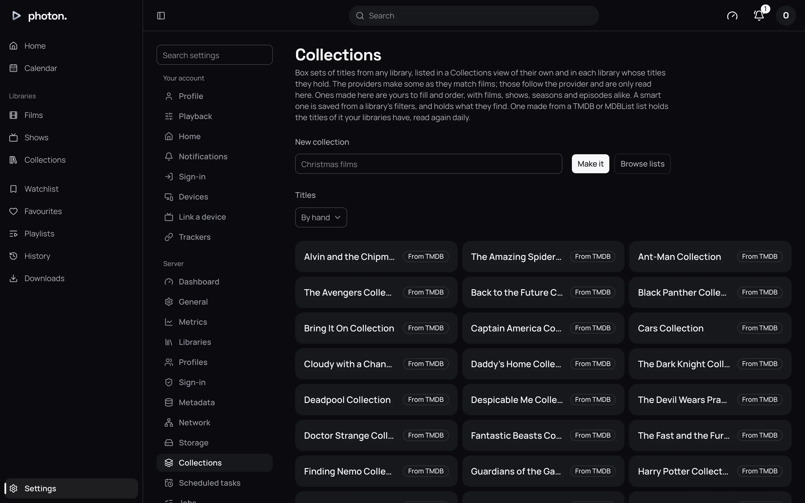
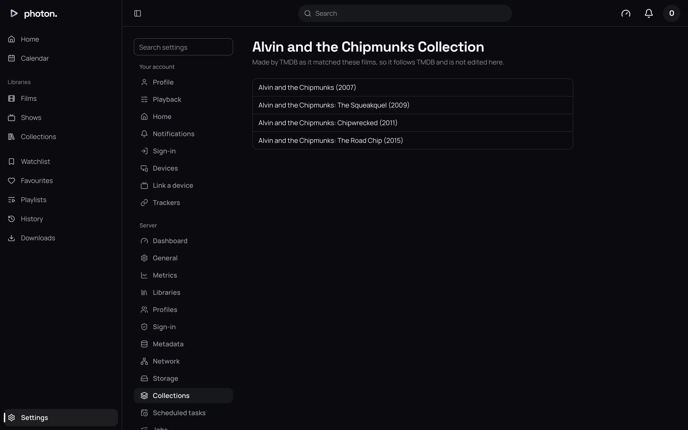
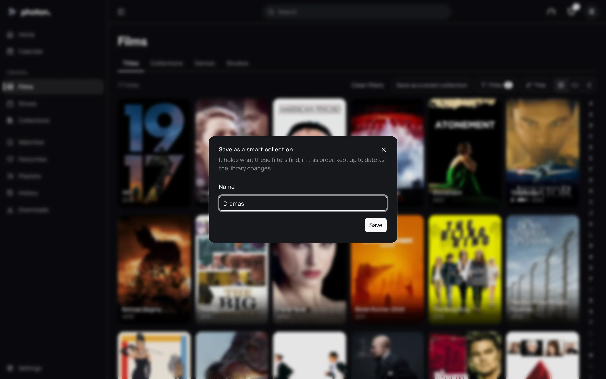
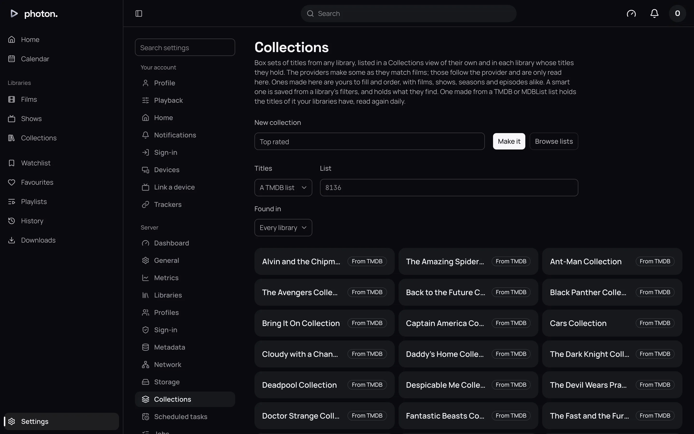
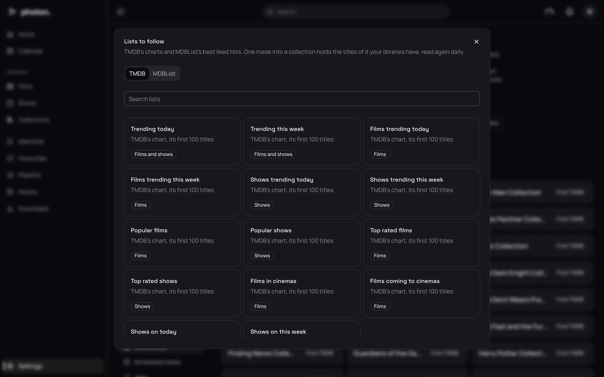

A collection is a box set of titles, such as every Bond film or your Christmas favourites. A
collection can hold titles from any of your libraries. You find collections under **Collections**
in the sidebar, and in each library that holds some of their titles.

Where a library holds two or more titles of a collection, its wall shows one tile for the
collection in their place, such as one **Harry Potter Collection** for all eight films. Filter the
library to see each title, or set its **Box sets** to **Each title on its own** (see
[libraries](02-libraries.md)).

Everyone sees only the titles of a collection they are allowed to see. A profile limited to some
libraries or age ratings finds only those titles in it.

A collection with no poster of its own uses its titles' posters: one poster, or a grid of the
first four.

## The four kinds

| Kind | Who makes it | What it holds |
| --- | --- | --- |
| From TMDB | photon-server, as it recognises your films | The films TMDB lists as part of the set, oldest first |
| Made here | You, by hand | Any films, shows, seasons or episodes, in the order you choose |
| Smart | You, from a library's filters | Whatever those filters find, updated as your library changes |
| From a list | You, from a list on TMDB, MDBList or a plugin | The titles on the list that you have, in the list's order |

All your collections are listed at Settings › Server › **Collections**, each with a badge saying
which kind it is. Choose one to open it.

## Collections from TMDB

TMDB is the online film database photon-server uses to recognise your films. When it says a film
belongs to a set, photon-server adds the film to that collection, and makes the collection if it
is new. A collection from TMDB only shows once it holds two of your films.

You cannot change which titles are in it, because it follows TMDB. You can rename it or change its
artwork, as for any title (see [fix a title's match and edit its details](05-fix-a-match.md)).

## Make a collection by hand

1. Open Settings › Server › **Collections**.
2. Type a name under **New collection**.
3. Leave **Titles** at **By hand**, and choose **Make it**. The collection's page opens.
4. Use **Add titles** to search for a film, show or episode, and choose **Add** beside each one.
5. Put them in order with the arrows. Remove one with its cross.
6. Choose **Save the order**. Nothing you added is kept until you do.

You can also add a title from its own page. Open the title's **⋯** menu and choose
**Add to collection…** under **Admin**. This is how you add a season. From here you can pick an
existing collection or make a new one.

## Save a library's filters as a smart collection

A smart collection remembers a set of filters, such as "comedies from the last two years, newest
first". It fills itself with whatever matches.

1. Open a library from the sidebar.
2. Narrow it with its filters, its sort, or both.
3. Choose **Save as a smart collection**.
4. Give it a name and choose **Save**.

photon-server checks the filters again after each scan of the library and every 15 minutes, so
new and changed titles are picked up.

To change the filters later:

1. Open the collection at Settings › Server › **Collections**.
2. Choose **Change its filters**. The library opens with those filters set.
3. Adjust them and choose **Save to the collection**.

> **Note:** A smart collection is the same for everyone, so it cannot use filters that differ
> from one profile to the next, such as watched or unwatched. When the filters you have chosen
> cannot be saved, the button does not appear.

## Follow a list

A list collection holds the titles from a list kept somewhere else, such as TMDB's top-rated
films, that you have in your libraries. photon-server reads the list again every day.

1. Open Settings › Server › **Collections**.
2. Type a name under **New collection**.
3. Set **Titles** to **A TMDB list**, **An MDBList list**, or a plugin's catalog.
4. Type the list under **List** (see below).
5. Under **Found in**, choose **Every library** or one library.
6. Choose **Make it**.

What to type under **List**:

- **TMDB**: the list's number, such as `8136`, or one of TMDB's charts, such as `movie/top_rated`
  or `trending/tv/week`. For a chart, the first 100 titles are used.
- **MDBList**: `user/list`, or the list's id. MDBList also copies lists from Trakt and IMDb. It
  needs your MDBList API key at Settings › Server › **Metadata**.
- **A plugin's catalog**: the name the plugin gives it, such as a Stremio addon's catalog (see
  [Stremio addons](../06-integrations/03-stremio.md)).

If you would rather pick than type, choose **Browse lists**. It shows TMDB's charts and popular
MDBList lists, and you can search for others. A list picked there is looked for in every library.

The collection's page says how many titles on the list you do not have. Those are counted but not
shown. To read the list again straight away, choose **Sync now** on the collection's page.

> **Tip:** If TMDB or MDBList cannot be reached, the collection stays as it was. It is never
> emptied because a website is down.

## Remove a collection

On the collection's page, choose **Remove this collection**. The titles in it stay in your
libraries. You can remove collections you made, smart collections and list collections. A
collection from TMDB cannot be removed, because it follows TMDB.

## Good to know

Two scheduled tasks keep collections up to date. You can run either straight away from Settings ›
Server › **Scheduled tasks** (see [scheduled tasks and jobs](../07-maintain/04-tasks-and-jobs.md)).

| Task | When it runs | What it does |
| --- | --- | --- |
| Refresh smart collections | Every 15 minutes, and after each library scan | Finds each smart collection's titles again |
| Sync list collections | Every day | Reads each list collection's list again |

A collection cannot hold an extra (such as a trailer) or another collection.
