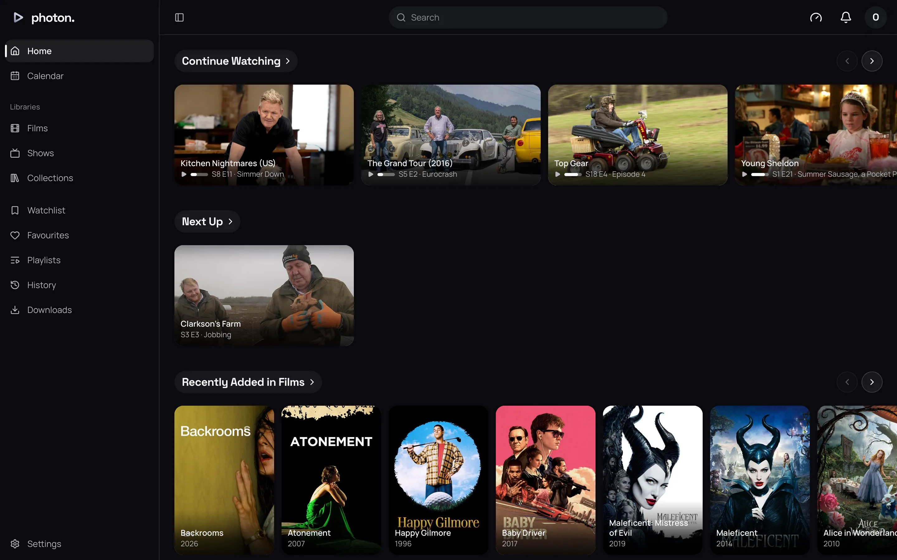
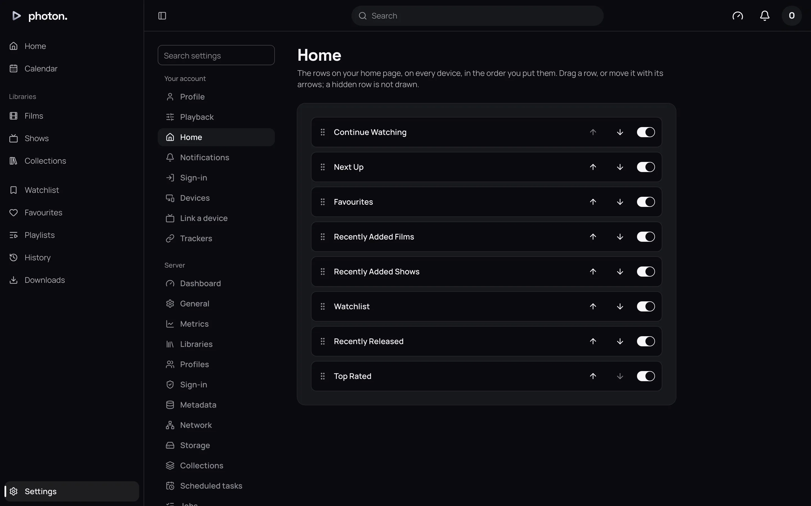

Home is the first page you see: a page of rows of titles. Each profile arranges its own Home,
choosing which rows show and in what order. The arrangement is kept on the server, so it is the
same on every device you sign in on, in the web app and in Photon.

## The rows

There are eight kinds of row. Four are about you. The other four are made once for each library
they suit, and named after it, such as "Recently Added in Films".

| Row | What it shows |
| --- | --- |
| Continue Watching | Films and episodes you stopped part way through, the most recent first |
| Next Up | For each show you are watching, the next episode, with the shows you played most recently first |
| Watchlist | What you added to your watchlist, newest first |
| Favourites | What you marked as a favourite, newest first |
| Recently Added Films | One for each library of films: the newest films |
| Recently Added Shows | One for each library of shows: shows with newly added episodes |
| Recently Released | One for each library: films released, and shows with an episode aired, in the past year |
| Top Rated | One for each library: films and shows you have not started, by their IMDb rating |

A few things are true of every row:

- Home shows 20 titles in a row. Choose the row's heading to open it on a page of its own.
- A row only shows what your profile is allowed to see.
- An episode you are part way through is in Continue Watching, so Next Up leaves it out.
- Top Rated leaves out ratings based on fewer than 1,000 votes.

## Arrange your Home

1. Open Settings › **Home**. You will see every row, in the order Home shows them.
2. Drag a row by its grip, or move it with its arrows.
3. Turn a row's switch off to hide it.

Each change is saved straight away. A new profile starts with all eight rows showing, in the
order of the table above. See [your settings](../02-web-app/06-your-settings.md) for your other
settings.

### Change the order of library rows

Library rows follow the order of your libraries in the sidebar. If you put Shows above Films, then
"Recently Added in Shows" comes before "Recently Added in Films".

1. In the sidebar, open a library's menu and choose **Reorder**.
2. Drag the libraries into the order you want.

## What an admin changes

An admin cannot arrange another profile's Home. Some admin choices still change what appears on
it:

- **Which libraries a profile can see.** A library a profile cannot open has no rows on its Home.
  Set this on the profile (see [profiles](../04-access/01-profiles.md)).
- **What a library holds.** A library of films has no Recently Added Shows row. See
  [add and manage libraries](02-libraries.md).
- **Ratings.** Top Rated uses IMDb ratings. A library whose titles have none has an empty Top
  Rated row. See [metadata providers and artwork](03-metadata.md).
- **The library's name.** Library rows are named after it.

## Good to know

- A title in two libraries shows once in your own rows, and once in each library's rows.
- If a later version of photon-server adds a new kind of row, it appears at the bottom of your
  Home, so nothing new is hidden by accident.
- Collections and playlists are not Home rows. Find collections under **Collections** in the
  sidebar (see [collections](07-collections.md)).
