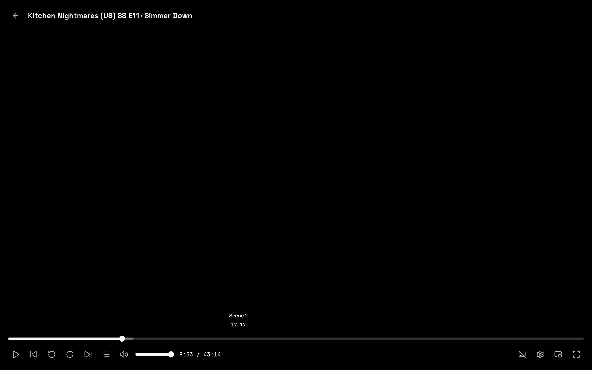
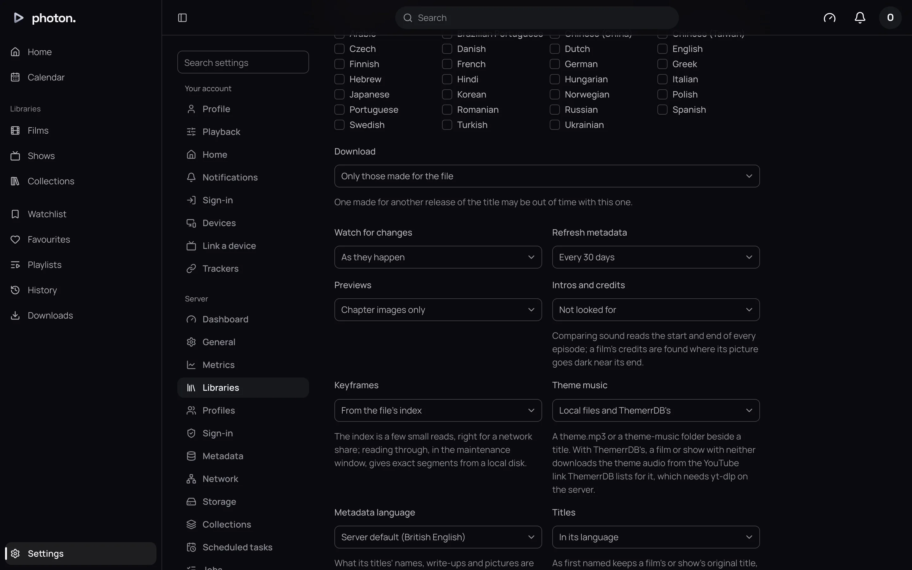
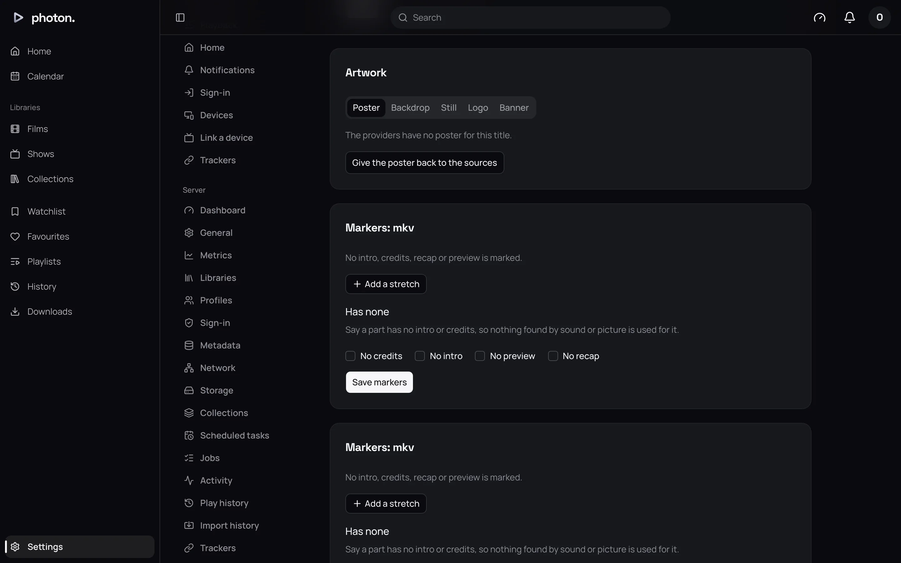
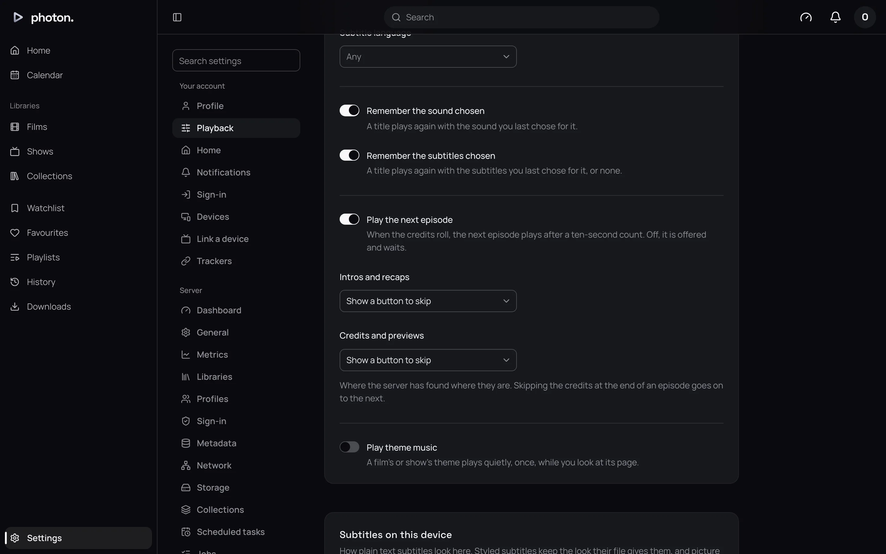
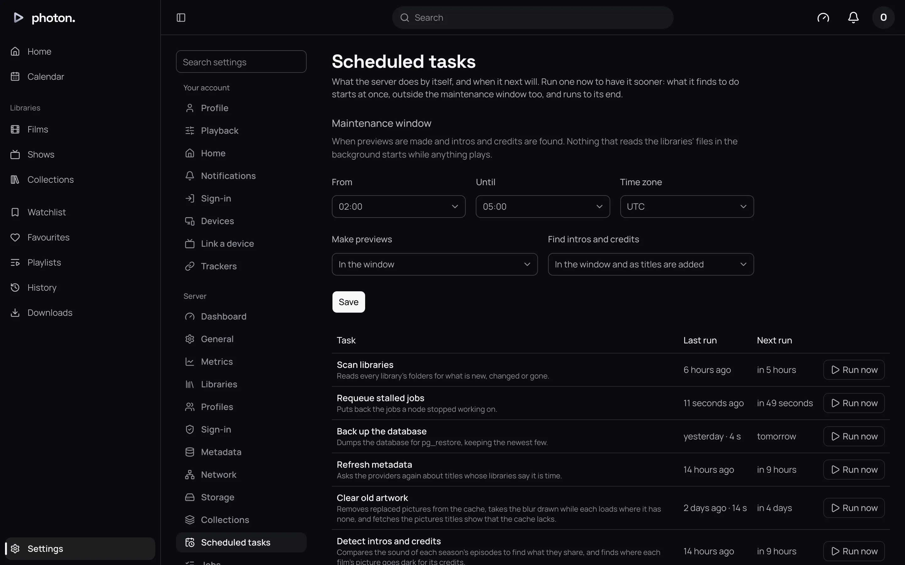

photon-server reads your files to make two things that make watching nicer.

- **Intro and credits markers.** A marker records where an intro, a recap, the credits or a
  preview of the next episode starts and ends. Markers are what make the **Skip Intro** and **Skip
  Credits** buttons appear while you watch.
- **Timeline previews.** These are the little pictures you see as you drag along the timeline, so
  you can find the scene you want. photon-server also makes a picture for each chapter.

Both are on by default for libraries of files on your server. Each library can turn them down, and
the work is done overnight.

## Choose what a library looks for

1. Open Settings › Server › **Libraries** and choose the library.
2. Open **More settings**.
3. Set **Previews** and **Intros and credits**, then save.

| Setting | What it does |
| --- | --- |
| Previews | **Chapters and seeking** (the default) makes timeline previews and a picture for each chapter. **Chapter images only** makes the chapter pictures alone. **None** makes neither, and deletes any already made. |
| Intros and credits | **From chapters, sound and picture** (the default) uses every method below. **From chapters only** uses chapter names and plugins. **Not looked for** uses only markers an admin set by hand. |

A library of titles streamed from an online service, rather than files, starts with both turned
off, because there are no files to read.

## How intros and credits are found

photon-server uses several methods. Where more than one finds a marker, it trusts them in this
order:

1. **Set by hand.** A marker an admin set always wins (see below).
2. **Chapter names.** Many files have chapters named "Intro", "Opening", "Credits", "Recap",
   "Previously" or "Next time". These are exact.
3. **Plugins.** A plugin can supply intro and credits times from an online database (see
   [plugins](../06-integrations/01-plugins.md)).
4. **Comparing sound.** For a show, photon-server compares the sound of each episode with the
   rest of its season. Sound the episodes share, near the start or the end, is the intro or the
   credits.
5. **Reading the picture.** A film has no other episodes to compare with, so photon-server looks
   near its end for dark scenes with writing on screen: the credits.

Recaps and next-episode previews only come from chapter names, plugins and markers set by hand.

> **Note:** Comparing sound needs a version of FFmpeg (the tool photon-server uses to read video)
> that includes Chromaprint. The Docker image has it. Settings › Server › **Dashboard** shows
> **Chromaprint** and whether your server has it. Without it, shows wait until it is available.

A season is compared 10 minutes after its last episode arrives, so a season added folder by
folder is compared once. When an episode is added later, the whole season is compared again.

## Correct a marker

If Skip Intro appears at the wrong moment, you can fix it.

1. Open the title, then its **⋯** menu, and choose **Edit markers** under **Admin**.
2. You will see each marker: what it is, where it **Starts** and **Ends**, and where it came from.
3. Change the times, remove a marker with its cross, or choose **Add a stretch** to add one.
4. If the title has no intro or no credits at all, tick that kind under **Has none**.
5. Choose **Save markers**.

What you set wins over every other method. To go back to what photon-server found, remove every
marker, leave **Has none** unticked, and save.

> **Important:** The page does not show what you ticked under **Has none** last time, and saving
> replaces it. Tick those again each time you save.

A title with more than one version has a markers card for each.

## Skip by itself, or show a button

Whether a player skips is each profile's choice, at Settings › **Playback**. **Intros and recaps**
and **Credits and previews** each offer **Show a button to skip** (the default), **Skip by
itself**, or **Don't offer to skip**.

Jellyfin apps connected to photon-server show the skip buttons too (see
[Jellyfin apps](../04-access/05-jellyfin-apps.md)).

## When the work is done

Reading every file takes time, so photon-server does it in the maintenance window: 02:00 to 05:00
UTC unless you change it. Nothing of this kind starts while someone is watching. Set the window at
Settings › Server › **Scheduled tasks** (see
[scheduled tasks and jobs](../07-maintain/04-tasks-and-jobs.md)).

On the same page you choose whether new titles are done straight away as well:

| Setting | What it does |
| --- | --- |
| Make previews | **In the window** (the default), or **In the window and as titles are added** |
| Find intros and credits | **In the window**, or **In the window and as titles are added** (the default) |

A change to a library's **Previews** or **Intros and credits** setting reaches its files in the
next window. To start sooner, choose **Run now** on the **Make previews** or **Detect intros and
credits** task. It runs straight away and carries on to the end.

## Good to know

- Turning a library's intro and credits setting down keeps what was found. Turn it back up and the
  markers come back without reading the files again.
- Previews of a video in HDR (a format with a wider range of brightness and colour) are adjusted so
  they look right on any screen.
- If a file goes missing, its previews are kept for 30 days, so a network drive that is down for a
  while does not mean making them all again.
- You can follow the work at Settings › Server › **Jobs**, as **Find intros and credits**, **Ask
  plugins for intros and credits** and **Make previews**.
