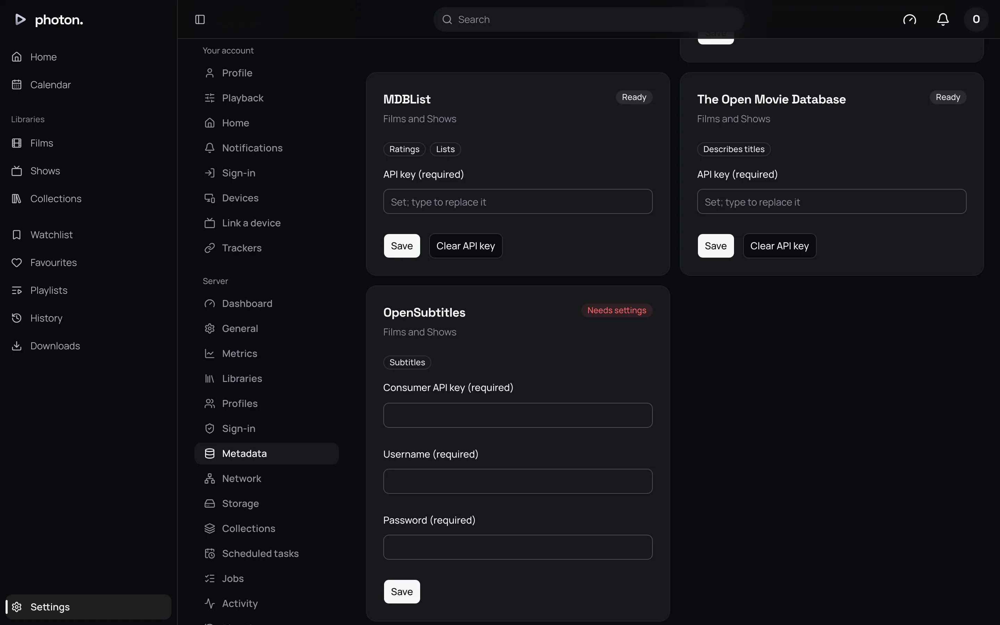
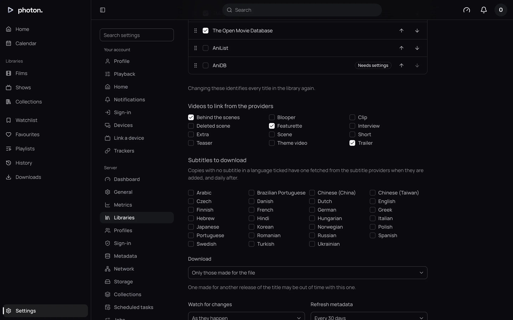

photon-server finds subtitles in two places when it scans a library: inside your video files, and
in subtitle files saved next to them. When a title has none in a language you want, it can find
one online, either when you ask or automatically for a whole library.

## Subtitles inside and beside your files

Subtitles inside a video file are found without you doing anything, along with their language and
whether they are forced (only shown for foreign-language lines) or for the hearing impaired (SDH).

A subtitle file beside a video is named after the video, with tags before the extension:

```text
Heat (1995).mkv
Heat (1995).en.srt
Heat (1995).en.sdh.srt
Heat (1995).en.forced.srt
Heat (1995).Director's Commentary.fr.default.ass
```

- **Language**: a short code (`en`, `fre`) or the English name (`English`).
- **Forced**: add `forced` or `foreign`.
- **For the hearing impaired**: add `sdh`, `cc` or `hi` beside a language. On its own, `hi` means
  Hindi.
- **Default**: add `default` to make it the one chosen first.
- Anything else becomes the subtitle's name, such as "Director's Commentary".

You can also put subtitle files in a `Subs` or `Subtitles` folder next to the video. If the title
has only one version, any subtitle file in that folder belongs to it, such as `Subs/English.srt`.

If a title has more than one version, a subtitle named after one version, such as
`Heat (1995) - 2160p.en.srt`, belongs to that version only. One named after the title belongs to
all of them.

The usual subtitle file types are read, including `.srt`, `.ass`, `.ssa`, `.vtt`, `.sup`, `.idx`
with its `.sub`, and `.smi`. See [prepare folders and name files](01-name-your-files.md) for naming
the videos themselves.

Which subtitles come on when you press play is each profile's choice, at Settings › **Playback**
(see [your settings](../02-web-app/06-your-settings.md)).

## Set up OpenSubtitles

To find subtitles online, photon-server uses OpenSubtitles.com, and any plugin that offers
subtitles (see [plugins](../06-integrations/01-plugins.md)). OpenSubtitles needs an account
and an API key of your own.

1. Sign in at [opensubtitles.com](https://www.opensubtitles.com), and create a consumer on its API
   consumers page. You will be given a key.
2. In photon-server, open Settings › Server › **Metadata** and find **OpenSubtitles**.
3. Fill in **Consumer API key**, **Username** and **Password**. All three are needed.
4. Choose **Save**. The card now says **Ready**.



> **Note:** Each download counts towards your OpenSubtitles account's daily limit. Once it is
> used up, photon-server stops downloading until the next day.

## Find a subtitle for one title

1. Open a film or an episode.
2. Open its **⋯** menu and choose **Find subtitles…**. A search starts in your subtitle language,
   or your browser's.
3. To search in another language, choose it.
4. Choose **Add** beside the subtitle you want.


Results made for your exact file come first, marked with a star. These are timed to match it. Then
come the most downloaded. Each result says whether it is for the hearing impaired (SDH) or forced.

Anyone can do this for the titles they can see. A subtitle added this way is there for every
profile.

> **Tip:** The title must be recognised first, because the search uses its IMDb or TMDB entry. If
> nothing is found, check the match (see [fix a title's match](05-fix-a-match.md)).

## Fetch missing subtitles automatically

A library can download a subtitle for every title that has none in the languages you choose.

1. Open Settings › Server › **Libraries** and choose the library.
2. Open **More settings** and find **Subtitles to download**.
3. Tick each language you want.
4. Choose what to **Download**, then save.



| Setting | What it does |
| --- | --- |
| Languages | The languages to fetch. None are ticked at first, so nothing is fetched. |
| Download | **Only those made for the file** (the default) takes only a subtitle timed for your exact file. **The best found** takes the best match of any kind, which may be slightly out of time. |

The **Download missing subtitles** task runs once a day, and after a scan adds titles, so new
titles get their subtitles the same day. It does the newest titles first. To run it straight away,
choose **Run now** on the task at Settings › Server › **Scheduled tasks**.

## Good to know

- A title only counts as having a language when it has a full subtitle in it. A forced subtitle on
  its own does not count, and forced subtitles are never fetched on their own.
- If nothing can be found for a title in a language, it is not searched for again for 7 days. Most
  subtitles are written in the first weeks after a release.
- When the daily download limit runs out, the task stops and carries on at its next run.
- Subtitle files in your library are yours. To remove one, delete or rename the file and scan the
  library again.
- Brazilian and European Portuguese, and Simplified and Traditional Chinese, are kept apart.
