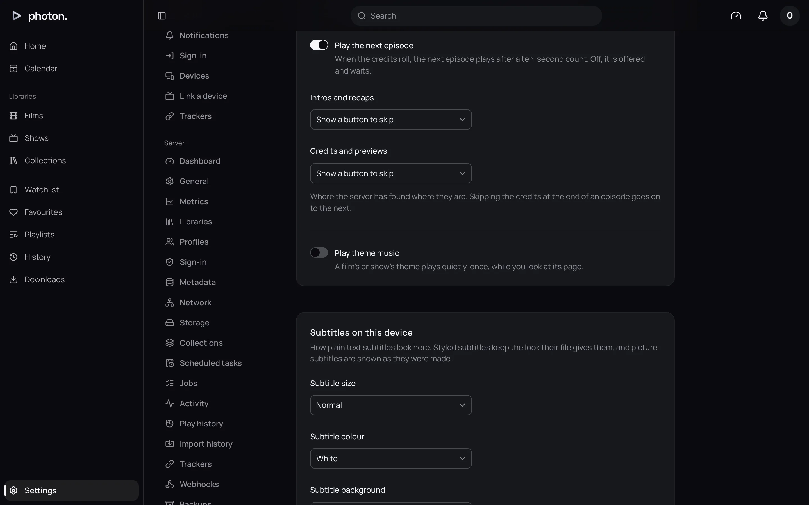
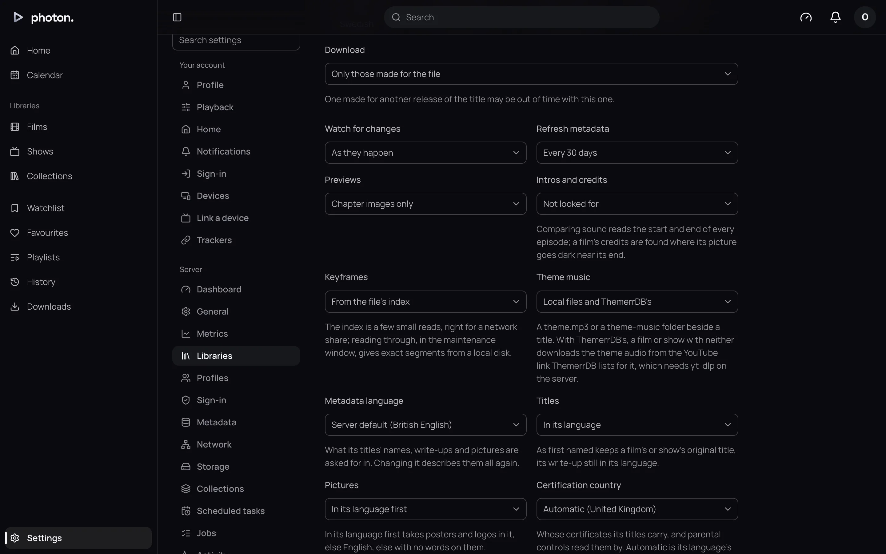

A film or show can have a theme tune that plays quietly while you look at its page. photon-server
finds theme tunes saved in the title's folder. It can also download them for you from ThemerrDB, a
community list of theme tunes.

Theme music is off until a profile turns it on.

## Turn theme music on

1. Open Settings › **Playback**.
2. Turn on **Play theme music**.



Now, when you open a film's or show's page, its theme plays once, quietly. A season's or an
episode's page plays its show's theme. This is a setting for your profile, so others on the same
server choose for themselves.

## Choose where a library's themes come from

1. Open Settings › Server › **Libraries** and choose the library.
2. Open **More settings** and find **Theme music**.
3. Choose one, then save.



| Setting | What it does |
| --- | --- |
| Theme music | **Local files only** (the default) plays theme files saved beside your titles. **Local files and ThemerrDB's** does the same, and downloads a theme for any film or show without one. **None** plays no theme music for this library. |

## Add theme files yourself

Put a sound file in the title's own folder, the film's or the show's:

- A file named `theme`, such as `theme.mp3`.
- Or any sound files in a `theme-music` folder. They play after a `theme` file, in order.

```text
Films/Heat (1995)/
  Heat (1995).mkv
  theme.mp3
Shows/Severance/
  theme-music/
    main-title.flac
    season-two.m4a
  Season 01/
```

The common sound file types work, including MP3, M4A, AAC, FLAC, Ogg, Opus, WAV and WMA. The file
is found the next time the library is scanned.

A title with its own theme file never gets one from ThemerrDB. Your file is what you chose.

## Download themes from ThemerrDB

ThemerrDB lists a YouTube link to the theme of many films and shows. With **Local files and
ThemerrDB's** chosen, photon-server looks each title up and downloads the sound from its link.

- When you choose it, photon-server looks for a theme for every film and show in the library.
- Each new title is looked up as it is added, and each title again whenever its details are
  refreshed, so themes added to ThemerrDB later are found.
- A title must be recognised first, because the lookup uses its TMDB or IMDb entry (see
  [fix a title's match](05-fix-a-match.md)).

> **Important:** Downloading needs yt-dlp, a tool that downloads from YouTube. The Docker image
> has it. Settings › Server › **Dashboard** shows **yt-dlp** and whether your server found it.
> Without it, you cannot choose ThemerrDB's.

photon-server downloads from YouTube at most once every 10 seconds, so it is not mistaken for a
bot. Filling a large library for the first time takes a while. You can follow each download at
Settings › Server › **Jobs**, as **Fetch a theme tune**.

## Good to know

- If ThemerrDB has no theme for a title, it is not asked again for a day.
- If a YouTube video cannot be downloaded (removed, private, blocked or age-restricted), it is not
  tried again for 7 days. The server log says why. If ThemerrDB replaces the link, the new one is
  tried straight away.
- A theme larger than 32 MiB is not kept.
- Downloaded themes are stored with the server's artwork (see
  [storage](../07-maintain/05-storage.md)).
- If you run several servers together, a server without yt-dlp leaves the downloads to one that
  has it (see [several servers](../05-playback/04-several-servers.md)).
