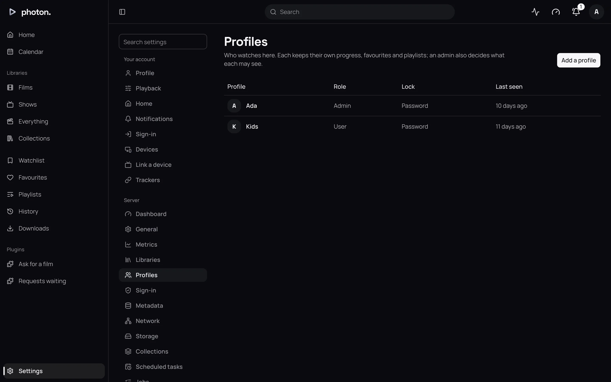
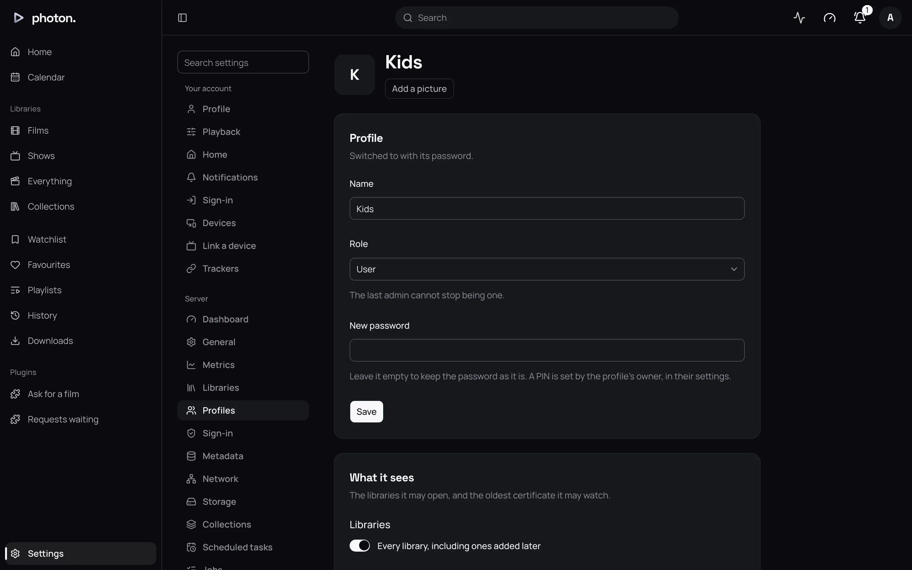

A profile is one person watching. It keeps their own progress, favourites, playlists and settings,
and it says which libraries and age ratings they may see.

The first profile is made when you [set up the server](../01-get-started/04-first-run.md), and it
is an admin. You add everyone else under Settings › Profiles.

## Roles

Every profile has one of three roles.

| Role | What it can do |
|---|---|
| Admin | Everything: the server's settings, every profile, every signed-in device, the dashboard, the activity log and API keys. |
| Manager | Adds users and looks after the ones it added: renames them, sets their passwords and pictures, chooses what they see, removes them and signs out their devices. Nothing else on the server. |
| User | Watches what it is allowed to, and changes only its own name, password, PIN, picture and settings. |

A manager can't give more than it has. A user it adds starts out seeing exactly what the manager
sees, and can only be narrowed from there.

The server always keeps at least one admin. You can't remove the last admin or change its role.

## Add a profile

1. Open Settings › Profiles and choose **Add a profile**.
2. Type a **Name**. Two profiles can't share a name, even in different capitals.
3. Choose a **Role**. A manager doesn't see this choice: it can only add users.
4. Type a **Password** of at least 8 characters.
5. Choose **Add profile**. The new profile appears in the list.

The list shows each profile's role and its **Lock**: whether switching to it asks for a PIN or a
password. An admin also sees when each profile was last seen on a device. A manager sees only the
users it looks after.

## Choose what a profile sees

Open the profile from Settings › Profiles. **What it sees** has three settings. Choose **Save
access** when you are done.

| Setting | What it does |
|---|---|
| Every library, including ones added later | On by default. Turn it off to tick only the libraries this profile may see. |
| Certificates | The highest age rating it may watch. **Any** by default, **Suitable for all**, or **Up to** 6, 7, 9, 12, 13, 15, 16, 17 or 18. |
| Titles with no certificate | **Shown** by default, or **Hidden**. Only matters when you set a certificate limit. |

Age ratings are read for the country set as **Certification country** under
Settings › Server › General.

## Change or remove a profile

On the profile's page, the **Profile** card renames it, changes its role, and sets a new password.
Leave the password empty to keep the old one.

> **Note:** Setting a password here leaves the profile's devices signed in. If you changed it
> because someone else knows it, also sign those devices out under
> [Devices](07-devices-and-playback.md).

**Remove this profile** signs out its devices, cancels any API keys it made, and forgets
everything it has watched. This can't be undone.

## Passwords

Each person changes their own password under Settings › Profile. They type their **Current
password**, then the new one twice. This signs out every other device on that profile, in case
someone else knew the old password. Its API keys keep working.

A profile made by a [sign-in service](02-single-sign-on.md) has no password at first. Its owner can
add one on the same page, leaving **Current password** empty.

After ten wrong passwords, the server makes whoever is trying wait before they can try again.

### A forgotten password

You can reset a password from a device on your home network.

1. On the login page, choose **Forgot your password?**.
2. Type the profile's name and choose **Get a code**.
3. The code is written to the server's log, not shown on screen, so only whoever runs the server
   can read it. With Docker, run `docker compose logs server` to see it.
4. Type the code and a new password within 30 minutes.

Every device on that profile is signed out.

## PINs and switching profile

On a shared device, anyone can change who is watching. Choose **Switch profile** in the profile
menu to open **Who's watching?**, then pick a profile.

- A **user** with a PIN asks for its PIN (4 to 6 digits). Each person sets their own PIN under
  Settings › Profile. A user with no PIN asks for its password.
- An **admin** or **manager** always asks for its password. That way nobody can take over the
  household's settings by guessing a few digits.

## Good to know

- Only the profile's owner can set its PIN. An admin can't.
- If an admin changes a manager's user into a manager or admin, that profile is then the admin's to
  look after. If a manager is removed, its users pass to the admin.
- After five wrong PINs or passwords on **Who's watching?**, a device must wait three minutes
  between tries.
