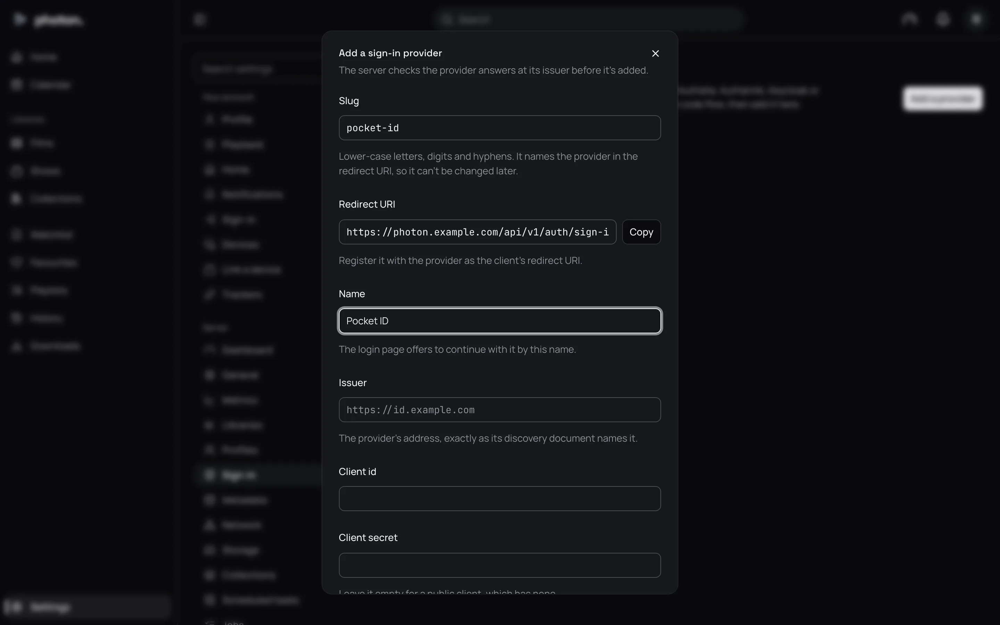

Single sign-on means people sign in to photon-server with an account they already have somewhere
else, instead of a separate password. That somewhere else is a **sign-in provider**: a service you
run for your household, such as Pocket ID, Authelia, Authentik or Keycloak. photon-server works
with any provider that speaks **OpenID Connect**, the common standard for this.

Use it when your household already signs in to your other services through one provider, and you
want one account and one place to remove someone.

When you are done, the login page shows a **Continue with** button for your provider.

## Before you start

The provider sends people back to photon-server after they sign in, so the server needs an address
the provider and your devices can both reach. Set **Public address** under
Settings › Server › Network first. See [Reach your server from outside](04-remote-access.md).

Until it is set, **Add a provider** under Settings › Server › Sign-in is greyed out.

Your provider must be reached over HTTPS (a secure address starting `https://`). The only
exception is a provider running on the same machine as the server.

## Example: Pocket ID

These steps use Pocket ID. Other providers ask for the same things under similar names.

### 1. Start adding the provider in photon-server

1. Open Settings › Server › Sign-in and choose **Add a provider**.
2. In **Slug**, type a short name for the provider, such as `pocket-id`. Use lower-case letters,
   digits and hyphens. You can't change it later.
3. A **Redirect URI** appears under it. This is the address the provider sends people back to.
   Choose **Copy**.

Leave this window open.

### 2. Register photon-server in Pocket ID

1. In Pocket ID's admin pages, add a new OIDC client, and name it Photon.
2. Paste the **Redirect URI** you copied as its callback URL.
3. If only some people should get in, choose which Pocket ID groups may use it.
4. Save it. Pocket ID shows a **client ID** and a **client secret**. Copy both now: the secret is
   shown once.

### 3. Finish in photon-server

Back in the **Add a sign-in provider** window:

1. **Name**: what the login page calls it, such as `Pocket ID`.
2. **Issuer**: Pocket ID's own address, such as `https://id.example.com`.
3. **Client id** and **Client secret**: paste what Pocket ID showed you.
4. **Who signs in**: see below.
5. Choose **Add provider**.

The server checks that it can reach the provider before it saves anything. If the issuer is
written differently from the way the provider writes it, the server tells you what to type
instead.

The provider then appears as a card under Settings › Server › Sign-in.

## The settings

| Setting | What it does |
|---|---|
| Slug | A short name used in the redirect address. Can't be changed later. |
| Redirect URI | Shown, not typed. Paste it into the provider. |
| Name | The name on the login page's **Continue with** button. |
| Issuer | The provider's address. |
| Client id | The id the provider gave photon-server. |
| Client secret | The secret the provider gave photon-server. Leave it empty if the provider gave none. When you change a provider later, leave it empty to keep the one you saved. |
| Who signs in | **Only accounts linked to a profile** (the default), or **Anyone it signs in, each given a profile**. |
| Required group | Only people in this group at the provider can sign in. Optional, unless the provider makes profiles. |
| Check back | **Every hour** (the default) or **Only as they sign in**. |

## Who signs in

**Only accounts linked to a profile.** Use this when everyone already has a profile. Each person
links their account once:

1. Sign in to the web app as usual, with your name and password.
2. Open Settings › Sign-in and choose the provider's **Link** button, such as **Link Pocket ID**.
3. Sign in at the provider. You come back to photon-server, linked.

After that, they can use **Continue with** on the login page.

**Anyone it signs in, each given a profile.** Use this to let new people in without making their
profiles yourself. The first time someone in the **Required group** signs in, they get a user
profile of their own, named after their account. You must set a group, or anyone with an account
at the provider would get in. Three more settings appear: **Every library, including ones added
later**, **Certificates** and **Titles with no certificate**. These decide what the new profiles
see, as for any [profile](01-profiles.md#choose-what-a-profile-sees).

A profile made this way has no password. Its owner can add one under Settings › Profile, leaving
**Current password** empty. To sign in to a Jellyfin app, it can also use
[Quick Connect](05-jellyfin-apps.md#quick-connect).

## Check back

This decides what happens when you remove someone at the provider.

- **Every hour**: the server asks the provider each hour whether each account may still sign in.
  If the account is gone, disabled, or has left the required group, its devices are signed out.
- **Only as they sign in**: the server checks only when someone signs in. Removing someone at the
  provider does not sign out their devices, so also sign them out under
  [Devices](07-devices-and-playback.md).

> **Important:** **Every hour** needs the provider to keep an account's sign-in alive for longer
> than your server might be switched off. Authelia keeps it for 90 minutes unless you raise it. If
> you can't change that, choose **Only as they sign in**.

## Good to know

- Sign in with the provider from the web app at the **Public address**. Starting from another
  address doesn't work, and the login page tells you which address to use.
- A sign-in that fails comes back to the login page with the reason: it took too long, the provider
  turned it down, the account isn't linked to a profile, or it isn't in the required group.
- The server asks the provider for these details: `openid`, `profile` and `email`, plus `groups`
  when you set a required group, and `offline_access` for **Every hour**. If your provider makes
  you allow each one for a client, allow these.
- A person unlinks their account under Settings › Sign-in. Their devices that signed in with it,
  and any TV they approved from one of those devices, are signed out. A profile with no password
  can't unlink its only way in: it sets a password first.
- **Remove** on a provider's card unlinks every account and signs out the devices that used it.
  Changing a provider's **Issuer** does the same.
- An account is recognised by the provider's own id for it, never by its email address, so changing
  an email at the provider doesn't change whose profile it is.
