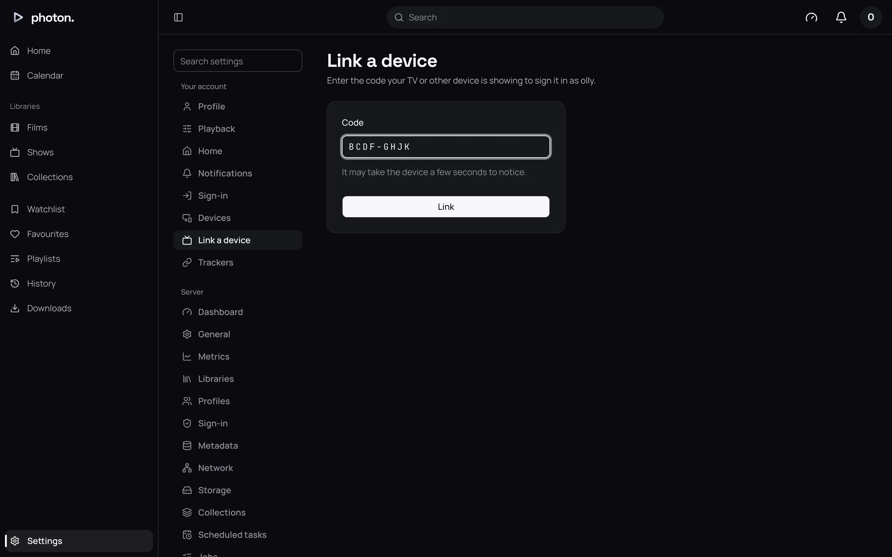

Typing a password with a TV remote is slow. So a television signs in with a code instead: it shows
a short code, you type that code on a phone or computer that is already signed in, and the
television is signed in as you.

Photon on Apple TV signs in this way. Jellyfin apps call the same thing **Quick Connect** (see
[Use Jellyfin apps](05-jellyfin-apps.md#quick-connect)).

## Sign in a television

1. On the television, choose to sign in with a code. It shows a code such as `BCDF-GHJK`, and an
   address to enter it at. It may also show a QR code.
2. On your phone or computer, sign in as the person the television should watch as.
3. Open Settings › Link a device. You can also go to the address the television shows, or scan its
   QR code, which fills in the code for you.
4. Type the code into **Code** and choose **Link**. The page says which device was signed in.

The television notices within a few seconds and finishes signing in.

You can also open **Link a device** from the profile menu.

## Whose profile it uses

The television signs in as whoever approved it. To sign it in as someone else, approve the code
from a device signed in as them. Or sign it in as yourself and
[switch profile](01-profiles.md#pins-and-switching-profile) on the television afterwards.

## The code

- It is eight letters, such as `BCDF-GHJK`. It has no vowels, so it never spells a word, and no
  letters that look alike on a screen.
- Capitals, dashes and spaces don't matter as you type it.
- It lasts **10 minutes**. After that, the television asks for a new one.
- It works once.

## The address the television shows

The television shows the server's **Public address**, set under Settings › Server › Network. That
way a phone that isn't on your home Wi-Fi can still reach it. If no public address is set, it shows
the address the television itself used. See [Reach your server from outside](04-remote-access.md).

## Signing a television out

A television appears under Settings › Devices with every other device, and you sign it out there.
Otherwise it stays signed in, unless it goes unused for 90 days. See
[Signed-in devices](07-devices-and-playback.md).

## Good to know

- If you approved the television from a device that signed in through a
  [sign-in service](02-single-sign-on.md), the television is signed out when that account is
  unlinked or removed at the service.
- Too many wrong codes in a row make you wait a few seconds between tries, so codes can't be
  guessed.
- Building your own TV app? Pairing is described in the [API reference](../08-reference/03-api.md).
