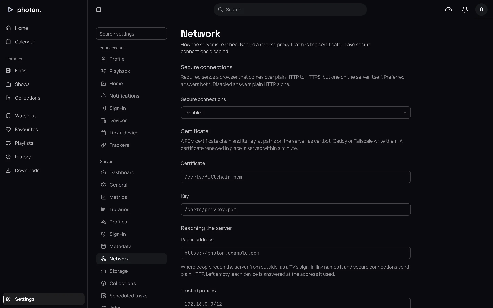

At home, apps reach photon-server at its own address on port 8640, such as
`http://192.168.1.10:8640`. To watch away from home, the server needs an address the internet can
reach, and it should be a secure one.

A secure address starts `https://`. **HTTPS** means everything between the device and the server
is encrypted, so passwords and what you watch can't be read on the way. HTTPS needs a
**certificate**: a small file that proves the address belongs to you. You get one free from
services such as Let's Encrypt.

There are two ways to set this up:

- **The server serves HTTPS itself.** You give it a certificate. Choose this if photon-server is
  the only thing you expose.
- **A reverse proxy serves HTTPS.** A reverse proxy is a program such as Caddy, nginx or Traefik
  that sits in front of your services, holds the certificate, and passes visits on to them. Choose
  this if you already run one.

Everything on this page is under Settings › Server › Network. Choose **Save** at the foot of the
page after a change. It takes effect at once, with nothing to restart.

## The settings

| Setting | What it does |
|---|---|
| Secure connections | **Disabled** (the default), **Preferred** or **Required**. Whether the server itself serves HTTPS. |
| Certificate | Where the certificate file is on the server. Needed for Preferred and Required. |
| Key | Where the certificate's private key file is on the server. |
| Public address | The address people use to reach the server from outside, such as `https://photon.example.com`. Empty by default. |
| Trusted proxies | The address of your reverse proxy, if you use one. Empty by default. |
| Discovery | **On** by default. Lets apps on your home network find the server by themselves. |
| Jellyfin apps | Lets apps made for Jellyfin sign in. See [Use Jellyfin apps](05-jellyfin-apps.md). |
| Local networks | Which networks count as home. Empty by default, meaning every private home network. |
| Limit (Mbps) | The most a stream to a device away from home may use. 0 by default, meaning no limit. |

## Serve HTTPS from the server

1. Get a certificate for the server's address. Tools such as certbot, Caddy and Tailscale make the
   two files you need: the certificate and its key.
2. Put both files where the server can read them. With Docker, mount them into the container.
3. Under Settings › Server › Network, type their paths in **Certificate** and **Key**.
4. Set **Secure connections** to **Preferred** or **Required**, and choose **Save**.

If the server can't read the files, it tells you and saves nothing.

What the three choices mean:

- **Disabled**: plain `http://` only.
- **Preferred**: both `https://` and `http://` work, on the same port.
- **Required**: a browser that arrives on `http://` is sent to `https://` at your **Public
  address**. Scripts on the server's own machine can still use `http://`.

> **Tip:** When your certificate is renewed, the server picks up the new one within a minute. You
> don't need to restart anything.

## Serve HTTPS behind a reverse proxy

1. Set up the server first, from its own address on your home network. First-time setup only works
   from there, not through a proxy.
2. Leave **Secure connections** at **Disabled**. The proxy handles HTTPS.
3. Point the proxy at the server's port 8640. Make sure it passes WebSocket connections through:
   the web app keeps one open to update pages live.
4. Have the proxy send the `X-Forwarded-For` and `X-Forwarded-Proto` headers. These tell the server
   who the visitor really is and whether they came over HTTPS.
5. Add the proxy's address to **Trusted proxies**. If the proxy runs in Docker, `172.16.0.0/12`
   covers Docker's usual networks.

> **Important:** Without step 5, every visitor looks to the server as though they were the proxy.
> If the proxy is on your home network, everyone counts as at home, and the remote limit below never
> applies.

## The public address

**Public address** is the address people use to reach the web app from outside your home. Fill it
in once you have one. The server uses it:

- as the address a television shows when you [sign it in with a code](03-pair-a-tv.md), so you can
  approve it from a phone that isn't on your Wi-Fi;
- for [single sign-on](02-single-sign-on.md), which needs it;
- to send browsers from `http://` to `https://` when **Secure connections** is **Required**.

## Home networks and the remote limit

The server treats a device as **at home** when it is on one of your **Local networks**. Left
empty, every private home network counts, such as addresses starting `192.168.` or `10.`.

Being at home matters in three places:

- **Limit (Mbps)** applies only to devices away from home. A video above the limit is converted to
  fit as it plays, so watching away from home doesn't use all your upload speed. The picture keeps
  the size the app asked for. See [transcoding](../05-playback/01-transcoding.md).
- A forgotten password can only be [reset](01-profiles.md#a-forgotten-password) from home.
- [First-time setup](../01-get-started/04-first-run.md) only works from home.

> **Tip:** Tailscale addresses (starting `100.`) don't count as home on their own. To treat your
> tailnet as home, add `100.64.0.0/10` to **Local networks**, and add your home network beside it,
> such as `192.168.1.0/24`. Once you list any network, only the ones you list count.

## Good to know

- **Discovery** helps Photon find the server on your home network. It doesn't work with the
  standard Docker setup in [Install with Docker](../01-get-started/02-install-docker.md), so type
  the server's address into the app instead.
- If the certificate file changes while it is being written, the server keeps using the old one
  until the new one is complete.
- The server only believes a device's address from **Trusted proxies**, so nobody can pretend to
  be at home by sending the header themselves.
