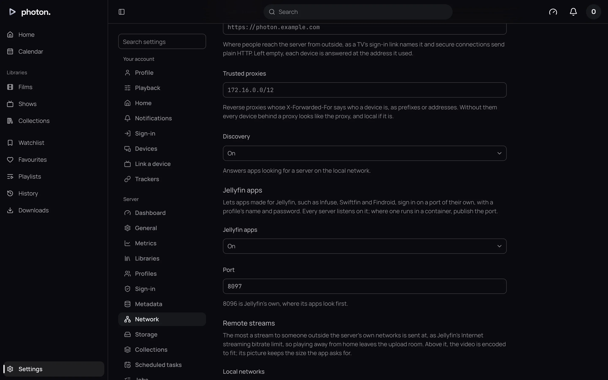

photon-server can pretend to be a Jellyfin server, so apps made for Jellyfin can use it too:
Infuse, Swiftfin, Findroid, Jellyfin's own apps, and the Jellyfin apps for LG and Samsung TVs.

It is still the same server underneath. People sign in with the same profiles, see the same
libraries, and keep the same progress, favourites and playlists, whichever app they use.

## Turn it on

1. Open Settings › Server › Network.
2. Under **Jellyfin apps**, set **Jellyfin apps** to **On**. It is off by default.
3. Leave **Port** at 8096. That is Jellyfin's usual port, and where its apps look first. You can
   choose another, but not 8640, which photon-server already uses.
4. Choose **Save**.



If another program is already using the port, the page says so under **Port**. The server keeps
trying every minute.

### With Docker

Docker also has to open the port. In `compose.yml`, add it beside 8640 under `server:`:

```yaml
    ports: ["8640:8640", "8096:8096"]
```

Then run `docker compose up -d` again.

## Add the server in an app

1. In the Jellyfin app, choose to add a server.
2. Type the address yourself, such as `http://192.168.1.10:8096`. Use `https://` if the server has
   a certificate (see [Reach your server from outside](04-remote-access.md)). Jellyfin apps can't
   find photon-server on the network by themselves.
3. Sign in with a profile's name and password.

The app shows the server under its **Name** from Settings › Server › General. It asks for a name
and password rather than showing a row of faces, because the server doesn't list its profiles to
anyone who asks.

You can also open the port's address in a web browser to use Jellyfin's own web app.

## Quick Connect

Quick Connect is Jellyfin's way of [signing in with a code](03-pair-a-tv.md). It is always on.

1. In the app, choose to sign in with Quick Connect. It shows a six-digit code.
2. On a device that is already signed in, open Settings › Link a device in the web app.
3. Type the code and choose **Link**.

The app signs in as whoever approved it.

> **Tip:** A profile made by a [sign-in service](02-single-sign-on.md) has no password at first.
> Quick Connect is how it signs in to a Jellyfin app.

## What playing is like

Titles play the same way they do in Photon. When the app can play a file as it is, the server sends
it unchanged. When it can't, the server converts it as it plays (this is called transcoding). The
app starts with the sound and subtitles it asked for.

Things you might notice:

- **A title that fails to start, then plays.** Some TVs say they can play a file and then can't.
  Jellyfin's web app then asks again, and the server converts the file instead. On the dashboard,
  the play shows **Playback failed** as the reason it was converted.
- **Subtitles.** Styled and picture subtitles are shown by the app itself, as Jellyfin shows them.
  A subtitle the app can't show at all is drawn into the picture instead (this is called burning
  in).
- **Links saved as `.strm` files** play in Infuse too.

The remote speed limit under Settings › Server › Network applies to Jellyfin apps away from home,
as it does to Photon.

## What a Jellyfin app can do

A Jellyfin app can browse, search, play, download a title's file, mark titles watched and
favourite, and keep playlists. It shows chapters, scrubbing previews, intro and credits skipping,
and theme music.

Some parts of Jellyfin are left out on purpose:

- **No profile is a Jellyfin admin**, not even an admin. Jellyfin's dashboard isn't there: you run
  the server from photon-server's own web app.
- **Live TV, SyncPlay, sharing and deleting** are turned off, so the apps don't offer them.
- **Intros** (trailers before a film) are never played.

## Signing a Jellyfin app out

A Jellyfin app appears under Settings › Devices with every other device, by the name it gave.
Sign it out there, or from the app itself. See [Signed-in devices](07-devices-and-playback.md).

## Good to know

- With a certificate set, the Jellyfin port serves `https://` too, with the same certificate.
  **Required** only redirects photon-server's own port: the Jellyfin port still answers `http://`.
- Behind a reverse proxy, give the Jellyfin port its own site. **Trusted proxies** applies to it as
  well.
- Wrong passwords in a Jellyfin app count towards the same limits as in the web app, and appear in
  the [activity log](07-devices-and-playback.md#the-activity-log).
