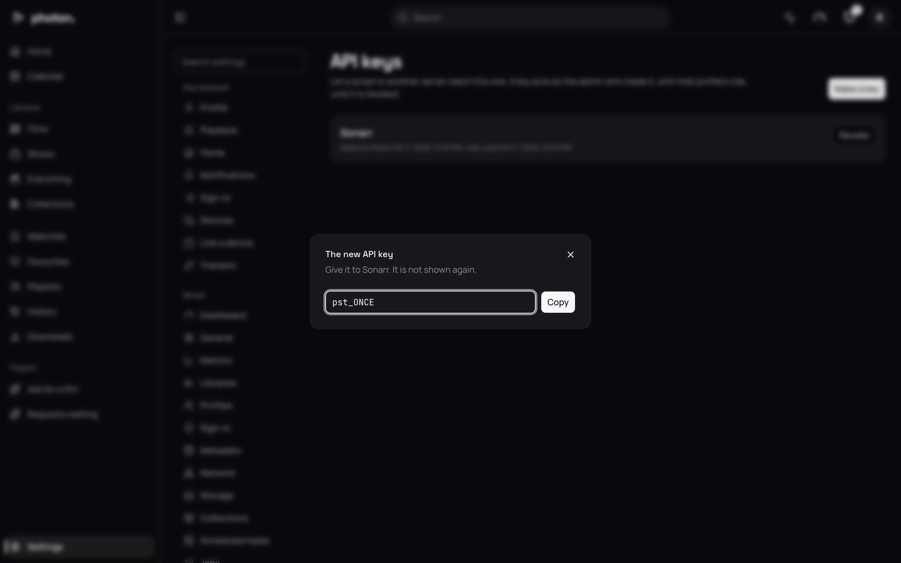

An API key lets a script or another program talk to photon-server without signing in. Use one for a
program such as Sonarr, a home automation, or a script of your own.

Only an admin can make, see and cancel keys, under Settings › Server › API keys.

## Make a key

1. Open Settings › Server › API keys and choose **Make a key**.
2. In **What it is for**, type something that reminds you where it is used, such as `Sonarr`.
3. Choose **Make key**.
4. Copy the key it shows, and paste it into the other program.

> **Important:** The key is shown only once. The server doesn't keep a readable copy, so if you lose
> it, make a new one.

Every key starts `pst_`. That makes it easy for tools that look for leaked passwords to spot one.

## What a key can do

- A key can do whatever the admin who made it can do. If that profile later stops being an admin,
  the key can only do what the profile can do now.
- A key never runs out by itself. It works until you cancel it, or until the profile that made it
  is removed.
- Changing your password doesn't stop your keys working.

For how a program sends the key, and everything it can ask the server, see the
[API reference](../08-reference/03-api.md).

## See and cancel keys

Settings › Server › API keys lists every key: what it is for, which admin made it, when, and when it
was last used. Last used is updated at most once an hour, so it may be up to an hour behind.

To cancel a key, choose **Revoke** on its row, then **Revoke key**. Anything using it stops working
at once.

## Good to know

- An API key isn't a device, so it isn't listed under Settings › Devices.
- A plugin that talks to the server uses a key you made for it. Removing the plugin doesn't cancel
  that key: revoke it here.
