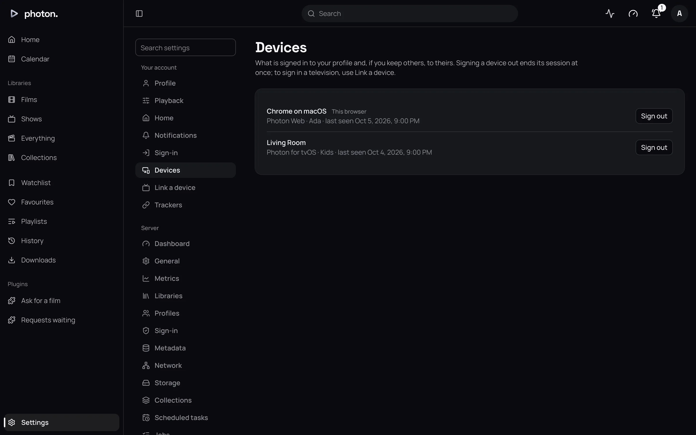
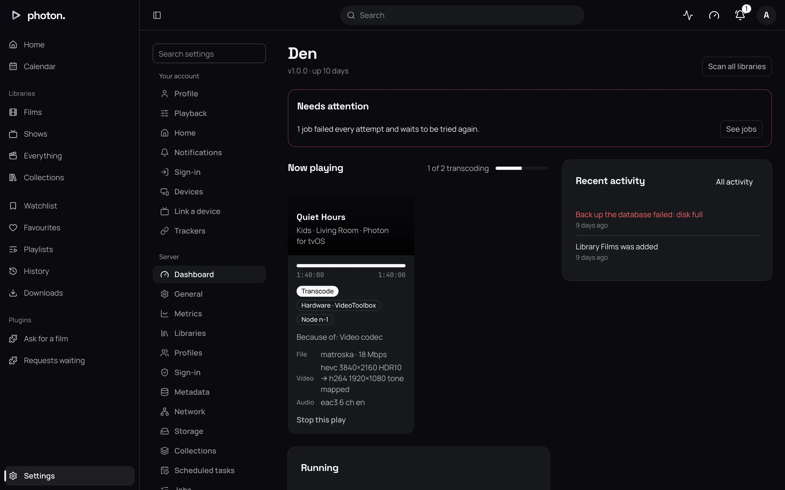
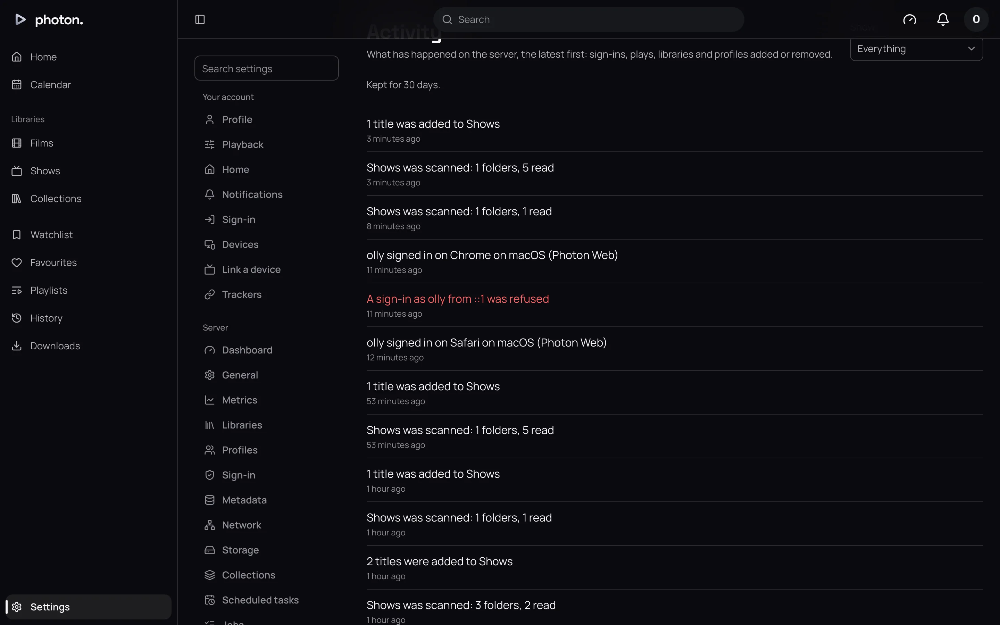

Every phone, browser, television and Jellyfin app that signs in stays signed in on its own. So you
can sign out one device without touching the others.

An admin can also see who is watching what right now, stop a play, and read a log of sign-ins,
plays and changes to the server.

## Signed-in devices

Settings › Devices lists the devices signed in, most recently used first. What you see depends on
your role:

- a **user** sees its own devices;
- a **manager** sees its own, and those of the users it looks after;
- an **admin** sees every device on the server.

Each row shows the device's name, its app, the profile it is signed in as, and when it was last
used. The device you are using now is marked **This browser**.

**Sign out** on a row signs that device out at once. Next time it is used, it asks to sign in
again. Signing out **This browser** logs you out.

### When a device is signed out for you

A device stays signed in until it goes unused for **90 days**. It is also signed out when:

- its profile changes its own password (every other device on the profile is signed out);
- its profile's password is [reset](01-profiles.md#a-forgotten-password);
- its profile is removed;
- it signed in through a [sign-in service](02-single-sign-on.md), and the account is unlinked or
  removed there.

> **Note:** When an admin sets someone's password under Settings › Profiles, their devices stay
> signed in. Sign them out here if that is what you want.

## What is playing now

Settings › Server › Dashboard shows an admin **Now playing**: a card for each play happening on the
server, updated as it goes.

Each card shows:

- the title, who is watching, and on which device and app;
- how far through they are, and whether it is paused;
- how it is playing:
  - **Direct play**: the file is sent as it is;
  - **Direct stream**: the file is repackaged for the device but not converted;
  - **Transcode**: the file is converted as it plays, which takes the most work;
- for anything but direct play, why, such as "Because of: Audio codec, Bitrate";
- the file's picture, sound and subtitles, and what each is converted into.

Beside **Now playing**, the dashboard shows how many videos the server is converting right now.

If a device stops checking in for two minutes, for example because it lost its connection, the
server ends the play by itself.

### Stop a play

**Stop this play**, on a card, stops it on that device. The person's place is kept, so they can
carry on from there later.

Stopping a play doesn't sign the device out. To keep someone from starting again, sign out their
device above, or change what their profile may see under [Profiles](01-profiles.md).

## The activity log

Settings › Server › Activity lists what has happened on the server, newest first, as it happens.
Use **Show** to see only one kind:

- plays started and stopped;
- sign-ins, and sign-ins that were refused;
- profiles added and removed;
- libraries added, removed and scanned, and titles added;
- failed tasks, backups made, and jobs that were given up on.

A sign-in, or a failed one, records the name typed, the device, the app and where it came from.
It never records a password.

Entries are kept for 30 days.

> **Tip:** To be told about these as they happen, in Discord or another app, set up a
> [webhook](../06-integrations/05-webhooks.md).

## Good to know

- API keys aren't devices. They are listed under [API keys](06-api-keys.md).
- A device's last-used time is updated at most once an hour.
- A television approved from a device that signed in through a sign-in service is signed out along
  with that account.
- See [Transcoding](../05-playback/01-transcoding.md) for more on how titles play.
