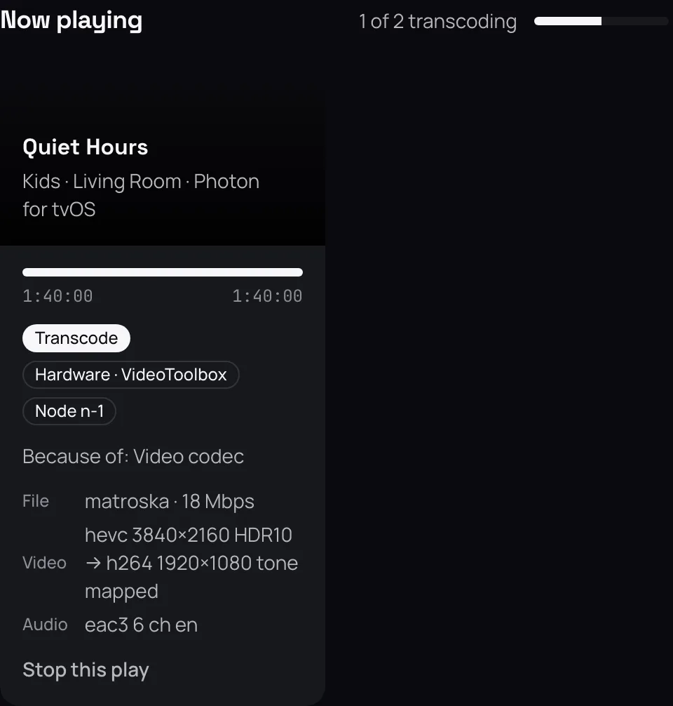
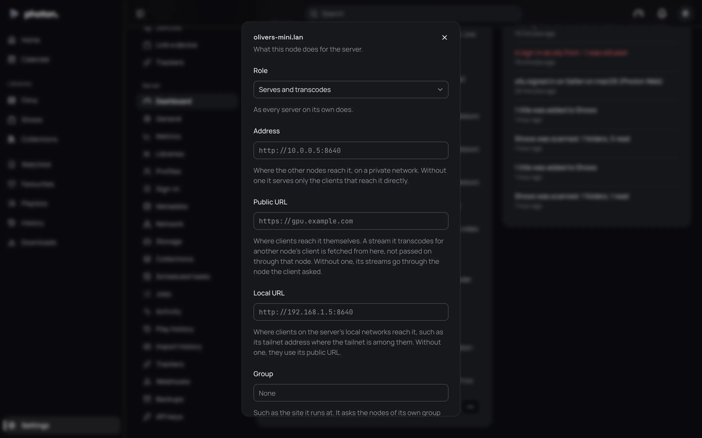

Most films play as they are. Sometimes the app you are watching on can't play a file, or the file is bigger than the quality you chose. Then photon-server converts the film as it plays, into something the app can show. This is called **transcoding**.

Transcoding is not a fault. The film still plays. But it costs the server a lot of work, and with no graphics card it can only do a few at once. This page explains why it happens, what it uses, and how to make it happen less.

## See why a film is being converted

1. Open Settings › Server › Dashboard while the film plays.
2. Find it under **Now playing**. It says **Direct play**, **Direct stream** or **Transcode**.
3. Under a transcode, **Because of:** lists the reasons.

| Reason | What it means |
|---|---|
| Container | The app can't open this kind of file. |
| Video codec | The app can't play the way the picture is stored. |
| Video profile | The app can't play this variety of the picture's format. |
| Video level | The picture is more demanding than the app plays. |
| Resolution | The picture is larger than the app plays. |
| Bit depth | The picture has more shades of colour than the app plays. |
| HDR | The screen doesn't show the film's HDR. See [HDR and Dolby Vision](02-hdr.md). |
| Audio codec | The app can't play the way the sound is stored. |
| Audio channels | The sound has more speakers than the app plays. |
| Bitrate | The file is above the quality chosen. |
| Subtitles | The subtitles are pictures, or styled text, the app can't draw, so they are drawn into the video. |
| Several files | The film is split across several files, played as one. |
| Playback failed | The app tried the file as it is, and it failed. |

Some reasons need only light work. A different kind of file, sound the app can't play, or several files, on their own, are handled as **Direct stream**: the picture is sent unchanged and only the sound is converted. Reasons about the picture, the bitrate or subtitles drawn in make it a full transcode.

## Make it happen less

- **Use a graphics card.** The server converts much faster, and many more at once, on a graphics card than on the processor alone. See [what the server converts on](#what-the-server-converts-on).
- **Raise the quality.** If the reason is **Bitrate**, the person watching has a quality limit below the file. They can change it in Settings › Playback › **Quality**, or in the player's own quality menu. Away from home, the server's limit for remote streams may also apply; see [Cap the quality](#cap-the-quality).
- **Use an app that plays more.** Photon on Apple devices plays most files as they are. A web browser plays far fewer, so the web app is converted for more often.
- **Choose text subtitles.** Picture subtitles (from Blu-rays and DVDs) force a transcode on apps that can't draw them. Where a film has text subtitles in the same language, choose those. The web app draws picture subtitles itself where the browser can.

## What the server converts on

When it starts, each server tries the graphics hardware it has, in this order, and takes the first that works:

1. Apple's own, on a Mac (VideoToolbox).
2. An NVIDIA graphics card (NVENC).
3. On Linux, Intel's (Quick Sync), then Intel or AMD through VA-API.
4. On Windows, Intel's (Quick Sync), then AMD's (AMF).

It tests each one by converting a test picture, so a missing driver is found at start, not at the first film. If nothing works, it converts on the processor (**Software**).

Settings › Server › Dashboard shows the choice in the **Server** card, as **Encoder**, such as "VA-API, /dev/dri/renderD128, HEVC and H.264". If it says "H.264 only", the hardware can't make the newer, smaller format (HEVC), so everything is converted to the older one (H.264).

> **Important:** In Docker, the graphics card must be passed into the container, or the server can't see it. See [install with Docker](../01-get-started/02-install-docker.md#hardware-transcoding).

### Choose it yourself

If the server picked the wrong one, such as when you have two graphics cards:

1. Open Settings › Server › Dashboard.
2. In the **Server** card, open the server's actions menu (**…**) and choose **Settings…**.
3. Set **Encoder** to the one you want: Automatic, Software, VideoToolbox, VA-API, Quick Sync, NVENC or AMF.
4. For VA-API or Quick Sync, give the device, such as `/dev/dri/renderD129`. For NVENC, give the card's number, such as `1` for the second card. Leave it empty for the first.
5. Choose **Save**. The server tests it straight away.

The next film converted uses it. A film already being converted carries on as it began. If the one you chose fails its test, the server uses the first that works, and says so in its log.

## How many at once

In the same **Settings…** dialog, **Transcodes at once** is one of:

| Setting | What it does |
|---|---|
| Worked out from its encoder | The default. On the processor, one transcode for every four processor threads, and at least one. On a graphics card, 8. |
| At most | The number you give. |
| No limit | As many as are asked for. |

When every slot is in use, a film that needs converting is turned away with a message saying the server is busy. Lowering the limit never stops a film already playing.

A download being converted also uses a slot, but gives it up to anyone who wants to watch (see [downloads](03-downloads.md)). The dashboard's **Now playing** heading shows this, such as "3 of 8 transcoding · 1 for downloads".

> **Note:** The server also needs 2 GB free in its cache folder to start a transcode, because it writes the converted video there as it plays.

## Cap the quality

Two limits decide the most a film may be sent at. The lower one wins.

| Setting | What it does |
|---|---|
| Settings › Playback › **Quality** | Each person's own. Original (the file as it is, the default), or a limit from 40 Mbps down to 420 kbps. Above it, the film is converted down. The player's quality menu changes it for one film. |
| Settings › Server › Network › **Remote streams** › **Limit (Mbps)** | For anyone watching from outside your home network, so streams away from home don't use up your upload. `0` means no limit, the default. |

Which networks count as home is set in **Local networks** on the same page; see [remote access](../04-access/04-remote-access.md).

## Good to know

- Converted video is HEVC where the app plays it and the hardware makes it, otherwise H.264. The picture keeps its size unless the app asks for smaller.
- Sound is converted only when the app can't play it. Surround sound mixed down to stereo is made a little louder, so speech isn't lost.
- HDR is kept where the screen shows it, and turned into ordinary picture otherwise; see [HDR and Dolby Vision](02-hdr.md).
- Styled subtitles can only be drawn into the picture if the server's FFmpeg has libass. The dashboard's **Server** card says whether it is available.
- With several servers, a film is converted on whichever has a slot free; see [several servers](04-several-servers.md).
