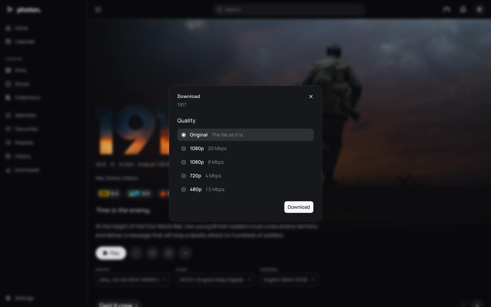
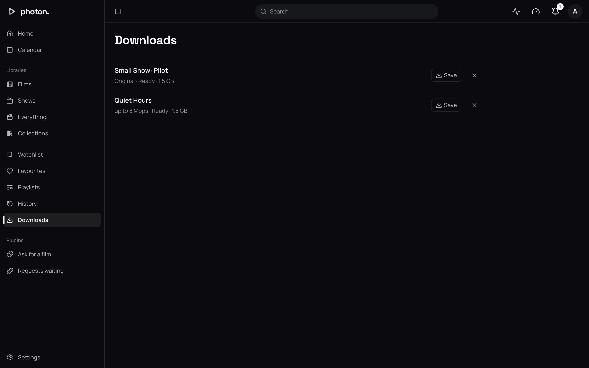

Anyone signed in can download a film or an episode to watch later on a device. You can take the file as it is, or ask the server to make a smaller version for a phone or a slow connection.

## Download a title

1. Open the menu of a film or an episode and choose **Download…**.
2. Under **Quality**, choose how big it may be.
3. If the title is split across several files, choose all of them or one under **Files**. Each file is a download of its own.
4. Choose **Download**. It appears under **Downloads** in the sidebar.

| Quality | What you get |
|---|---|
| Original | The file as it is. |
| 1080p, 20 Mbps | No wider than 1920 pixels, at most 20 Mbps. |
| 1080p, 8 Mbps | No wider than 1920 pixels, at most 8 Mbps. |
| 720p, 4 Mbps | No wider than 1280 pixels, at most 4 Mbps. |
| 480p, 1.5 Mbps | No wider than 854 pixels, at most 1.5 Mbps. |

## Fetch it

The **Downloads** page lists each download with its state: **Waiting**, **Converting** (with a progress bar), **Ready**, or **Failed** with the reason.

1. Open **Downloads** in the sidebar.
2. When a download is ready, choose **Save**. Your browser saves the file.
3. To remove a download, choose the cross beside it.

Removing a download only forgets it on the server. A file you have already saved stays on your device.

## The file as it is, or a smaller one

If the file is already within the quality you chose, you get it as it is. It is ready at once and costs the server nothing.

Otherwise, the server converts it into a single MP4 file. Downloads from the web app come out in the older, widely supported H.264 format, as an ordinary (SDR) picture. Photon can ask for the newer HEVC format, which keeps HDR where the device shows it.

If several people ask for the same film at the same quality, the server converts it once and they share it.

## How the server fits conversions in

- It converts one download at a time, so films being watched never go short.
- A conversion uses one of the server's [transcode slots](01-transcoding.md#how-many-at-once), but only while nobody watching needs it. If someone starts a film that needs the slot, the conversion stops, and starts again from the beginning when a slot is free.
- Conversions don't wait for the night or for nothing to be playing. Someone is waiting for each one.
- You can follow each one on Settings › Server › Jobs, as **Convert for download**.

> **Note:** If a conversion makes no progress for 5 minutes, such as when a network drive stops responding, it fails. A failed download is not tried again until someone asks for it again.

## How long downloads are kept

The server keeps a download ready for **7 days** after it finishes, or after it fails. That gives a device that is away or switched off time to fetch it. After that it is forgotten and its file removed, unless someone removed it sooner.

## Good to know

- If the server doesn't know a file's quality, it treats it as 40 Mbps, so it is sent as it is only at Original.
- The link to a ready download works for 24 hours at a time, and a download manager can resume it if it is interrupted.
- With several servers, a converted file is kept on the server that made it. If that server is switched off, the file can't be fetched until it is back.
