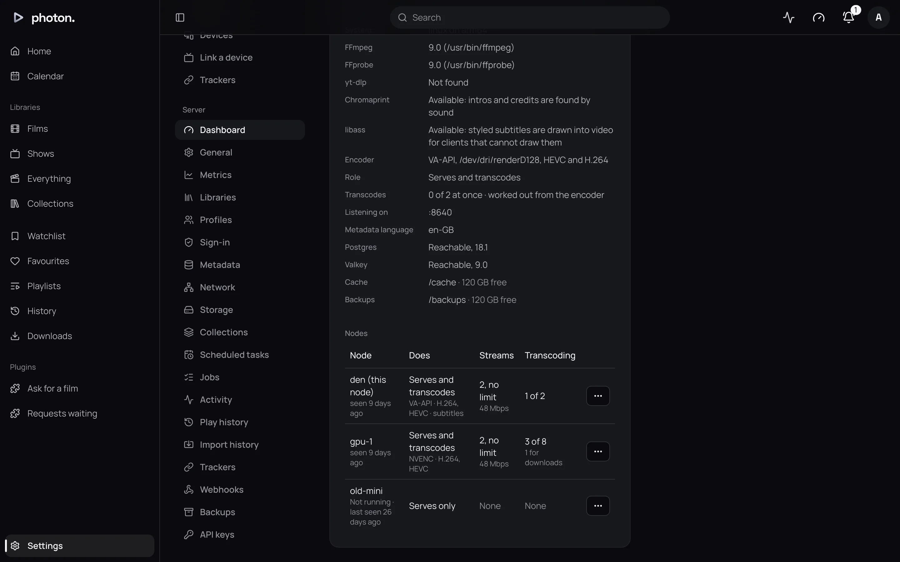

Most households need one server. If you want to share the work, such as a small always-on machine for everyday streaming and a second machine with a graphics card for converting, you can run several photon-server processes as one server. On this page each of them is called a **node**.

The nodes share one database and one Valkey (a small store for what is happening right now). Your apps can connect to any node. If someone's film is being made on another node, the node they connected to passes the request on, so every node must be able to reach the others.

## Add a node

1. On the new machine, mount your media at **the same path** as on the first. A library remembers its folders by their path.
2. Start photon-server with the same database and Valkey addresses as the first node. It joins the server by itself.
3. In Docker, give each machine its own name with `PHOTON_HOSTNAME` in `.env`. Otherwise every node is called `photon`. See the [Docker Compose reference](../08-reference/02-docker-compose.md).
4. Open Settings › Server › Dashboard. In the **Server** card, open the new node's actions menu (**…**) and choose **Settings…**.
5. Set **Address** to where the other nodes reach it, such as `http://10.0.0.5:8640`, and choose **Save**.

The node now appears in the **Server** card, with its encoder and how busy it is, such as "3 of 8".

> **Important:** Keep node addresses on a private network. The nodes trust what they pass each other.

A node without an **Address** is never passed another node's work, and is not listed as running.

## What each node does

Each node's **Settings…** dialog says what it does. Changes take effect at once, without a restart.

| Setting | What it does |
|---|---|
| Role | **Serves and transcodes**, the default, does everything. **Serves only** sends films but converts nothing, for a machine with no graphics card. **Transcodes first** is asked to convert before any other node while it has room: the machine with the graphics card. |
| Address | Where the other nodes reach this one. |
| Public URL | Where apps outside your home reach this node directly, such as `https://gpu.example.com`. Empty: its streams go through the node the app connected to. |
| Local URL | Where apps at home reach this node directly, such as `http://192.168.1.5:8640`. |
| Group | Any name, such as the place a node runs. A node asks those in its own group to convert first, so a stream need not travel between sites. Empty by default. |
| Streams at once | How many films the node sends at once, converted or not. No limit by default. |
| Egress | How fast the node may send, in megabits a second, to suit its upload. No limit by default. |
| Transcodes at once | How many films it converts at once. See [transcoding](01-transcoding.md#how-many-at-once). |
| Encoder | What it converts on. See [transcoding](01-transcoding.md#choose-it-yourself). |

Lowering a limit never stops a film already playing. It only stops new ones starting until there is room.

## Where a film is converted

When a film needs converting, the server picks the node with the most free transcode slots, among those whose hardware can do the job. It prefers, in order, a node in the same group, then a node set to **Transcodes first**. If a node is full or short of space, the next is asked. If every node is full, the person watching is told the server is busy.

A film that isn't converted is sent by the node the app connected to, or by another node with more room, preferring one set to **Serves only**.

## Take a node out of service

To stop a node without cutting anyone off:

1. In the node's actions menu (**…**), choose **Drain…** and confirm.
2. The node takes no new films. The ones it is sending play to the end. The dashboard says "Draining · 3 streams left".
3. When it says "Drained · safe to stop", stop the node.

Choose **Resume** to give it work again.

Stopping a node any other way, such as `docker compose stop`, drains it too. It waits up to two hours for its streams to end. Stop it a second time to stop it at once. The Compose file gives it those two hours with `stop_grace_period: 2h`.

A node that isn't running stays listed as "Not running · last seen 3 days ago", in case it is only restarting. If you have removed it for good, choose **Forget…** in its menu.

## Check a library on every node

On Settings › Server › Libraries, choosing **Check access** beside a library checks its folder on every running node. Each says whether it can read the folder, or why not: missing, not a folder, no permission, or no answer, as with a network drive that has stopped responding.

## Good to know

- If a running node is missing from the dashboard, it either has no **Address** or can't reach Valkey. Its log says which.
- Each node keeps its own identity in its cache folder. A node given an empty cache folder joins as a new node.
- Everything one node is told by the others is refreshed every 15 seconds. A node silent for 45 seconds is no longer listed as running.
- Scheduled tasks run on one node at a time. If it stops, another takes over within 20 seconds.
- With Prometheus, scrape every node. Some figures, such as the job queue and library size, are reported by only one node at a time, so combine them across nodes with `max without(instance)`, not `sum`. See [health, logs and metrics](../07-maintain/03-health-and-metrics.md).
