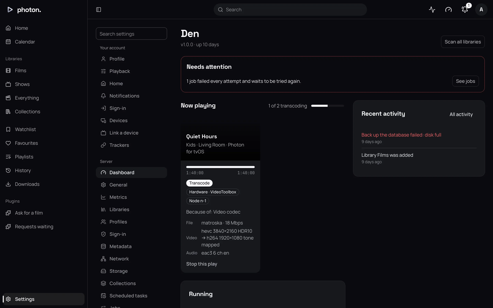

Every time you start a film or an episode, the app you are watching on tells photon-server what it can play: which kinds of file, which kinds of video and sound, whether the screen shows HDR, and the most it wants to be sent. The server then picks one of three ways to send it.

| What the dashboard says | What the server does |
|---|---|
| Direct play | Sends the file as it is. This costs the server almost nothing. |
| Direct stream | Sends the picture unchanged, but repackages the file, and converts the sound if the app can't play it. This is light work. |
| Transcode | Converts the picture as it plays, so the app can show it. This is the heavy work, and your graphics card helps if you have one. |

When a film is not played as it is, Settings › Server › Dashboard says why, under each play in **Now playing**, such as "Because of: Audio codec, Bitrate". Photon, the web app and Jellyfin's apps all go through the same choice.

## Pages

- [Transcoding and hardware encoders](01-transcoding.md): why a film is converted, whether that matters, and how to make it happen less.
- [HDR and Dolby Vision](02-hdr.md): what you see on a screen that shows HDR, and on one that doesn't.
- [Downloads and conversions](03-downloads.md): keeping a film on a device, as it is or made smaller.
- [Run several servers](04-several-servers.md): sharing the work between more than one machine.

What each person chooses for themselves, such as quality, languages and subtitles, is in [your settings](../02-web-app/06-your-settings.md). When something won't play, see [troubleshooting](../08-reference/05-troubleshooting.md).
