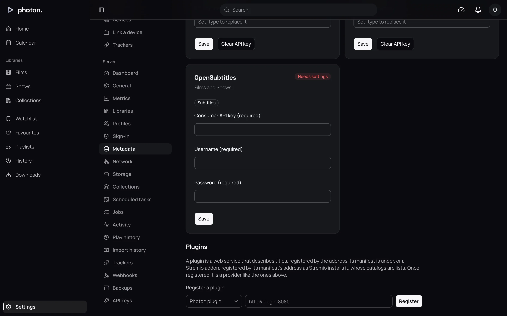
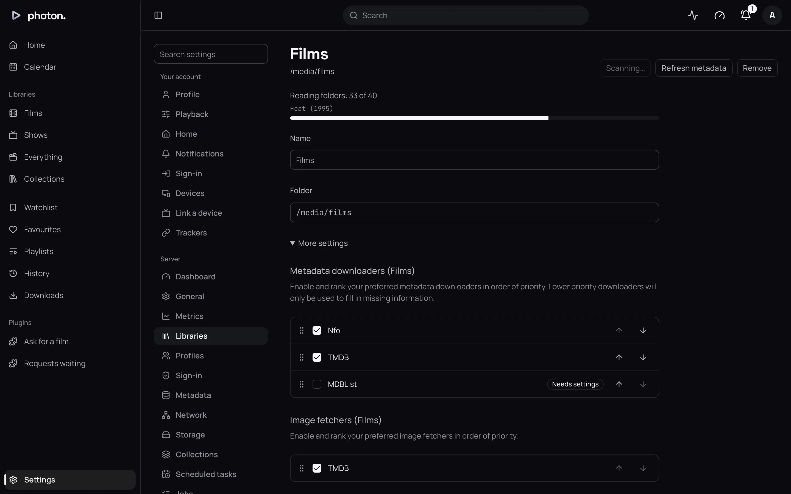

A plugin adds something to photon-server that it doesn't do by itself. It might describe titles
from a site the server doesn't know, add ratings, keep lists of titles, find subtitles, or add
pages of its own to the web app.

A plugin is a small program you run beside the server. Once you add it, it works like the
built-in sources such as TMDB and TheTVDB: it can have its own settings, such as an API key, and
you choose where your libraries use it.

A Stremio addon is added the same way, and has its own page: [Stremio addons](03-stremio.md).

## Add a plugin

1. Start the plugin, following its own instructions. It only has to be reachable from the server,
   not from the internet. In Docker, a container on the same network is enough.
2. Open Settings › Server › Metadata and scroll to **Plugins**.
3. Under **Register a plugin**, leave the choice at **Photon plugin**.
4. Type the plugin's address, such as `http://plugin:8080`, and choose **Register**.

The plugin appears in the list with its name, its address, whether it works with films, shows or
both, and what it can do. It also appears among the sources above, with a card of its own.

If the server can't add it, it says why. The usual reasons are an address that isn't a plain web
address, a plugin made for a different version of photon-server, or a plugin that isn't running.

> **Note:** Don't put a username or password in the address. Give those to the plugin in its
> settings instead.

## Give it its settings

If a plugin needs settings, such as an API key, they are on its card under
Settings › Server › Metadata. The card says **Needs settings** until every setting marked
**(required)** is filled in, then **Ready**. The server doesn't use a plugin until it is ready.

A secret setting, such as an API key, is never shown again once saved. Leave it empty to keep it,
type to replace it, or choose **Clear** to remove it.

## Use it in a library

A plugin that describes titles or has pictures of them is only used where you turn it on.

1. Open the library under Settings › Server › Libraries.
2. Find **Metadata downloaders** and **Image fetchers**.
3. Turn the plugin on, and drag it into place. The server asks the sources from the top down, and
   a source lower down only fills in what those above it didn't.

Changing these makes the server look up every title in the library again.

## What a plugin can do

The plugin's row says what it can do. Each one is used in a different place:

| It can | Where it is used |
|---|---|
| Describe titles | Naming and describing a library's titles, where you turn it on in the library. |
| Search, to fix a match | When you [fix a title's match](../03-library/05-fix-a-match.md) by hand. |
| Ratings | Scores shown beside other sites' scores. |
| People | Details about the people in a title. |
| Lists | Lists a [collection](../03-library/07-collections.md) can follow. |
| Streams | Things a streamed library can play. See [Stremio addons](03-stremio.md#play-what-it-streams). |
| Subtitles | Subtitles offered beside other sources'. See [Subtitles](../03-library/10-subtitles.md). |
| Events | Being told what happens on the server, as a [webhook](05-webhooks.md) is. |
| Intros and credits | Where intros and credits are. See [Intros, credits and previews](../03-library/09-markers-and-previews.md). |
| Pages | Pages of its own, under **Plugins** in the web app's sidebar. |

A page a plugin marks for admins appears only to admins. Its pages open on the plugin's own site,
so they can't see anyone's photon-server sign-in.

## When a plugin is down

If a plugin doesn't answer within 20 seconds, the server skips it and asks the next source in the
library instead. A plugin being down never empties a library.

## After a plugin is updated

If a plugin's update adds new features or settings, choose **Read manifest again** on its row. The
server checks it again, as it did when you added it.

## Remove a plugin

1. Choose **Remove** on its row.
2. Choose **Remove plugin** to confirm.

The server forgets the plugin, its settings, and its place in every library. What it said about
your titles stays until another source says something different, so titles are never left blank.

> **Tip:** If you made an [API key](../04-access/06-api-keys.md) for the plugin, removing the
> plugin doesn't cancel it. Revoke it under Settings › Server › API keys.

## Good to know

- The server only ever talks to the address you added the plugin at. It never follows a plugin
  elsewhere, so a plugin can't send your settings to another machine on your network.
- A plugin keeps the id it was added under. If an update gives it a different id, **Read manifest
  again** refuses, and the plugin stays as it was. Remove it and add it again instead.
- To write a plugin, see [Write a plugin](../08-reference/06-write-a-plugin.md).
