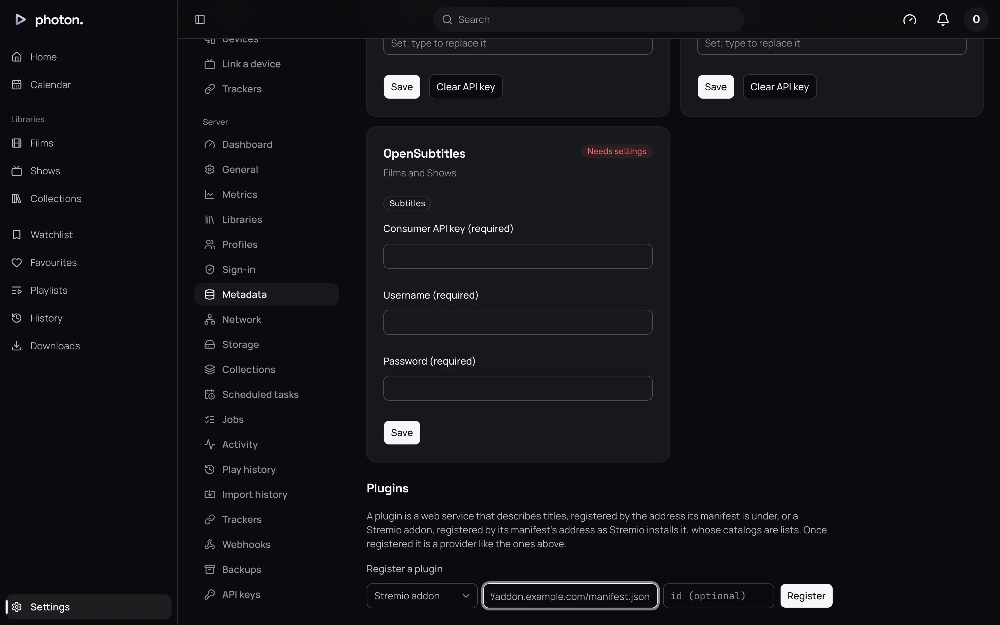

A Stremio addon is a web service made for the Stremio app. It offers lists of films and shows,
such as "Popular" or "Top rated", and things to stream for them. photon-server can use both:

- its **lists**, to fill a collection or a library;
- its **streams**, to play titles you don't have as files.

By the end of this page you have an addon added and a library that plays what it streams.

An addon doesn't describe titles. The titles it lists are named, described and given artwork by
your library's usual sources, such as TMDB, like any other title.

## Add an addon

1. Copy the addon's install address, the one you would paste into Stremio. It ends in
   `manifest.json`. If the addon has its own settings page (for example to connect a debrid
   service, a paid service that fetches files for you), set it up there first: your settings become
   part of the address.
2. Open Settings › Server › Metadata and scroll to **Register a plugin** under **Plugins**.
3. Change **Photon plugin** to **Stremio addon**.
4. Paste the address and choose **Register**.

The addon appears in the list as a **Stremio addon**, with **Lists** if it has lists of films or
shows, and **Streams** if it offers streams.

> **Important:** An addon's address can hold your settings for it, including keys for paid
> services. The server keeps it as a secret: the list shows only the start of it, and it never
> appears in a log or an error.

To change an addon's settings later, remove it and add it again at its new address.

## Make a collection from one of its lists

1. Open Settings › Server › Collections.
2. Under **New collection**, give it a name.
3. Set **Titles** to **A … catalog**, with the addon's name in it.
4. In **List**, type the list's name as the addon gives it, such as `movie/top`. Lists of films
   start `movie/`, and lists of shows start `series/`.
5. Under **Found in**, choose whether to take the list's titles from every library or from one.
6. Choose **Make it**.

The collection holds the titles from the list that your libraries have. It is read again every
day. See [Collections and the lists they follow](../03-library/07-collections.md).

## Play what it streams

A **streamed library** has no folder of files. Its titles come from a list, or from what people
search for, and they play from what the addon streams. Your household can then watch them like
your own files.

1. Open Settings › Server › Libraries and choose **Add a library**.
2. Name it and choose what it **Holds**.
3. Set **Its media** to **Streamed by a provider**. You only see this once an addon that streams is
   added.
4. Under **Titles from**, choose the addon and type a list in **List**, such as `movie/top`. Or
   choose **No list**.
5. Under **Search finds titles from**, choose a source that can search, such as TMDB, or
   **Nothing**. With a source chosen, searching the server also shows titles this library doesn't
   hold yet. Opening one adds it to the library.
6. Under **Streamed by**, choose the addon.
7. Choose **Add and scan**.

The library needs a list, a search, or both. You can't change its media afterwards.

### Keeping it up to date

Each scan reads the list again. New titles are added. Titles that have left the list are removed,
unless someone has played them, favourited them, or added them to their watchlist.

If the list can't be read, the scan fails rather than emptying the library.

### What playing is like

When someone plays a title, the server asks the addon what it can stream and tries the first few
in the addon's order. It skips any that fail, and any shorter than a minute (addons often offer a
short clip saying a title isn't available).

> **Note:** Some addons fetch a title only when you ask for it, for example through a debrid
> service. If nothing starts within 15 seconds, the player says "the provider is fetching the
> title; it plays once it has it". Try again a little later.

If nothing the addon offers can be played, the player says so.

## Remove an addon

Remove it from its row under Settings › Server › Metadata, as any plugin. See
[Install and manage plugins](01-plugins.md#remove-a-plugin).

## Good to know

- Only addons with films or shows can be added.
- To add the same addon twice with different settings, type an id of your own for the second one
  in the **id (optional)** box beside the address.
- A streamed library has no files, so the server can't watch it for changes, and its titles can't
  be deleted from the web app. Previews and intro and credits detection are off for it unless you
  turn them on.
- Streams that are bare torrents or YouTube videos, or that need special settings to open, are left
  out.
- A list is read up to 500 titles. Titles the addon lists only by its own ids, which no other site
  knows, are left out.
