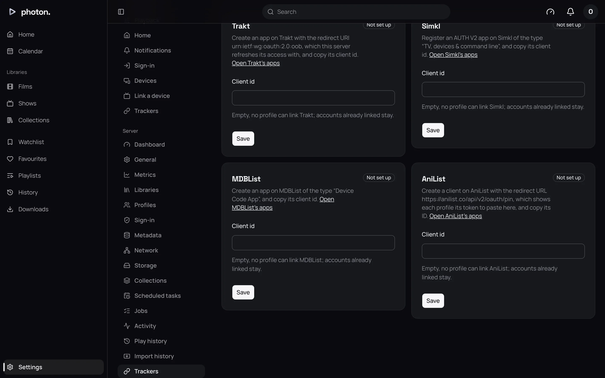
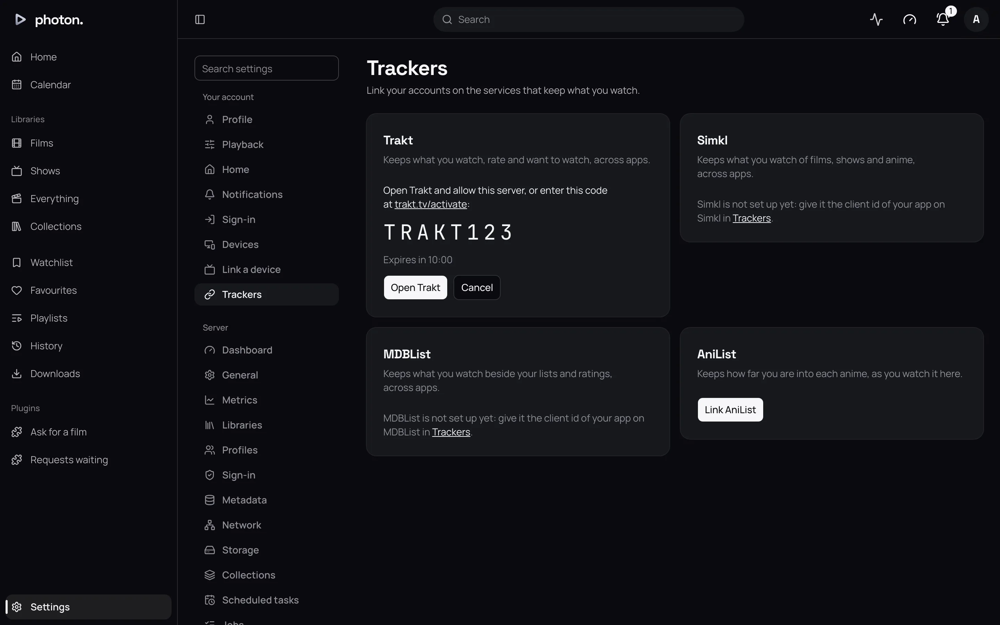

A tracker is a website that keeps a record of everything you watch, from every app you use.
photon-server works with four: **Trakt**, **Simkl**, **MDBList** and **AniList**.

Setting one up takes two parts:

1. An admin connects the server to the tracker, once.
2. Each person links their own account.

From then on, the server tells each linked account what that person plays and marks as watched.

The server only sends to trackers. It doesn't read your history back from them. To bring in
history from another media server, see [Import watch history](07-import-history.md).

## Connect the server to a tracker (admins)

Each tracker needs you to register an "app" on its website, which gives you a **client id**: a code
that tells the tracker which app is asking. You do this once for the whole household.

1. Open Settings › Server › Trackers.
2. Follow the link on the tracker's card, and register an app there as the table below says.
3. Copy the app's client id.
4. Paste it into **Client id** on the card, and choose **Save**. The card then says **Set up**.

| Tracker | What to register |
|---|---|
| Trakt | A new app at [Trakt's apps page](https://app.trakt.tv/settings/apps). For the redirect URI, type `urn:ietf:wg:oauth:2.0:oob`. |
| Simkl | An **AUTH V2** app at [Simkl's developer settings](https://simkl.com/settings/developer/), of the type "TV, devices & command line". |
| MDBList | An app at [MDBList's developer page](https://mdblist.com/developer/), of the type "Device Code App". |
| AniList | A client at [AniList's developer settings](https://anilist.co/settings/developer). For the redirect URL, type `https://anilist.co/api/v2/oauth/pin`. Copy its **ID**. |

You don't need a client secret for any of them.

> **Note:** MDBList as a tracker is separate from MDBList under Settings › Server › Metadata. That
> one uses an API key for ratings and lists. This one uses an app's client id to link people's
> accounts.

## Link your account

Each person links their own account under Settings › Trackers. If no admin has set the tracker
up yet, the page says so.

### Trakt, Simkl and MDBList

1. Choose **Link Trakt**, **Link Simkl** or **Link MDBList**.
2. The card shows a code. Choose **Open Trakt** (or the tracker's name) to open the tracker's page
   with the code filled in. Or go there yourself and type the code.
3. Sign in to the tracker and allow photon-server.
4. Back in photon-server, the card changes to **Linked as** and your name on the tracker.

**Cancel** stops linking. If the code runs out, the card offers to try again.

### AniList

AniList works a little differently: it gives you a code to paste back.

1. Choose **Link AniList**, then **Open AniList**.
2. Sign in to AniList and allow photon-server.
3. AniList shows a long token. Copy it.
4. Paste it into the card and choose **Link**.

You have 15 minutes to paste it. AniList's link lasts a year. After that, it is unlinked and you
link it again.

### Unlink

Choose **Unlink** and confirm. The server forgets your account. What the tracker has already
recorded stays there.

For AniList, also remove photon-server from your AniList account's settings.

## What the server sends

- **Plays.** When you start, pause, resume or stop a title, each linked tracker is told how far
  through you are. Trakt, Simkl and MDBList count a title as watched from 80% of the way through.
  If photon-server counts it watched sooner, for example when a film's credits start early, the
  tracker is told it was watched.
- **Watched marks.** Marking a title watched or unwatched by hand is sent too, about two minutes
  later.
- **AniList** only keeps how far through each show you are. It is moved forward to the furthest
  episode you've watched, but never back.

Titles are matched by their TMDB, TheTVDB and IMDb ids, the codes those sites give each title.
A title the server knows by none of them isn't sent.

## Good to know

- Only what you watch after linking is sent. Earlier history stays where it is.
- To stop everyone using a tracker, an admin empties its **Client id** and saves. Linked accounts
  stay linked but are sent nothing until a client id is set again.
- If a tracker stops accepting the server, for example because you removed the app on the
  tracker's site, the account is unlinked and the Trackers page offers to link it again.
- A profile can link one account on each tracker.
