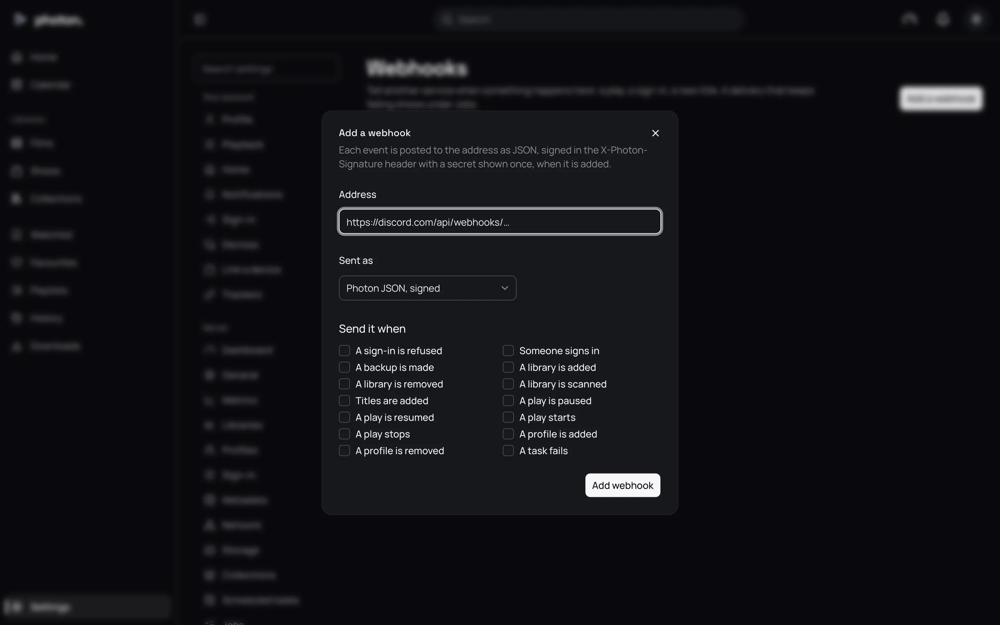

A webhook is a web address the server sends a message to whenever something happens: someone
starts watching, someone signs in, new titles arrive, a task fails.

What people use them for:

- a message in a **Discord** or **Slack** channel when new episodes are added;
- a notification on your phone through **ntfy** or **Gotify** when a sign-in is refused;
- feeding your own home automation, for example to dim the lights when a film starts.

By the end of this page you have a webhook added and tested.

## Add a webhook

1. In the service you want to message, make a webhook and copy the address it gives you. The
   address has a secret token in it, which is what lets the server post there.
2. In photon-server, open Settings › Server › Webhooks and choose **Add a webhook**.
3. Paste the address into **Address**.
4. Under **Sent as**, choose the kind of service: **Discord**, **Slack**, **ntfy**, **Gotify**, or
   **Photon JSON, signed** for your own automation.
5. Under **Send it when**, tick the events you want to hear about.
6. Choose **Add webhook**.



For **Photon JSON, signed**, the server then shows the webhook's **Secret**. Copy it into the
service that receives the webhook. It is shown only once.

## The events

You can tick any of these under **Send it when**:

- **A play starts**, **A play is paused**, **A play is resumed**, **A play stops**
- **Someone signs in**, **A sign-in is refused**
- **A profile is added**, **A profile is removed**
- **A library is added**, **A library is removed**, **A library is scanned**, **Titles are added**
- **A task fails**
- **A backup is made**

## What is sent

**Discord, Slack, ntfy and Gotify** get a short message, as a sentence, with your server's name
as its sender or heading. For example: "Oliver started Heat". The sentence is the same as the one
in Settings › Server › Activity.

**Photon JSON, signed** is for your own automation. Each message is a block of data describing the
event: what happened, when, on which server, and the profile, title or library it is about. A
title comes with its IMDb, TMDB and TheTVDB ids, so other apps can find it. It also carries the
same sentence the chat services get.

## Test a webhook

Choose **Send a test** on a webhook's row. A test message goes to that webhook alone, whatever
events it is set up for. Check the other end to see that it arrived.

## When a message doesn't arrive

The server doesn't hold anything up to send a webhook: messages go out in the background. If the
service doesn't answer within 10 seconds, or turns the message down, the server tries again later,
waiting longer each time. After five tries it gives up.

Messages it gave up on are listed under Settings › Server › Jobs, in **Given up**, with what the
service said. You can try them again from there.

> **Tip:** If nothing ever arrives, check the address. The server won't follow a service that
> answers by pointing it to another address.

## Remove a webhook

Choose **Remove** on its row, then **Remove webhook**. Nothing more is sent to it, including
messages still waiting to go.

## Good to know

- The server's own background work, such as jobs starting and finishing, isn't offered as an event.
- A sign-in message never includes a password.
- Errors only show the service's host name, never the whole address, since the address holds its
  token.
- Plugins can be told of events too. See [Install and manage plugins](01-plugins.md).

### Checking the signature

**Photon JSON, signed** messages carry a signature, so whoever writes the receiving service can
check a message really came from your server and wasn't changed on the way. The signature is in the
`X-Photon-Signature` header: `sha256=` followed by the HMAC-SHA256 of the message body, made with
the webhook's secret. Work it out from the body exactly as it arrived, and compare. To try it in a
terminal, with the body saved as `body.json`:

```sh
printf 'sha256=%s\n' "$(openssl dgst -sha256 -hmac "$SECRET" -hex < body.json | awk '{print $NF}')"
```
