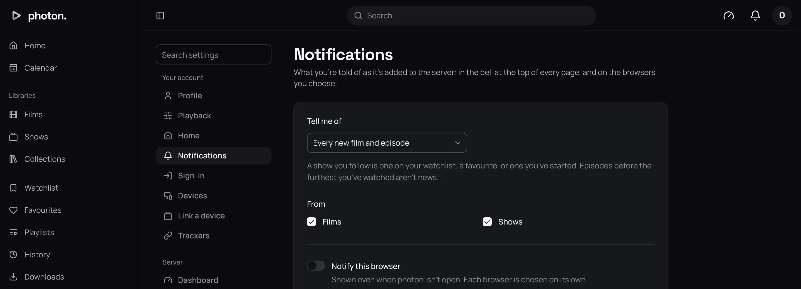
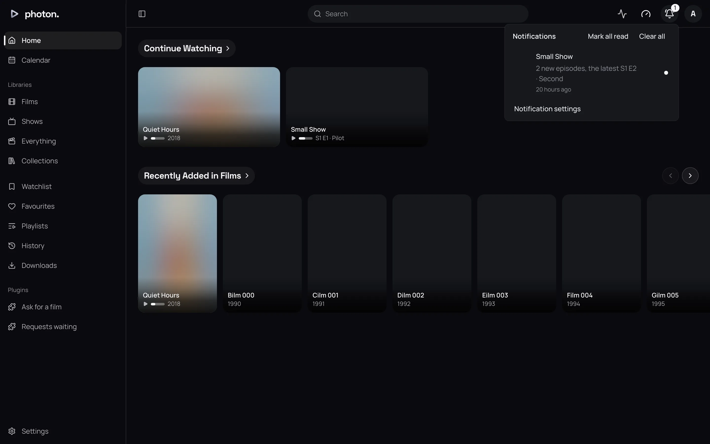

When new films and episodes arrive, photon-server tells each person about the ones they care about.
When someone [asks for a title](../02-web-app/07-requests.md), it tells whoever can decide the
request. You see both in the bell at the top of every page of the web app, and in Photon. You can
also have them sent to your browser and your Apple and Android devices, so you hear about a new
episode, or a request waiting for you, even when nothing is open.

Each person chooses for themselves. An admin has nothing to set up, but the server needs to reach
the internet for anything to be sent to a browser or phone.

## Choose what you hear about

Open Settings › Notifications.

| Setting | What it does |
|---|---|
| Tell me of | **New episodes of shows I follow** (the default), **Every new film and episode**, or **Nothing**. A show you follow is one on your watchlist, one of your favourites, or one you have started. |
| From | Which libraries you hear about, when the server has more than one. Untick a library to hear nothing from it. Libraries added later are included. |

These are yours, and the same on every device you sign in on.

You aren't told about:

- titles you aren't allowed to see;
- an episode earlier than the furthest you've watched of that show, or a film you've watched;
- a brand-new library being filled for the first time, so adding a library doesn't flood everyone
  with notifications.

## Requests waiting for you

When someone asks for a title, every admin, and the manager who looks after the person who asked,
gets a notification of the request saying who asked. The person who asked isn't told of their own
request, an admin's own request is approved at once and tells no one, and someone whose **Tell me
of** is **Nothing** isn't told.

**Approve** and **Decline** are on the notification itself. Declining asks for a reason, which you
can leave empty. As soon as anyone approves, declines or takes back the request, or the title
arrives, its notification goes from everyone's bell, and from their devices where the device
allows. Settings › **Requests** lists the requests waiting too.

## Read them

The bell shows a count of unread notifications, and holds the newest hundred.

- A film is one notification.
- New episodes of a show are gathered into one notification while it is unread, so a whole season
  arriving at once is one notification that says how many episodes it brings.
- A request waiting for you is one notification.

Opening a title's notification clears it. **Mark all read** marks every one as read, and **Clear
all** empties the bell. Your other devices update to match.

## Notifications in your browser

1. Open the web app at a secure address, one starting `https://`. Browsers only allow
   notifications from secure pages. See [Reach your server from outside](../04-access/04-remote-access.md).
2. Open Settings › Notifications and turn on **Notify this browser**.
3. Allow notifications when the browser asks.

Each browser is turned on separately. The page says how many of your other browsers and devices are
notified.

> **Note:** On an iPhone or iPad, a browser can only show notifications once you add the web app
> to your Home Screen. Open it from there, then turn on **Notify this browser**.

If the page says "This browser can't be notified here", the address isn't secure, or the browser
doesn't support notifications. If notifications were blocked for the site, allow them again in the
browser's site settings, then turn the switch back on.

Clicking a title's notification in your browser opens the title's page; clicking a request's opens
Settings › **Requests**.

### When it arrives

The server waits about a minute after new titles arrive before sending, so a whole batch is sent
together and with proper names. A request is sent as soon as it is asked for. If your browser is
closed, its push service keeps the message for a day.

## On iPhone, iPad, Mac, Apple Vision Pro and Android

In Photon, turn on **Notify This Device** in the server's settings.

Apple and Google only let an app's own developer send to its devices, which a server in your home
can't be. So the server wakes your device through **photon's push relay**, a small service run for
Photon, which hands the message to Apple's push service or to Firebase Cloud Messaging. The relay is
told nothing about your libraries: it passes on a number, and your device then asks your own server
what the notification says.

## Good to know

- Nothing is told to you twice, even after you've read or cleared it.
- A browser or device that has stopped accepting notifications is forgotten by itself.
- If sending fails, the server tries again later. Ones it gave up on show under
  Settings › Server › Jobs.
