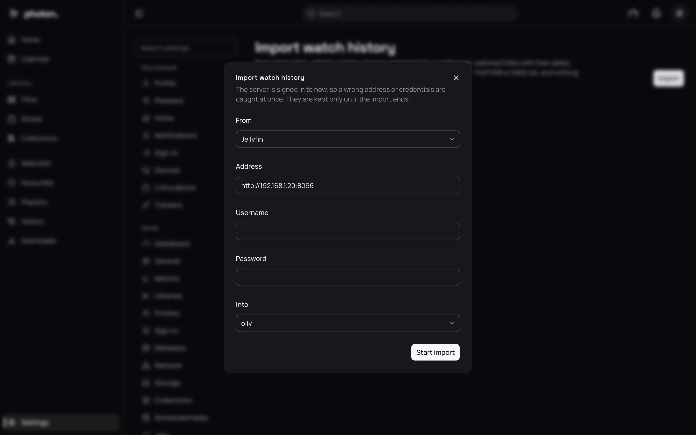

Moving to photon-server doesn't mean starting your watch history again. An import signs in to the
Plex, Jellyfin or Emby server you are leaving, reads what one person watched there, and copies it
into one of your profiles:

- which films and episodes they finished, and when;
- how many times they watched each;
- where they stopped in anything they didn't finish, so they can carry on.

Run one import for each person.

> **Important:** Add your libraries and let them finish scanning first. An import can only bring
> in titles photon-server already has and has recognised.

## Run an import

1. Open Settings › Server › Import history and choose **Import**.
2. Under **From**, choose **Plex**, **Jellyfin** or **Emby**.
3. Type the old server's **Address**, such as `http://192.168.1.10:32400` for Plex, or
   `http://192.168.1.10:8096` for Jellyfin and Emby.
4. Sign in as the person whose history you want:
   - **Jellyfin** and **Emby**: their **Username** and **Password**.
   - **Plex**: their **Token**. This is a code Plex gives each account (often called the
     X-Plex-Token). Use the token of the person whose history you want: the server owner's token
     only brings the owner's history.
5. Under **Into**, choose the profile it goes into.
6. Choose **Start import**.

The server checks the address and sign-in straight away, so a mistake shows before anything
starts. The sign-in is forgotten when the import ends. For Jellyfin and Emby, the server also signs
itself out of the old server, so it doesn't stay in that server's device list.

## Follow how it went

Each import is listed on the page, newest first. It shows **Waiting to start…**, then
**Importing…**, then the result:

| Result | What it means |
|---|---|
| matched | Titles found in your libraries here. |
| imported | Of those, how many were copied into the profile. |
| left as they are here | Of those, how many were skipped, because the profile had something newer here already. |
| not found here | Titles that couldn't be found in your libraries. |

**Titles not imported** lists up to 200 of the titles that were skipped, each with the reason:

| Reason | What to do |
|---|---|
| No TMDB, TheTVDB or IMDb id | The old server never recognised this title. Fix its match there, then import again. |
| Not in a library here | You don't have this title, or this episode, here yet. Add it and import again. |
| No date watched | The old server says it was watched, but not when. If the profile hasn't watched it here, it is marked watched as of now. Otherwise it is left as it is. |

## Good to know

- An import never overwrites something newer. If the person watched a title here more recently than
  on the old server, it is left alone.
- Titles are matched by their TMDB, TheTVDB or IMDb ids (the codes those sites give each title),
  never by name or file. So a title is never put on the wrong film.
- Running the same import again is safe. Nothing is counted twice, and titles you have added since
  are brought in.
- If the old server stops answering partway through, the import ends as **Failed**, with the
  reason.
