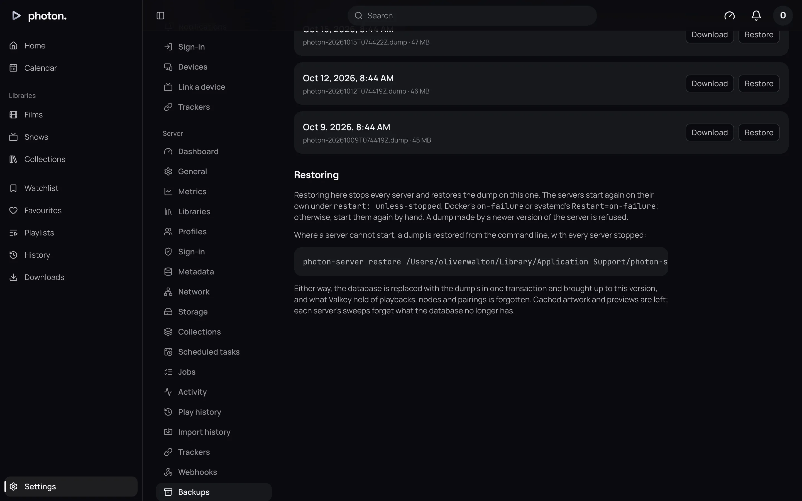
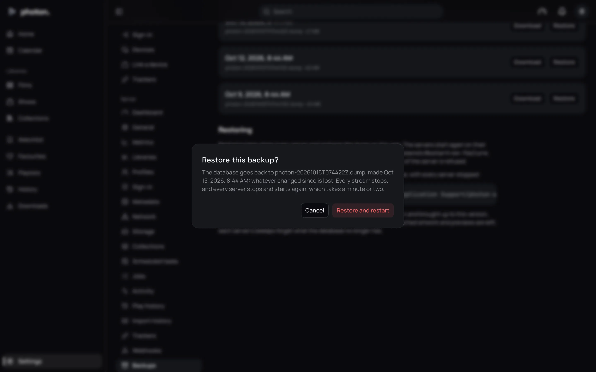

photon-server keeps everything it knows in its database: your libraries and what it matched, profiles, watch history, playlists and settings. It backs that database up by itself every three days and keeps the newest three backups.

## What a backup holds, and what it doesn't

A backup is a copy of the database. It does **not** hold:

- **Your films and shows.** The server only reads them; it never changes them.
- **Pictures you uploaded and profile avatars.** These are kept in the server's cache folder or in a storage bucket (see [storage](05-storage.md)). Artwork from the internet is fetched again by itself, but pictures you uploaded are only there. Back up the cache folder's `artwork` folder, or the bucket, if you want to keep them.

## See your backups

Open Settings › Server › Backups. It lists the backups, newest first, with when each was made and its size.



To make one now, choose **Back up now**.

The page also shows the folder they are kept in. Settings › Server › Dashboard shows it too, as **Backups**, with the space free. In Docker, it is the `backups` volume.

> **Important:** The backups sit on the same machine as the database. If the disk fails, you lose both. Keep a copy somewhere else.

## Keep a copy somewhere else

Choose **Download** beside a backup to save it to your computer. Or copy the backups folder (or the Docker volume) with whatever already backs up the machine.

## Restore from the web app

Restoring puts the database back as it was when the backup was made. Anything that changed since is lost. Every film playing stops, and the server restarts, which takes a minute or two.

1. Open Settings › Server › Backups.
2. Choose **Restore** beside the backup you want.
3. Read the warning, then choose **Restore and restart**.



While it restores, the web app shows a page saying the server is restoring, which reloads itself when it is done. Afterwards, Settings › Server › Backups says "The last restore, of … succeeded", or that it failed, and why. A failed restore leaves the database as it was.

> **Note:** The server needs something to start it again after a restore. Docker's `restart: unless-stopped` (in the standard Compose file), systemd's `Restart=on-failure`, the Mac app, the Flatpak and the Windows service all do this. Otherwise, start it again by hand.

A backup made by an older version of photon-server can be restored; it is brought up to date as it is. A backup from a newer version can't.

## Restore from the command line

Use this when the server won't start, or on a new machine. Stop the server first.

In Docker:

```sh
docker compose stop server
docker compose run --rm --no-deps server restore /var/lib/photon-server/backups/photon-20261016T030000Z.dump
docker compose up -d
```

Without Docker, set the same two addresses the server uses, then run:

```sh
export PHOTON_DATABASE_URL=postgres://photon:<password>@localhost/photon
export PHOTON_VALKEY_URL=valkey://localhost:6379
photon-server restore /path/to/photon-20261016T030000Z.dump
```

It refuses while anything else is connected to the database, and says who.

## Move to a new machine

1. Install photon-server on the new machine. In Docker, start only the database and Valkey: `docker compose up -d db valkey`.
2. Restore your backup from the command line. In Docker, pass the file in (it must be readable by everyone, as the server runs as its own user):

   ```sh
   docker compose run --rm --no-deps -v "$PWD/photon-20261016T030000Z.dump:/tmp/photon.dump:ro" \
     server restore /tmp/photon.dump
   ```

3. Mount your media at the same paths as before. A library remembers its folders by their path.
4. Start the server.

Copy the old cache folder's `artwork` across too, to keep avatars and uploaded pictures.

## Good to know

- The server needs the PostgreSQL tools (`pg_dump`, `pg_restore` and `psql`) to back up and restore. The Docker image, the Flatpak and the Mac app include them. Without them, the log warns that the database is neither backed up nor restored.
- With several servers, the backups are kept by whichever node made them. The page names the node it lists.
- Backups appear in Settings › Server › Activity, and can trigger a [webhook](../06-integrations/05-webhooks.md).
