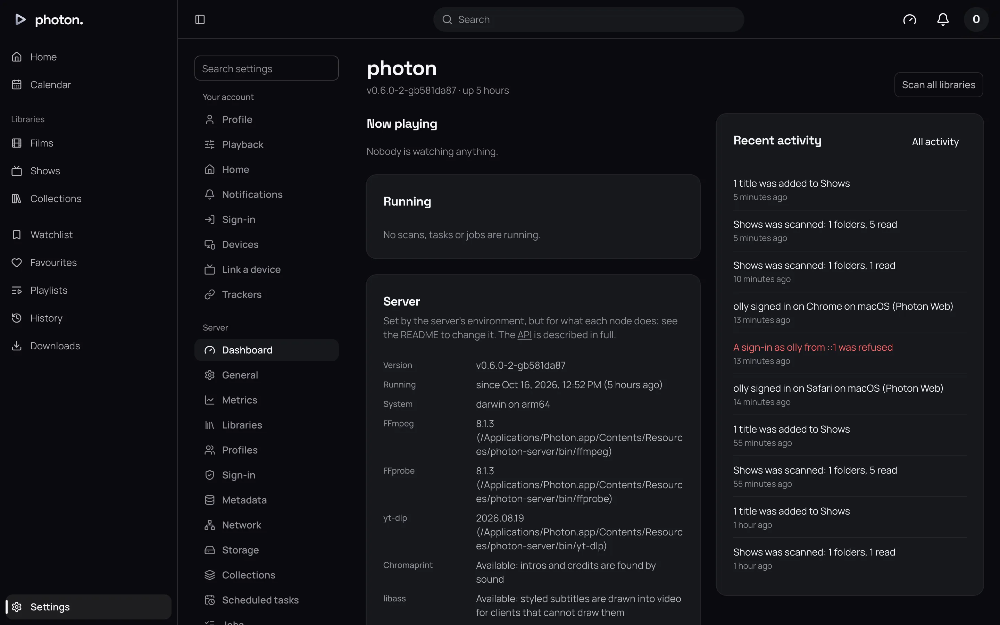
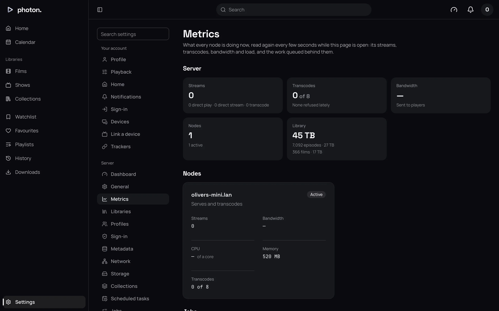

photon-server tells you how it is doing in four places: the dashboard, Metrics and Watch statistics pages in the web app, its log, a health address for uptime monitors, and figures for Prometheus. Most people only need the dashboard.

## The dashboard

Settings › Server › Dashboard is the first page of the server's settings. From the top:

- **Needs attention**: anything to put right, each with a link. For example, no libraries yet, work that failed every attempt, or a metadata provider a library uses that hasn't been set up.
- **Now playing**: each film playing, who is watching, on what, how far through, and whether it is converted (see [transcoding](../05-playback/01-transcoding.md)). **Stop this play** ends it and remembers where they got to.
- **Running**: library scans and the work waiting behind them.
- **Server**: the version and how long it has been running, the tools it uses, its encoder, whether it can reach its database and Valkey, and its cache and backups folders with the space free on each.
- **Recent activity**, and **All activity** for Settings › Server › Activity, which keeps 30 days of plays, sign-ins, scans, failed tasks and the like.



The page updates itself. "reconnecting to live updates…" beside the version means it has lost touch with the server for a moment.

## The Metrics page

Settings › Server › Metrics shows what the server is doing now, refreshed every 5 seconds, with the last ten minutes drawn as charts:

- Films playing and how they play, transcodes against the limit, how many were turned away lately, and how much is being sent.
- Each server's processor, memory, streams and transcodes.
- The films and episodes in your libraries and the space they take.
- The queue of background work, and when each scheduled task last finished.



The page keeps no history beyond ten minutes. For longer, use Prometheus.

## Watch statistics

Settings › Server › Watch statistics adds up what the household watched, from its play history:

- **Plays** and **Time watched** over the span chosen under **When**: the last 7, 30 or 90 days, or the last year.
- **Time watched**, drawn a day at a time, or a week at a time for a year. Days are counted where you are reading, so a film finished late at night is that night's.
- **Who watched**, longest first. Each name opens that profile's plays in Settings › Server › Play history.
- **Watched most**: the ten titles watched longest, a show counting every episode of it.

**Who** narrows all of it to one profile.

A play counts from when it started to when it stopped, so a film left paused counts the time it sat paused, as Plex's and Tautulli's reports count it.

## The log

The log records what the server does, one line per event.

| Install | Where to read it |
|---|---|
| Docker | Run `docker compose logs -f server` |
| Flatpak | The `logs` folder in `~/.var/app/io.github.olivertgwalton.Photon/data/photon` |
| Mac app | **Show Logs** in Photon's menu, or `~/Library/Logs/Photon` |
| Windows service | `photon-server.log` in `C:\Windows\System32\config\systemprofile\AppData\Local\photon-server` |
| Archive | Wherever you send its output |

Lines worth knowing, as the server starts:

- `media tools`: the FFmpeg and other tools it found, and their versions.
- `encoding video`: the encoder it chose (see [transcoding](../05-playback/01-transcoding.md#what-the-server-converts-on)).
- `serving`: it is up, with its address and version.
- Warnings about anything missing, such as the database tools for backups.

For what a message means and what to do, see [troubleshooting](../08-reference/05-troubleshooting.md).

## Uptime monitors

Point an uptime monitor or a load balancer at the server's `/health` address, such as `https://photon.example/health`. It needs no sign-in. It reports healthy while the server can reach its database and Valkey and is taking new viewers, and unhealthy while:

- it can't reach the database or Valkey (the log says which, and why);
- it is shutting down, letting its last films play to the end;
- a backup is being restored.

A node that is shutting down reports unhealthy on purpose, so a load balancer stops sending it new viewers without treating it as broken.

## Prometheus

Prometheus is a tool for recording figures over time and alerting on them. Every server publishes its figures at `/metrics` on port 8640, but only to computers on your home network (Settings › Server › Network › **Local networks**). Add it to Prometheus like this:

```yaml
scrape_configs:
  - job_name: photon
    static_configs:
      - targets: ["photon.lan:8640"]
```

With several servers, list every one.

The main figures:

| Metric | What it counts |
|---|---|
| `photon_playbacks` | Films playing now, by how they play. |
| `photon_transcodes` | Films being converted now, for playback or downloads. |
| `photon_transcode_slots` | The most it converts at once. |
| `photon_transcode_refusals_total` | Films turned away because no transcode slot was free. |
| `photon_sent_bytes_total` | How much has been sent to players. |
| `photon_jobs` | Background work, by kind and state. |
| `photon_task_last_finished_timestamp_seconds` | When each scheduled task last finished, and how. |
| `photon_library_items` | Films and episodes in the libraries. |
| `photon_library_bytes` | The space they take on disk. |

Alerts worth having:

- `photon_jobs{state="dead"} > 0`: work that failed every attempt, waiting on Settings › Server › Jobs.
- `time() - photon_task_last_finished_timestamp_seconds{task="backup_database", result="succeeded"} > 4 * 86400`: backups have stopped. The figure also disappears when the last backup failed, so alert on it being absent too.
- `rate(photon_transcode_refusals_total[5m]) > 0`: people are being turned away for lack of transcode slots.

> **Note:** With several servers, figures about shared things (the job queue, tasks and libraries) come from one node at a time. Combine them with `max without(instance)`, not `sum`. See [several servers](../05-playback/04-several-servers.md).
