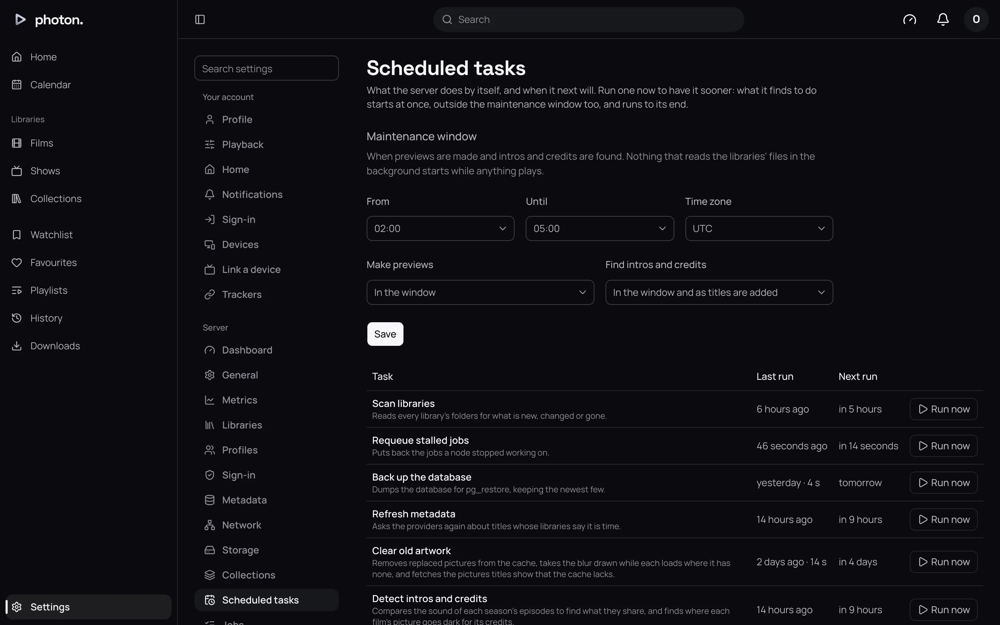
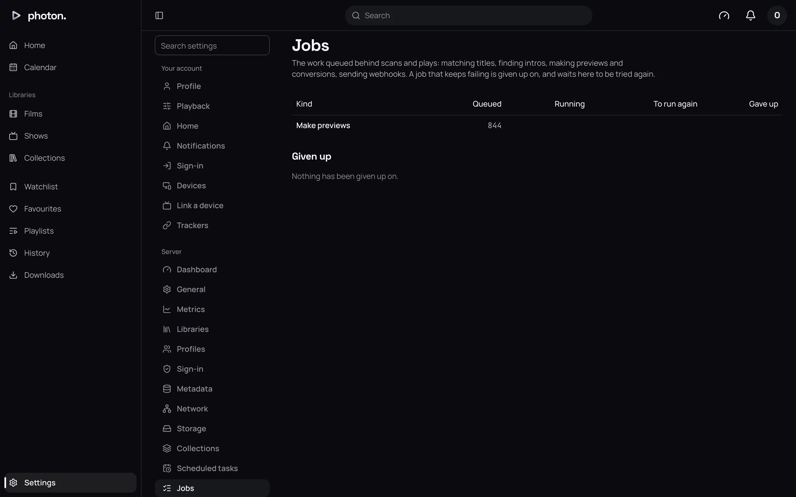

photon-server does a lot by itself: it scans your libraries, refreshes what it knows about titles, backs up its database, and more. You can see all of it, run it now, or stop it, under Settings › Server.

- **Scheduled tasks** run on a timetable.
- Many tasks split their work into **jobs**, one per library, title or file, which the server works through in the background.
- The **maintenance window** is the time of night when the heaviest jobs, the ones that read whole video files, are allowed to run.

## Scheduled tasks

Settings › Server › Scheduled tasks lists each task, when it last ran and how it ended, and when it runs next.

| Task | What it does | When |
|---|---|---|
| Scan libraries | Looks in every library's folders for what is new, changed or gone. | Every 12 hours |
| Requeue stalled jobs | Puts back work a server stopped part way through. | Every minute |
| Back up the database | Makes a backup, keeping the newest three. | Every 3 days |
| Refresh metadata | Updates titles' details from the online providers, when their library says it is time. | Daily at 03:00 |
| Clear old artwork | Removes pictures no longer used, and fetches any that are missing. | Every 7 days |
| Detect intros and credits | Finds where intros and credits start and end, so they can be skipped. | Daily, as the maintenance window opens |
| Make previews | Makes chapter pictures and the previews shown while you scrub. | Daily, as the maintenance window opens |
| Clear old downloads | Forgets downloads past their week. | Every hour |
| Prune the activity log | Forgets activity older than 30 days. | Every day |
| Refresh smart collections | Updates what each smart collection holds. | Every 15 minutes |
| Sync list collections | Reads each list collection's online list again. | Every day |
| Download missing subtitles | Fetches subtitles in the languages a library asks for. | Every day |
| Refresh the anime lists | Reads the lists that match anime to the right seasons again. | Every day |

**Refresh metadata** runs at 03:00 in the server's own time zone. A task missed while the server was off runs at the next chance.

### Run a task now

Choose **Run now** beside a task. It starts as soon as it isn't already running, and its work starts at once, even outside the maintenance window.

### Stop a task

The four tasks that queue jobs (**Scan libraries**, **Refresh metadata**, **Detect intros and credits** and **Make previews**) show their progress while they run, such as "42% · 1,260 of 3,000 · 1 running", and a **Stop** button. Stopping keeps what is done. The next run picks up the rest.

## Jobs

Settings › Server › Jobs shows how much work is waiting, by kind, and lists any work the server has given up on.

When a job fails, the server tries again, waiting longer each time, up to five times. After the fifth, it gives up:

- Settings › Server › Dashboard shows it under **Needs attention**.
- It is listed under **Given up** on Settings › Server › Jobs, with its last error.
- Choose **Try again** to give it five more attempts. It is also tried again by itself if what it was working on changes.

## The maintenance window

Some jobs read whole video files: making previews, finding intros and credits, and reading media details. Reading a whole file uses the same disk or network drive a film is played from, and several at once can make playback stutter. So these jobs:

- never start while anything is playing, and stop when someone presses play, to be tried again later;
- wait for the maintenance window, if they were queued for it.

Set the window at the top of Settings › Server › Scheduled tasks, under **Maintenance window**, then choose **Save**.

| Setting | What it does |
|---|---|
| From | The hour the window opens. 02:00 by default. |
| Until | The hour it closes. 05:00 by default. An hour earlier than **From** runs past midnight. |
| Time zone | The time zone of those hours, such as Europe/London. UTC by default. |
| Make previews | **In the window**, the default: previews for new titles wait for the window. **In the window and as titles are added**: they are made straight away. |
| Find intros and credits | **In the window and as titles are added**, the default: new titles are checked straight away. **In the window**: they wait. |

A library with previews or intros and credits switched off in its own settings makes none, whatever this says.

> **Tip:** Run now ignores the window. Use it when you want previews or intros found today rather than tonight.

## Good to know

- Matching, scans, webhooks, notifications, imports and download conversions don't wait for the window or for playback. Someone is waiting for each.
- With several servers, scheduled tasks run on one at a time, and every server works through the jobs.
- Some tasks also start by themselves when needed. For example, a scan that adds titles fetches their missing subtitles straight away.
