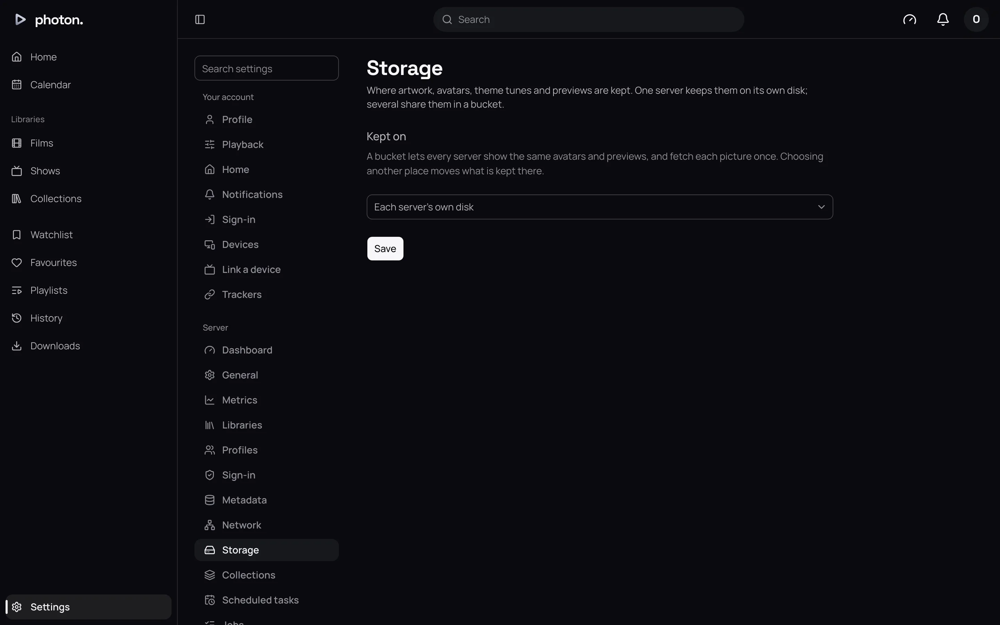
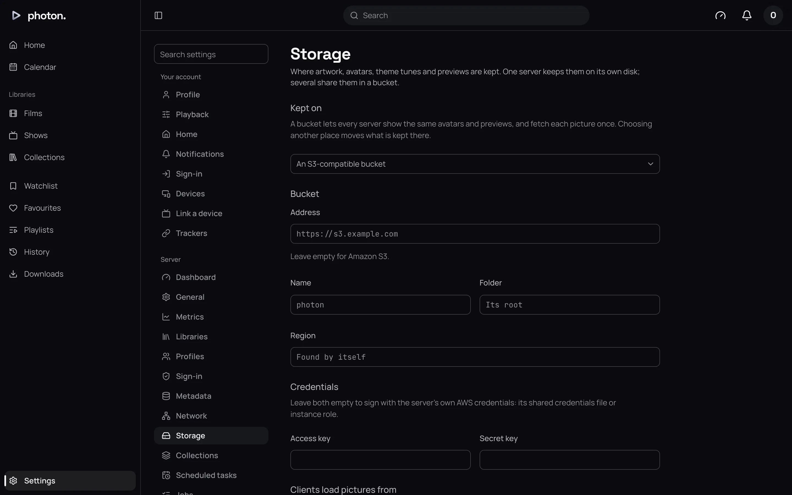

Besides its database, photon-server keeps files of its own: the artwork it fetches and you upload, profile avatars, theme tunes, and the chapter pictures and scrubbing previews it makes. Settings › Server › Storage chooses where they go.

- **Each server's own disk** is the default, and right for almost everyone.
- **An S3-compatible bucket** is online storage, such as Amazon S3 or a self-hosted MinIO. It is useful when you [run several servers](../05-playback/04-several-servers.md), so they share one set of pictures.

## The cache folder

Every server has a cache folder. Settings › Server › Dashboard shows where, as **Cache**, with the space free.

| Install | Cache folder |
|---|---|
| Docker | The `cache` volume |
| Linux | `~/.cache/photon-server` |
| Mac | `~/Library/Caches/photon-server` |
| Windows | `%LOCALAPPDATA%\photon-server` |

Besides artwork and previews, it holds the video the server is converting right now, downloads converted for devices, and subtitles. Starting a new transcode needs 2 GB free in it.

> **Important:** Pictures you uploaded and profile avatars are only in the cache folder (or the bucket), not in the database's [backups](01-backups.md). Back up the cache folder's `artwork` folder with the rest of the machine.

## Use a storage bucket

1. Create a bucket at your storage provider, and an access key that can add, read, list and delete files in it.
2. Open Settings › Server › Storage and set **Kept on** to **An S3-compatible bucket**.
3. Fill in the bucket's details (see the table below).
4. Choose **Check**. The server tries adding, reading, listing and removing a small test file, and says what failed if anything does.
5. Choose **Save**. The server checks again first, and won't save a bucket that fails.

| Setting | What it does |
|---|---|
| Address | The storage provider's address, such as `https://s3.example.com` or `http://minio:9000`. Leave empty for Amazon S3. |
| Name | The bucket's name. Required. |
| Folder | A folder inside the bucket to use. Empty for the top. |
| Region | The bucket's region. Empty to ask the provider. |
| Access key, Secret key | The key the server signs in with: both or neither. The secret key is never shown again once saved; leave it empty to keep it. |
| Clients load pictures from | **This server**, the default: every picture goes through the server. **The bucket directly**: apps fetch pictures from the bucket, which saves the server's upload, if they can reach it. |
| Address clients reach it at | With **The bucket directly**, the address apps use to reach the bucket, if it differs from **Address**. |

With **The bucket directly**, the page tests a picture from your browser after saving. It says "This browser loads pictures from the bucket", or that it can't, and at which address. If it can't, set **Address clients reach it at**, or go back to **This server**.

## Moving between the disk and a bucket

When you change **Kept on**, the server moves what it has:

1. It starts saving new files in both places, and reading from the old one.
2. It copies what the old place holds. The page shows progress, such as "1,204 of 5,880", then Copied.
3. Once every copy is done, it uses only the new place.

You can't change anything else on the page while a move runs. **Cancel move** stops it, and everything stays where it is now.

Changing only the keys, or how apps load pictures, for the same bucket is not a move. It takes effect at once.

## Good to know

- With several servers, a move waits for every running server, as each copies its own disk.
- A server that can't reach its storage when it starts won't start, and its log says why. One that loses the bucket while running keeps trying.
- With no access key, the server uses its own AWS credentials, from its shared credentials file or the machine's role.
