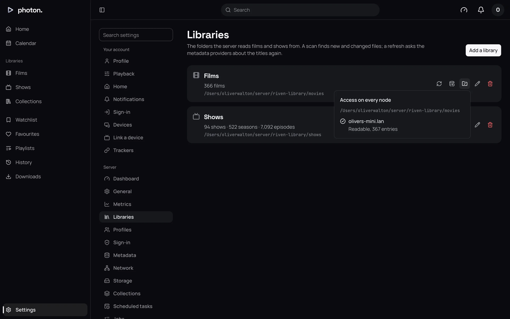

When something goes wrong, photon-server nearly always says why: in the app, on Settings › Server › Dashboard, or in its log. This page is organised by what you see. Under each, look for the message, then do what it says.

To read the log, run `docker compose logs -f server`, or see [where the log is](../07-maintain/03-health-and-metrics.md#the-log) for other installs.

## The server won't start

Look at the last lines of the log.

| The log says | What to do |
|---|---|
| `PHOTON_DATABASE_URL is not set` (or `PHOTON_VALKEY_URL`) | Set the address. See [Configuration](01-configuration.md#the-two-addresses). |
| `schema version mismatch … (run photon-server migrate)` | The database needs updating for this version. Run `photon-server migrate`, then start the server again. The standard Docker setup does this for you. |
| `postgres … is older than 18` | Move to PostgreSQL 18 or newer. |
| `valkey: …` | Valkey's address, user or password is wrong, or Valkey isn't running. |
| `ffmpeg` not found, `not a release build`, or `older than 8` | FFmpeg is missing, broken or too old. Install a release, version 8 or newer, beside the server or on the system path. |
| `waiting for a restore to finish before starting` | A restore is running. The server starts when it ends. |
| `usage: photon-server …` | The server was given a command it doesn't know. See [Configuration](01-configuration.md#commands). |

Once it is running, the log says `serving`, with its address and version.

## I can't open the web app, or an app can't reach the server

1. On the server's machine, open `http://localhost:8640` in a browser. If nothing answers, the server isn't running, or in Docker, its port isn't published.
2. Open `http://localhost:8640/health`. If it loads with no error, the server is fine, and the problem is between you and it: the network, a firewall, or the address the app was given.
3. If it reports an error, the server can't reach its database or Valkey. The log says `not ready`, and which one.

| You see | What to do |
|---|---|
| Apps on your network don't list the server | Type its address into the app instead. A server run from the standard Compose file can't be found automatically. The log line `clients must be given the server's address` means the same on other installs. |
| Jellyfin apps can't connect | Check Settings › Server › Network › **Jellyfin apps** is On, and in Docker that its port is published too. The log says `jellyfin's apps cannot reach this node` if the port is taken by something else. |
| Secure (HTTPS) connections stopped working | The log says `secure connections not applied` if the certificate under Settings › Server › Network can't be read. The server keeps using the last one that worked. |
| Everyone looks like they are on the home network, or nobody does | Behind a reverse proxy, add the proxy to Settings › Server › Network › **Trusted proxies**. |

For reaching the server from outside your home, see [Reach your server from outside](../04-access/04-remote-access.md).

## A film won't play

The app shows the server's reason.

| The app says | What to do |
|---|---|
| Nothing it plays can be made of this file, with reasons such as "Video codec" or "HDR" | Even converting can't help this app. Try another app or device, or another version of the film. |
| Every node is already transcoding as many videos at once as it may | Every transcode slot is in use. Wait for someone to finish, or raise **Transcodes at once**; see [Transcoding](../05-playback/01-transcoding.md#how-many-at-once). |
| … or is short of space to | The cache folder has less than 2 GB free. The log says `transcode refused for want of space`, with the folder. Free some space there. |
| Every node is delivering as many streams at once as it may | The server is at its **Streams at once** or **Egress** limit. See [Run several servers](../05-playback/04-several-servers.md#what-each-node-does); these apply to a single server too. |
| The playback has stopped, or lapsed | The app went quiet for two minutes and the film was stopped. Start it again. |
| The provider is fetching the title; it plays once it has it | A Stremio title is still being fetched. Try again shortly. See [Stremio addons](../06-integrations/03-stremio.md). |
| Nothing the provider offers of the title could be read | Every source the Stremio addon offered failed. |

## A film plays, but is being converted

That is not a fault, but it costs the server work. Settings › Server › Dashboard shows the reasons under the film, after **Because of:**. [Transcoding](../05-playback/01-transcoding.md#see-why-a-film-is-being-converted) explains each reason and how to avoid it.

The most common is **Bitrate**: the person's quality setting is below the file. Away from home, Settings › Server › Network › **Remote streams** › **Limit (Mbps)** may also apply.

## Converting is slow, or my graphics card isn't used

Look at the dashboard's **Server** card, under **Encoder**. If it says **Software**, the server isn't using your graphics card.

| The log says | What to do |
|---|---|
| `encoding video` | Shows which encoder it chose, its device, and whether it makes HEVC. |
| `the encoder set encodes no test picture: encoding on the first that does` | The encoder you chose doesn't work. In Docker, check the graphics card is passed into the container; see [Hardware transcoding](../01-get-started/02-install-docker.md#hardware-transcoding). |
| `transcoding will fail: ffmpeg would not encode a test picture` | Even the processor can't convert. FFmpeg is broken; reinstall it. |
| `encoding H.264 alone` | The hardware can't make HEVC, so everything is converted to H.264. It still works. |
| `burning subtitles in on vaapi through the cpu instead` | The graphics card can't draw subtitles into the picture, so the processor does, more slowly. |
| `burning subtitles in will fail` | Picture or styled subtitles can't be drawn into a converted film. |
| `styled subtitles play only on clients that draw them: ffmpeg has no libass` | Your FFmpeg can't draw styled subtitles. Apps that draw them themselves still show them. |
| `remux failed` | One film's conversion failed. The line includes the error. |

## HDR looks washed out or too dark

The app has said the screen shows HDR when it doesn't, or the other way round. In the web app, check your display is set to HDR in your computer's settings. See [HDR and Dolby Vision](../05-playback/02-hdr.md).

## The server can't find my folder

On Settings › Server › Libraries, choose **Check access** beside the library. It says whether the server can read the folder, or why not: it is missing, it isn't a folder, permission is denied, or it didn't answer in time (as with a network drive that has stopped responding).

- In Docker, the path must be the path **inside** the container, such as `/media/Films`, not the path on your machine.
- The server must have permission to read the folder and everything in it.
- With several servers, every one must have the media at the same path.

## New films don't appear

| The log says | What to do |
|---|---|
| `out of inotify watches … raise fs.inotify.max_user_watches` | Linux has a limit on how many folders can be watched for changes, and it was reached. Raise `fs.inotify.max_user_watches` on the machine (a Docker container shares it). Until then, new films appear at the next scheduled scan. |
| `libraries are scanned on schedule only` | Watching for changes couldn't start. New films appear at the next scheduled scan, or choose **Run now** beside **Scan libraries** on Settings › Server › Scheduled tasks. |
| `folder not read`, `file left out` | A folder or file couldn't be read. The line gives the path and why: usually permissions, or a drive that has gone. |
| `NFO not read` | An NFO file (a small file of details beside a film) couldn't be read. The film is matched another way. |

See [Keep libraries up to date](../03-library/06-keep-up-to-date.md).

## Plugins, trackers, webhooks and notifications

| You see | Where to look |
|---|---|
| A plugin is refused when you add it | The message says what is wrong. See [Install and manage plugins](../06-integrations/01-plugins.md). |
| A tracker won't link | An admin hasn't set it up, or the tracker refused the server's details. See [Sync with trackers](../06-integrations/04-trackers.md). |
| A webhook never arrives | Settings › Server › Jobs › **Given up** lists failed deliveries, with the reply. See [Webhooks](../06-integrations/05-webhooks.md). |
| An import fails | Its row on Settings › Server › Import history says why. |
| A notification doesn't reach a device | Failed pushes are listed under Settings › Server › Jobs › **Given up**. See [Notifications and push](../06-integrations/06-notifications.md). |
| `the database is neither backed up nor restored` | The PostgreSQL tools aren't installed. See [Back up and restore](../07-maintain/01-backups.md). |

## Pages are slow

The log records any database request that takes over 200 milliseconds as `slow query`. [Health, logs and metrics](../07-maintain/03-health-and-metrics.md) shows how to watch the server over time.
